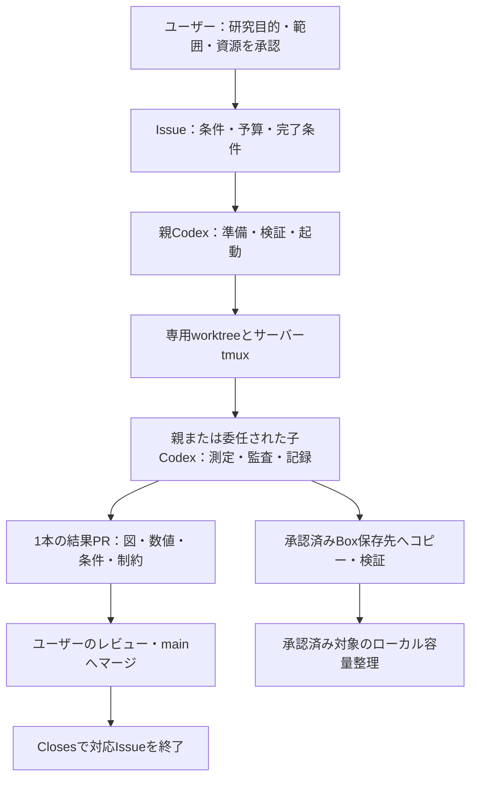

# 研究・実験運用の全体方針

研究の準備、実験、検証、記録、レビュー、成果物保管をこの文書で管理する。個別の研究目的・条件・予算・完了条件はIssue、実装と結果はPR、その時点の観測と判断は既存の [docs/research/](research/) に残す。

2026-10-16更新。[#21](https://github.com/ken2129/c3_neural_compression/issues/21)に由来する初期の手動引き渡し案を、#46・#49・#50・#26で運用したサーバーtmuxとCodexによる進行に合わせて整理した。過去の研究日記・測定値は当時の条件を示す記録として保持する。

## 現在の役割と実行フロー

- ユーザー：研究の方向、利用する環境・資源、実行範囲、Box保存先を決め、結果PRをレビューする。マージをCodexへ明示依頼することもできる。
- 親Codex：Issueと既存成果物を調べ、計画・実装・CPU検証を準備し、承認された実験の起動、状態確認、解析、記録、PR作成まで進める。
- 子Codex：ユーザーが委任したIssueをサーバーtmuxで担当し、Goalに沿って測定・検証・記録・結果PRまで継続する。小さい作業は親Codexが直接進めてもよい。委任の指示なしに子を増やさない。
- サーバー：許可されたworkspace・GPU・永続領域で実行する。各Issueのworktree・実験領域・ログ・出力を分け、他者のジョブやデータへ干渉しない。

ユーザーが利用環境へ接続し、Codexを起動するのは環境への入口である。既に利用を許可され、稼働中の環境では、毎回ユーザーがコンテナへ入り直して手動起動することを要求しない。新しい接続先・認証・恒久アクセス・権限変更が必要な場合は別途確認する。

## 承認の範囲と継続

1. 実行前に対象画像、方式・条件、候補数、GPU、時間・容量上限、最低空き容量、停止・復旧条件、成果物を具体化する。GPUを使うsmokeも範囲に含める。長い本測定の費用が不明な場合は、先に小規模試験を行って見積もる。
2. ユーザーの会話での明示指示・委任とIssueの確定計画を、実行承認の根拠として記録する。会話で条件が更新されたら、Issueと子への指示にも反映する。Issueの作成やPRのready化だけで、未承認の実験が許可されたとは扱わない。
3. **一度承認された範囲では、候補・画像・工程ごとに再承認を求めない。** 通常の準備、可逆的な修正、検証、測定後の解析、記録、単一の結果PRへの反映まで進める。実行開始の許可とマージの許可は区別する。
4. 新しい研究目的、追加画像・条件・再学習、予算超過、新Box保存先、権限変更など、既存承認で足りない変更は具体的な差分を示して確認する。過去IssueのGPU予算や「上限なし」を別Issueへ自動継承しない。
5. 実験・図表・記録・公開を可能な範囲で並行する。PRの作成・更新や通知の失敗だけで、独立して実行できる科学的な作業を止めない。追加の研究Issueは承認された場合に着手する。
6. 自動承認レビューが拒否した操作は迂回しない。拒否対象・理由・残る作業を記録し、実行可能な作業を継続する。本当に不足する承認だけを具体的に提示する。

## tmux・Goal・実行状態

- 長い測定と、委任された子Codexはサーバー上のtmuxで動かす。セッション名、PID、Issue、固定source、実験root、開始時刻、ログ、状態ファイルを私有の引継ぎへ保存する。
- 子のGoalは、承認済み範囲の測定・検証・図表・研究記録・結果PRまでを対象にする。計画や部分PRを作っただけで完了としない。性能改善が出ることを完了条件に追加しない。
- tmuxは端末切断後のプロセス保持に使う。サーバー・コンテナの停止には耐えない。CodexのGoalと、別プロセスの実験制御プログラムは状態が異なるため、Goal表示だけで実験の稼働を判断しない。
- 状態確認では、永続状態に加えて実PID・プロセス開始時刻・GPUデバイス・ログ更新・終了コードを照合する。古いrunning表示をそのまま報告しない。観測できなければ最終確認時刻と不明状態を示す。
- 科学的進捗、成果物公開、Box保管、通知、ユーザーレビュー待ちを分けて記録する。実験が完了しているのに「実行中」とせず、通知未達だけで科学的完了を取り消さない。
- 再接続時は既存runを確認し、重複起動しない。失敗や中断は元のrunに関連付けたattemptとして残す。予算と復旧条件の範囲内で再開し、良い結果を選ぶために再試行しない。

## 資源・依存環境・実装

- 起動直前にGPUの実使用状況を確認し、許可された空きデバイスだけを使う。台数・利用者・割当てを名前だけで判断しない。他者ジョブの停止・設定変更は行わない。
- 壁時計時間と累計GPU時間を区別し、画像ごとの最適化・推論、compile、load、同期、検出評価のどこを含むか記録する。smoke・失敗・検証・重複推論も計上し、CPU集計や環境構築の時間と混同しない。
- 新規成果物・一時archive・checkpointの保存量と最低空き容量を監視する。容量や時間上限、非有限値、入力・設定・寸法・hash不整合で停止する。旧成果物の無断削除を容量計画の前提にしない。
- 公式のsource・公開重み・依存物を使い、取得元、利用条件、version／commit、hashを確認する。方式ごとの依存環境を分離し、既存環境を不用意に更新しない。必要な実装だけをC3側へ置き、外部repo全体や重みを同梱しない。
- 実行source、config、seed/RNG規則、入力・重み・出力の対応と完了attemptを固定する。保存物を再利用する場合も、条件と出典の一致を確認する。未マージ実装・私有wrapperに依存する結果は、その固定sourceと差分を記録する。
- 実行・集計コードと手順をGitで管理し、mainとの整合性を確認する。過去の手順を最新の動作保証へ読み替えず、実際に使える入口と未実装の部分を明記する。

## 評価・研究結果の扱い

### 入力・rate・metric

- 現在のC3比較は `detector_input_v1` を基本とする。D2のuint8 mapperで短辺800・長辺上限1333へresizeしてから圧縮する。復元はこの入力寸法で評価し、共通Detectron2側の追加resizeを行わず、boxを元画像座標へ戻す。
- **現在の主rateは、各画像の全推定bits／圧縮入力のresize済み非padding画素数を算術平均する。** C3はlatentと画像ごとのsynthesis・entropy network bitsを含める。外部方式の共有事前学習重みを画像ごとに課金しない仮定を明記する。likelihood／entropy推定bitsとactual bitstream・header込みファイルサイズを混ぜない。
- #20等の旧測定には元画像画素数を分母とするpooled rateがある。歴史的な結果として残し、現在の入力・分母・集計方法と一致しない点を同じ曲線へ無条件に混ぜない。分母の再表示だけでは、新入力での再測定にならない。
- TransTICの公式codec前後resize、Adapt-ICMHのpadding→crop、C3のPNGと外部float32復元など、方式固有の差を記録する。精度を揃えた補助評価は主比較と分け、結果を見て有利な経路へ選び直さない。
- YOLO等の別評価器は、その固定versionの標準前後処理を圧縮入力の後へ共通適用する。YOLOのletterbox画素数へcodecのrate分母を変更しない。座標逆変換とCOCOクラス対応を検証する。
- 主metricは対象集合全体の公式COCO bbox AP@[.50:.95]。AP50／AP75／サイズ別APとGT支持数・欠測も残す。画像別APの平均や評価器独自のmAPで置き換えない。空検出は評価に含め、失敗・欠損画像は黙って除外しない。
- 元画像baselineはCOCO配布JPEGを同じ入力経路へ通したもの。JPEG化前のlossless原画像とは呼ばず、codecのbpp動作点を割り当てない。

### 条件の凍結と解釈

- 校正集合と評価集合を分け、対象・抽出規則・条件・解析規則を評価APを見る前に凍結する。rate校正は指定集合のrateで行い、APでλ・seed・checkpoint・数値設定・品質・画像を選ばない。
- 同rate比較では、目標rateへの相対差と方式間のrate差を分ける。許容差と分母を事前に記録し、rate不一致のAP差を厳密な同rate改善量にしない。非単調な点・逆転・未達も残す。
- 既存結果を見て企画した追加評価は探索的と位置づける。未使用・非重複の主張は照合できた履歴の範囲に限る。20画像など小標本の結果を全COCO性能・一般的汎化・統計的優越性へ広げない。
- 不確実性の方法は事前に決め、公式集合APを再計算する。delete-oneの感度範囲を信頼区間と呼ばない。APの補間・外挿で実測点を作らず、点数・曲線形状が不十分なままBD-rateを算出しない。
- 観測、仮説、対照で確認した因果、未確認事項を分ける。改善がないことを自動的に実装失敗と扱わず、単一原因や修正効果を証拠以上に断定しない。

## 文書の役割と命名

- GitHub Issue：目的・計画・実行承認・進捗・未完了事項・終了状態。docsへIssue本文のコピーを作らない。
- docs直下：内容ベースの名前を付けた再現手順・評価規約。Issue番号は本文から参照する。
- docs/research：`YYYY-MM-DD_内容.md` または既存の日付時刻形式で観測・結果・考察を記録する。完了監査は原則その結果記録の節へ統合し、別の進捗台帳にしない。
- 当時の未実行・未マージ・承認待ちは日付付きの過去記録として明示し、現在の運用手順に残る古い状態は更新する。数値・当時の観測は書き換えない。
- 改名時はREADME・相対リンク・生成／監査コードを同時に更新する。固定commitを指す過去の出典URLは当時のpathを保持する。

## 実験結果のレビューとIssueの終了

原則 **1 Issue・1結果PR**。途中の実験・監査・記録は同じブランチとPRへ追記し、進捗報告のためだけにPRを分割しない。独立した依存実装の分割が必要な場合は、例外の理由と各PRの役割を示し、Issueを終了する最終結果PRを1本に定める。

1. 承認された測定・検証を終え、図・数値・条件・費用・失敗・制約・未確認事項・次判断を記録する。
2. 研究記録は既存の `docs/research/` に時点ごとの統合記録を追加し、READMEの索引を更新する。別綴りの研究フォルダを新設せず、既存日記を上書きしない。日記を分割する場合は独立した記録としての理由を明記する。
3. main向けの通常の結果PRを作り、Issueの完了条件への対応、図・数値と再現手順、検証範囲を記載する。公開内容をローカルと読み戻し照合する。完了条件を満たす結果PRにだけ `Closes #<番号>` を付け、部分成果は `Refs` に留める。
4. 通常の実装PRは、ユーザー自身がマージするか、明示的な依頼に基づきCodexがマージする。例外として、ken2129/c3_neural_compression内の承認済み研究実験の完了結果PRは、#56の限定方針に従い、固定された独立validator、scope、必須checks、成果物、head/base SHAと既存保護条件を満たした場合に個別確認なしで自動マージする。否定的・混合結果も正しい完了なら対象になる。本ハーネス・認証・権限・CI・policy・依存環境や混在変更は対象外。実験承認とmerge policyを分離し、単なるpush・PR作成許可からmerge権限を推定しない。現MVP0はfixtureのみで、本番の自動mergeは未接続・無効。
5. 完了PRをmain（既定ブランチ）へマージすると対応Issueを自動closeする。PRを未マージでcloseしただけではIssueを終了扱いにしない。
6. 追加rate、画像拡大、新loss・実装など当初範囲を超える研究は別Issue・別結果PRへ切り出す。完了済みIssueを際限なく拡張しない。

既に結果PRがマージ済みで終了用キーワードを付け忘れた場合は、ユーザーの承認と完了条件を確認し、最終結果PR・未実施範囲をIssueへ記録してcloseする。既存の複数PRの履歴は書き換えず、先行記録と最終結果PRを明示する。

## データ・成果物の保管と容量整理

### 正本と承認

- コード・手順・公開可能な図・CSV／JSON・検証要約はGit。実行中の状態、実画像、重み、全予測、詳細metadata、checkpointは許可された私有永続領域へ保存する。
- 大容量成果物は指定Box基準フォルダ以下に、Issue／runごとの保管先を用意する。**新しい転送先は対象・容量・フォルダ構成を提案し、ユーザーの承認を得る。** 承認した転送先・対象の範囲内ではファイルごとの確認を繰り返さない。新たな共有リンクや権限変更は含めない。
- 保管先URL／ID、内部絶対パス、画像ID一覧・対応表、モデル識別hash、環境詳細、接続設定は私有の引継ぎへ記録する。秘密値・実画像・重み・全予測を公開Git／Issue／ログへ載せない。公開には研究数値・必要なコードcommit・検証要約を残す。
- Box保管完了、ローカル整理完了、科学的な測定完了、PR公開完了を区別する。ファイルがあるだけでは転送・実験の成功としない。

### コピーと検証

- 認証は本人が用意した既存接続を使う。接続先の読み取りから確認し、token、SSH鍵、webhookをチャット・Git・コマンド引数・ログへ出さない。秘密設定を複数マシンへ無断で複製しない。権限やアカウント設定を勝手に変更しない。
- 専用の転送一覧に対象・サイズ・hashを固定する。repo全体、秘密、環境、不要cacheを丸ごと転送しない。symlinkは参照先も確認する。再現性・失敗調査に必要な中断証拠は明示的な対象として保持できる。
- `copy`で保管し、Box側の削除を伴う`sync`／`delete`／`purge`を使わない。既存の異なる成果物は上書きせず、同名競合時はhashを確認する。rcloneを使う場合は設定パス・承認済みrootを明示し、`--immutable`等で上書きを防ぐ。
- 転送後に同じ対象のBox側metadataを読み戻し、全ファイルのサイズとchecksumを照合する。archiveはarchive本体のhash／サイズとmember相対path・SHA256一覧を保持する。途中成果物を完成品としない。
- 復旧は私有の転送台帳と検証済み保管先から、新しい専用領域へ取得して照合する。再取得しただけで実験を再起動しない。

### ローカル容量の確保

- ユーザーから転送後の整理を依頼された範囲では、**Boxコピーの検証後、再取得できる旧成果物をローカルから削除して空きを確保する。** 転送だけで容量確保が終わったとは報告しない。未承認のデータやBox上の保管コピーは削除しない。
- 対象ごとに転送検証が済めば、全転送の完了前でも、その対象の整理と別の実験を並行できる。転送中・検証未完了の対象は削除しない。
- 削除前に稼働中・予定実験の依存と最新のローカルhashを確認する。重い旧中間checkpointを優先し、必要な入力・最終params・復元・予測・設定・集計・コード・環境は保持する。どこまで残すかを用途別に決め、ディレクトリ丸ごとの無確認削除をしない。
- 削除した相対path・bytes・hash・Box参照・検証証拠・時刻を監査台帳へ残す。復旧先があることと、稼働中処理が読み込まないことの両方を確認する。
- 新しい実験の一時checkpointも、事前に保存頻度・最終成果物・再開性・成功後の整理規則を決める。最終保存や必要な復旧状態を確保する前に、唯一のコピーを削除しない。

## 進捗とSlack通知

- ユーザーが依頼した既存の通知先へ、開始・定期進捗・停止／失敗・完了を通知する。通知先、周期、対象、文面の範囲を私有設定に記録し、承認済みの通知を毎回確認し直さない。
- 通知は一般的な工程、完了件数、必要な公開PRリンクを中心とする。秘密値・実画像・詳細な私有metadataを送らない。公開PRのURLが確定する前に架空のURLを載せない。
- 配送結果を記録し、拒否・失敗を送信済みと扱わない。自動承認レビューの拒否は迂回しない。通知未達を科学結果や公開の状態と分けて報告し、継続できる作業は進める。

## 実行基盤の境界と今後の整備

許可されたworkspace・GPU・永続領域で作業し、host設定、Docker socket、広いmount、管理者権限、新しい恒久アクセスへ勝手に拡張しない。他者のジョブ停止、`killall`、広範囲の`prune`や任意パスの削除を研究操作に含めない。

実行入口は現存する各IssueのCLI／監督プログラムを正本とする。共通の単一ハーネスは引き続き整備目標で、全操作が実装済みとは扱わない。[MVP0制御fixtureの手順](research_harness.md)はCPU合成試験専用であり、実チャット承認、実issuer、共有マシン隔離、GPU実行、Box操作、実mergeの運用入口ではない。

| 操作 | 必要な責務 |
| --- | --- |
| plan／validate | 条件・資源・予算・停止条件と、入力・環境・容量・承認を確認する |
| run | 承認した範囲を起動し、run／attempt・source・実PID・ログを保存する |
| status／logs | 永続状態と実ジョブを照合し、最終確認時刻と停止理由を返す |
| collect | 必須成果物、条件・入力・予測・rateの対応を検証して集計する |
| cancel | 実際の識別子・権限を確認した自分の対象runだけを止める。データ削除は含めない |

任意shellを外部へ公開するAPIをこの設計の代わりにしない。共通ハーネスを作る場合は型・値・対象・path・操作を検証する。接続方式の拡張、新マシン・外部サービス、当初範囲を超える常駐監視や自動実験選択は、必要になった時に対象・権限・停止条件を決める。

## 運用実績の参照

- [#46の原因調査記録](research/2026-10-15_0317_JST.md)：部分結果だけで止めず、追加対照と限定的な結論を記録。
- [#49の校正・非重複評価](research/2026-10-16_1041_JST.md)：8条件凍結、tmux実行、rate不一致・混合結果、Box保管。
- [#50の4方式比較](research/2026-10-16_four_method_comparison.md)：公式TransTIC resizeの例外承認、方式固有の差と全点の保持。
- [#26のYOLO転移pilot](research/2026-10-16_detector_transfer.md)：保存PNGの再利用、別検出器の前処理・座標対応、改善が一貫しない結果。

これらは個別実験の記録であり、新しい実験の開始・予算・保存先を自動承認するものではない。
