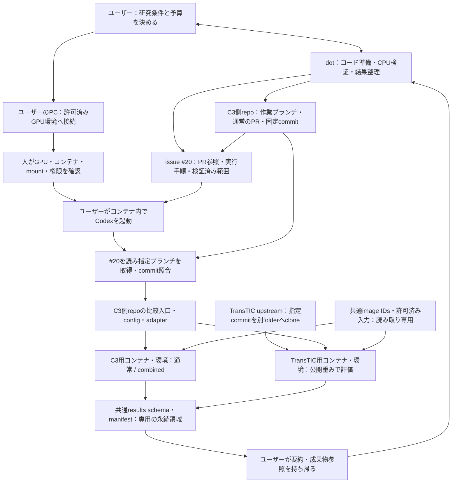

# 研究・実験運用の全体方針

この文書は、研究の準備、GPU実行、結果整理、データ・成果物の保管に共通する方針をまとめる。運用方針はこの文書で更新し、個別の実装・実験の作業はIssue／PR、その時点の経過や判断は[研究日記](research/)に残す。

[Issue #21](https://github.com/ken2129/c3_neural_compression/issues/21)の本文とコメントをもとに、2026-10-10に整理した。元の「draft PR」前提は通常のPRで共有する運用へ更新している。

## 決定済みの方針と、未確認・保留の事項

- **決定済みの運用方針**：dotで準備し、人がGPU・コンテナ・権限・予算を確認してコンテナ内Codexへ渡す。コード・設定・手順はGit、実行中の状態と実データは許可された永続領域、受け渡し・保管用のデータと成果物は指定Box領域で管理する。共有サーバー上の他人のデータ・ジョブへ影響を与えない。
- **到達目標**：共通CLIの操作・状態管理・再試行・成果物検証。下記の図、CLI契約、段階は設計目標であり、すべて実装済みという意味ではない。
- **実行環境ごとに確認する事項**：接続先、利用許可、GPU型番／VRAM、driver／CUDA、コンテナ内Codexの利用可否、mount、永続領域、認証・通信、時間／容量予算、切断・再接続時の動作。
- **保留**：チャットからの直接起動、常時監視、必要性が確認されていない自動化・大規模化。必要になってから権限と停止条件を別途決める。

本文書の追加・更新やPRのready化は、GPU実験開始、接続設定変更、新しい恒久アクセス、権限変更の承認を兼ねない。

## 目的・役割分担

実験の準備と結果整理はdotとのチャットで進め、**GPU実験はユーザーがPCから対象コンテナへ入り、その中で起動したCodexに#20を読ませ、GitHubの指定ブランチ・commitを取得して実行する**。共有サーバー上の他人のデータやジョブに影響を与えないことを優先する。

- dot：研究条件・実行手順の整理、コード／config／Dockerレシピの準備、利用可能な環境でのCPUテスト、作業ブランチへのpushと通常のPRによる共有、持ち帰った結果の比較
- ユーザー：接続先・利用許可・GPU・コンテナ・mount・予算を確認し、PCから接続してコンテナ内のCodexへ作業を依頼する
- コンテナ内のCodex：issueとrepoの手順を読み、承認された範囲で共通CLIハーネスを使って実行・状態確認・成果物整理を行う
- GPUサーバー：許可されたコンテナでC3／TransTICを実行し、ログ・checkpoint・成果物を専用の永続領域に保存する

個別実験の研究目的・比較条件は [#20](https://github.com/ken2129/c3_neural_compression/issues/20) などの対応する実験計画を参照し、本文書ではリポジトリ全体の運用方針を扱う。以下のC3／TransTIC比較と#20への言及は、この方針を適用する最初の実験を示す。旧パイプライン案 [#19](https://github.com/ken2129/c3_neural_compression/issues/19) は、既存実装の再利用を確認する参考とする。旧実験の再開や大規模化は含めない。

## To Be：人が実行境界を選び、ハーネスで実験を揃える

以下は目標構成。接続・権限制限・ハーネスが実装済みであることを示す図ではない。



- dotから研究室サーバーを直接操作する経路は、今回の実行フローに含めない。dotにPCの画面操作を渡すことも、このフローの必須条件にはしない
- ユーザーがPCから接続し、対象コンテナに入ってCodexを起動する。コンテナ内でCodexが利用可能か、必要な認証・通信が許されるかは初期確認項目とする
- C3／TransTICは別リポジトリ・別実行環境を基本とする。図の比較入口は処理と入出力の関係を示し、コンテナからホストDockerを操作する経路ではない。別コンテナへ切り替える場合もユーザーが対象を確認し、同じCLI／config契約で各方式を実行する
- 再現用コード・設定・手順はGit、実行状態と実データはサーバーの永続領域を正本とする。チャット履歴だけに依存しない
- 実行セッションの切断耐性は採用する起動方法で検証する。PCが切れても実験が継続するとは未検証のまま保証しない。再接続時は既存runの状態確認から始める
- 将来のチャットからの直接起動・常時監視は保留。必要になった時点で、権限・接続・運用を別途設計し承認する

## GitHubを中心にした引き渡し

1. dot側でC3 repoの作業ブランチへコード・config・adapter・手順をpushし、通常のPRを作る。実装済み範囲、CPUで通った検証、GPUで未確認の範囲を区別して書く
2. [#20](https://github.com/ken2129/c3_neural_compression/issues/20)を実験の入口にし、通常のPR、ブランチ名、実行対象commit、実行手順、既知の制約をまとめる。PRの作成後に実URLを記録する
3. ユーザーが許可済みGPU・mountを選んで対象コンテナへ入り、Codexに#20を読ませる。Codexは指定ブランチを取得し、移動し得るブランチ名だけでなく指定commitとの一致を確認する
4. 許可されたworkspace内で必要なコード・依存環境を準備し、plan／validate相当の確認を経て、承認済み条件だけを実行する。GitHubへの通信・認証は事前にユーザー側で用意できるか確認し、自動取得できると決めつけない
5. 共通形式の結果・manifest・ログを残し、ユーザーが共有範囲を確認してdotへ持ち帰る。#20への結果記録も依頼された範囲に限る

再現用コードの正本はGitHub上のブランチ・通常のPR・固定commitとする。データ・成果物・引き継ぎパッケージの受け渡しには、後述のBox保管規約を適用する。通常のPRは準備物のレビュー単位であり、GPU動作確認済みや実験開始の承認を意味しない。

### C3とTransTICの置き方

- C3側repo：通常C3／combinedのコード、比較の入口、config、共通manifest／results schema、TransTIC向けadapter、検証・実行手順を置く
- TransTIC：公式[NYCU-MAPL/TransTIC](https://github.com/NYCU-MAPL/TransTIC)を別folderへcloneし、指定commit `1132f62cbddc0122aa19f620453c3b0c4de49b2c` に固定する。upstream全体をC3 repoへ取り込まない
- JSON configの `transtic.repository` に、その実行環境でのTransTIC checkoutのパスを設定する。C3／TransTIC両方のcommit、checkpointのSHA-256、quality設定、依存環境をmanifestへ記録する。実際の起動方法はPR内の手順を正本とする
- C3／TransTICの依存関係を別環境で管理し、必要なら別コンテナをユーザーが用意する。同じimage IDsと読み取り専用の入力データ、#20の共通評価規約、共通results schemaで比較する
- コード・モデル重み・依存物の取得前に、公式の取得元、利用条件、version／commit／hashを確認する。データ・重み・大容量成果物・秘密情報はGitへ追加しない

## 実験結果のレビューとIssueの終了

実験の完了報告とIssueのcloseを分け、結果をレビューしてmainへ反映してからIssueを閉じる。

1. Issueで承認した範囲の実験と必要な検証を終え、結果・グラフ・条件・制約・未確認事項を記録する。改善がない結果も記録し、完了条件に性能改善を追加しない。
2. 最新mainの構成を確認し、研究日記は既存の `docs/research/` へ日時ごとに1本追加する。既存日記を上書きせず、READMEの索引を更新する。GitHubには結果要約と公開可能な小容量の図・CSV・検証情報を残し、大容量成果物・重み・秘密情報の扱いは本書のBox保管規約に従う。
3. 結果を作業ブランチへpushし、mainを対象とする通常の結果PRを作成する。本文に対象Issue、完了条件への対応、結果への参照、検証範囲、制約と次の判断を記載する。対象Issueの完了条件を満たすPRにだけ `Closes #<Issue番号>` を付ける。
4. CodexはPR作成・検証までを進め、ユーザーがレビュー・承認する。明示的なマージ指示がない限りCodexはマージしない。実験開始・結果のpush・PR作成の許可を、マージの許可と同一視しない。
5. 承認した結果PRをmain（既定ブランチ）へマージした時にIssueを自動closeする。PRをマージせず単にcloseした場合は、実験Issueをcloseしない。部分結果のPRは `Refs #<Issue番号>` などの参照に留め、未完了を残す。
6. 追加rate点、held-out評価、新実装など、当初の完了範囲を超える作業は別Issueへ切り出し、完了したIssueを際限なく拡張しない。追加実験の条件・予算・承認は別途揃える。

既に結果PRがマージ済みでclose用キーワードを付け忘れた場合は、ユーザーが結果を承認したことと完了条件への対応を確認し、Issueに結果・マージ済みPRへの参照と未実施範囲を残してcloseする。実験完了だけを根拠に、レビュー前のIssueを自動closeしない。

## データ・成果物の受け渡しと保管

### 保管先と正本

- データ・重み・実験成果物・引き継ぎファイルは、ユーザーが指定したBoxの基準フォルダ以下で受け渡し・保管する。具体的なURL、フォルダID、接続設定は承認済みの私的な引き継ぎで確認し、この公開文書へ記載しない。
- Issueやrun IDごとに新規子フォルダを作り、既存成果物を上書きしない。
- 実行中の作業ファイルと状態は、許可されたマシンの専用永続領域を正本とする。受け渡すファイルを選び、Boxへコピーして照合する。
- GitHubにはコード・設定・手順・結果要約と、公開してよい成果物識別子・検証情報を残す。実データ、重み、大容量成果物、秘密情報をGitへ入れない。
- Box転送・照合の完了と実験自体の完了を区別する。ダウンロードだけで実験を自動起動しない。

### 環境ごとの準備と認証

1. rcloneの有無とversionを確認する。未導入の場合は利用許可を確認し、公式配布元のバイナリを専用領域へ配置して公式SHA-256を照合する。sudoや既存の共有環境の変更を前提にしない。
2. remote名は `handoff_box`、backendは `box` とし、基準フォルダ以下を対象にする。rclone本体と設定ファイルのパスは環境ごとに明示する。
3. 認証・認証情報の入力・保存・設定は本人が行う。認証JSON、token、SSH鍵、webhookなどをチャット、Issue、Git、共有成果物、コマンド引数、ログへ出さない。設定はGit管理外の専用秘密領域に置く。
4. マシンごとに認証し直し、同じrefresh tokenや旧設定ファイルを複数マシンへコピーして使い回さない。
5. 接続確認は許可された基準フォルダへの読み取りから始める。接続不能時に権限やアカウント設定を勝手に変えない。

認証の具体的な操作は本人が公式手順で行う。[rclone導入](https://rclone.org/install/)、[Box設定](https://rclone.org/box/)、[ブラウザなし環境の認証](https://rclone.org/remote_setup/)、[refresh tokenの注意](https://rclone.org/box/#invalid-refresh-token)を参照する。

### コピーと照合

以下は、本人による設定と対象フォルダへのアクセス確認が済んだ後の例。パス・フォルダID・子フォルダ名は、許可された環境の値に置き換える。掲載したコマンドは実行済み・接続確認済みという意味ではない。

```bash
RC=/path/to/rclone
CFG=/path/to/private/rclone.conf
BOX_ROOT_FOLDER_ID='<approved-folder-id>'
SOURCE=/path/to/selected/handoff_files
BOX_SUBDIR=issueNN_runID

"$RC" copy "$SOURCE" "handoff_box:$BOX_SUBDIR" \
  --config "$CFG" --box-root-folder-id "$BOX_ROOT_FOLDER_ID" \
  --immutable --transfers 2 --stats 30s --stats-log-level NOTICE

"$RC" check "$SOURCE" "handoff_box:$BOX_SUBDIR" \
  --config "$CFG" --box-root-folder-id "$BOX_ROOT_FOLDER_ID" --one-way
```

- `SOURCE`は選択済みの専用フォルダとし、repo全体、認証情報、仮想環境、不要なキャッシュ、中断成果物を丸ごと転送しない。必要容量を事前に確認する。
- `copy`を使い、`sync`／`delete`／`purge`は使わない。`--immutable`で既存の異なるファイルを上書きしない。symlinkは参照先と転送対象を確認する。
- 取得先は新規の空の専用領域にし、取得時も`copy`と`--immutable`を使う。
- 各子フォルダのREADMEに、用途、取得対象、未完成／完成、検証方法、対応Issue／run IDを記載する。checksum一覧を用意し、取得後にも照合する。`SHA256SUMS`がある場合は、一覧の相対パスの基準ディレクトリで`sha256sum -c SHA256SUMS`を実行する。
- 転送・照合成功後に、許可された共有範囲で完了と保存先を報告する。途中のフォルダを完成品として扱わない。

個別の引き継ぎパッケージの内容・容量・完成状態は対応する実験記録で管理し、全体方針へ固定しない。

## 安全境界

最初は読み取りによる確認から始め、書込み・起動・停止の前に対象GPU、許可パス、コマンド、予算を明確にする。

- コンテナの名前やrunのownerラベルだけを権限境界にしない。共有サーバーの管理者と、実際にどこまで読める・書ける・停止できるかを確認する
- コンテナへDocker socket、ホスト全体のmount、SSH秘密鍵を渡さない。privilegedを使わず、許される範囲でnon-rootを使う。専用work／resultsのみ書込み可、共有データは必要な範囲のみ読み取り専用にする
- Docker daemonへの広い操作権はホストへの強い権限につながり得る。制限付きアカウント／実行経路など、サーバー側で強制できる境界を確認する。CLIラッパーやコンテナ化だけで完全に隔離できるとは扱わない
- ハーネスは型・値を検証する固定操作を公開し、モデルが作った任意shell文字列をそのまま実行する入口を持たせない。対象・方式・GPU・パスをallowlist化し、パスはrealpathとsymlinkを検査する
- 他人のジョブへの停止操作、広いmount、管理者操作、`prune`、`killall`、任意パスの削除を実験操作に含めない
- 秘密情報の入力・新しい恒久アクセス・権限変更は本人または管理者の確認のもとで行う。秘密鍵・認証情報・実ホスト名などの私的な接続情報をissueやログへ載せない

## ハーネスの最小契約

入口はrepo内の単一CLIとし、人とコンテナ内Codexが同じ操作を使う。以下の名前・出力形式は到達目標であり、すべて実装済みとは扱わない。実際に使えるコマンドと未実装部分は#20から参照する通常のPRの手順・検証結果に明記し、既存実装に合わせる。

| 操作 | 責務 |
| --- | --- |
| `plan` | 方式・画像集合・レート点・config・GPU・時間／容量上限を固定し、実行予定を出す。起動しない |
| `validate` | 実行環境、利用許可、GPU、driver／image互換性、空き容量、入力hash、mountと書込み範囲を確認する |
| `run` | 検証済み・承認済みの計画を起動し、request ID、run ID、実ジョブ識別子を永続保存する |
| `status` / `logs` | run IDで実ジョブと永続状態を照合し、状態・終了コード・失敗理由・ログ位置を返す |
| `collect` | manifestと成果物を検証し、#20の条件に沿った集計・参照先を返す |
| `cancel` | 実際の権限と対象runの識別子を照合し、そのrunだけを停止する。出力削除は含めない |

- version付きJSONでrequest ID、run ID、状態、識別子、成果物参照、エラーを返す。人向け要約も同じ情報から出す
- request IDと計画hashを記録し、同じ要求は既存runへ結び直す。同じIDで異なる条件は拒否する。起動応答が失われても、実ジョブを照合するまで二重起動しない
- manifestにcommit、image digest／依存version、config、seed、入力・重みhash、評価規約、実行資源、開始／終了時刻を残す
- `planned / starting / running / succeeded / failed / cancelled` を区別する。観測不能時は最終確認時刻と不明状態を返し、成功・失敗を推測しない
- 部分成果物は完成品と分け、検証後にmanifestをatomicに確定する。成功は終了コードと必須成果物の検証が揃った場合だけとする
- 再試行は固定した上限とcheckpoint再開条件に従い、元runに関連付けたattemptとして残す。完了済み処理を黙って再実行せず、良い結果だけを選ばない

## 段階と完了条件（到達目標）

以下は運用を整えるための確認項目であり、現在の完了件数・実装状況を表すものではない。実施日、対象commit、検証結果は対応するPR・実験記録に残す。

### 0. 現状と境界を確認する
- [ ] 接続経路、担当、利用許可GPU、driver、データ・重み、永続領域と空き容量を読み取り確認し、非機密の構成表とブロッカーを残す
- [ ] コンテナ内Codexの利用可否、実際の権限、read-only／read-write mount、許可コマンドをユーザー・管理者と確認する
- [ ] #20の条件表とCPUで進められる準備を整理する。GPU型番・VRAM・CUDA構成は確認後に決める

### 1. 再現可能な最小実行を作る
- [ ] C3側のコード・config・adapter・手順を作業ブランチへpushして通常のPRを作り、#20へPR・ブランチ・固定commit・検証済み範囲を記録する
- [ ] TransTICは別folderの指定commitで準備し、configのtranstic.repository、checkpoint hash、quality、別環境のversionを確認する
- [ ] commit、image digest／依存version、config、seed、入力manifest、checkpoint hashを固定する。C3とTransTICの入出力形式を揃える
- [ ] run IDごとに専用の永続領域へログ・checkpoint・結果manifestを保存する
- [ ] CPUテスト後、ユーザーが対象コンテナへ入り、許可された単一GPU・1画像でsmoke testを行う。終了コードと成果物を確認し、性能比較の完了とは扱わない

### 2. 人が確認して安全に起動する
- [ ] #20をコンテナ内Codexに読み込ませ、参照PRの指定ブランチ・commitと固定configを確認し、plan／validateの対象、条件、GPU、時間・容量上限を確認してから起動する
- [ ] 実ジョブ識別子を保存し、実行セッションの切断・再接続後に状態とログを取得できるか検証する。container／host停止への耐性は別途確認する

### 3. 操作をハーネスへ揃える
- [ ] 開始、進捗、ログ、回収、停止を共通CLIへ対応付け、手操作でもCodex経由でも同じ制約を適用する
- [ ] 許可済み対象・予算を超える操作は確認する。停止は管理対象runだけとし、他人のジョブ停止・既存出力削除を行わない

### 4. 中断・重複・失敗に対応する
- [ ] 再接続時に永続状態と実ジョブを照合し、重複起動と同一出力への二重書込みを防ぐ
- [ ] 切断、同じ要求の再送、異常終了、部分出力からの復旧をテストする。回復不能時は止めて報告する

### 5. 結果をチャットへ戻す
- [ ] #20の通常C3／combined／TransTICを、まず小規模で共通の画像・評価規約に従って比較する
- [ ] 推定bitsと元画像画素数からbppを集計し、actual bitstreamとは分離する。APは共通評価器で対象集合全体から再計算し、画像別APの平均や失敗画像を黙って除いた値を全体APにしない
- [ ] 完了・失敗数、条件差、指標、実行時間、成果物参照をまとめ、ユーザーがdotへ持ち帰れる要約と#20に記録できる結果を生成する。データ・重み・大容量成果物はGitへ入れない

### 6. 必要な範囲だけ自動化する（保留）
- [ ] 手動で実行境界を選ぶフローが安定し、自動化が必要になってから対象・権限・通知先・停止条件を別途決める。未承認の次実験を起動しない

## 最初の到達点

まず「GitHubへ準備物を共有 → ユーザーがコンテナへ入る → #20を読ませ指定ブランチ・commitを取得 → plan／validate → 単一GPU・1画像の起動 → 切断／再接続確認 → 結果を持ち帰る」を通す。その後、#20の小規模3方式比較へ進む。

本文書の更新は、接続設定変更、認証情報生成、恒久アクセスの追加、GPU実験開始の承認を兼ねない。
