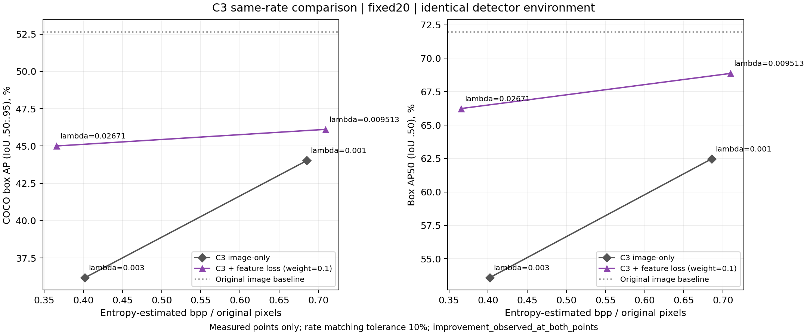

# 研究日記: 2026-10-14 11:02 JST

記録時点: 2026-10-14 11:02 JST
対象: 4方式校正、#35初期診断、#36同一bpp帯比較の結果と記録の整合

ここに記載するGPU実験は2026-10-10に実行した。
[前回の研究日記（2026-10-10 17:32 JST）](2026-10-10_1732_JST.md)で未確認だった実測結果と、その後の診断・比較の更新を残す。過去の日記は変更しない。
実行済みの比較は固定COCO val2017 20画像の校正であり、held-out本評価・論文再現の完了ではない。

## 目的

前回の日記で整理した比較方針に対し、実験から何を確認できたか、判断がどう変わったかを記録する。新しい機構の追加より、現combinedの近いbpp帯での有効性を先に確認する。

## 実施したこと

### 前回から変わったこと

| 項目 | 更新前／当初 | 今回の更新 |
|---|---|---|
| 比較基盤 | 固定条件・成果物制約と転移評価の計画を整理。最新runのAP／bppは日記上で独立検証していない | #20/#23の4方式・14条件の校正データとグラフを作成 |
| C3＋特徴損失 | 旧3点は通常C3より高bpp・低AP、rate範囲が非重複 | #36でλを個別校正し、近いbpp帯・同一評価環境で両点のAP改善を観測 |
| 環境差 | 旧・新Detectron2拡張のハッシュ差が残る | TransTIC det1/2の再評価ではAP・AP50差が0。ただし全方式への無影響は未証明 |
| 動作診断 | 特徴損失・勾配の健全性が未確認 | 1画像で同一入力loss=0、bridge勾配、teacher凍結、係数0の更新一致を確認 |
| 実験の優先順位 | #35の原因診断・別実装を検討 | ユーザー指示で#36を先行。#35の追加実装・広範診断は保留 |

### #20／#23：4方式の校正と引継ぎ

対象は通常C3 3条件、C3＋特徴損失3条件、TransTIC det1–4、Adapt-ICMH level1–4の14条件。
TransTIC det1/2の旧評価JSONはBoxから取得済み。新環境で両点を再評価し、TransTICの4点を揃えた。
Adapt-ICMHは公開TIC-SFMA重みを使用し、公式前処理とのadapter parityを確認した。

C3の旧5条件（通常3条件、combined λ=.0003/.001）はJSONのみの引継ぎ。
旧復元画像・最適化成果物は当該最小引継ぎパッケージにはなく、完全artifact検証・同一環境での再評価はできていない。
combined λ=.003の20画像は新環境で最適化・評価した。
旧結果を含む4方式グラフは旧環境の点を白抜きで表示し、strict collectorの未通過を解消済みとは扱わなかった。

精査用パッケージ約2.8GBとグラフ類は、ユーザーが転送先を承認した後、承認済みのBox精査用フォルダへ転送し、14ファイルのハッシュ一致を確認した。
**このBoxパッケージは#35/#36実行前のもの。今回の#35/#36成果物はまだBoxへ転送していない。**

元の結果参照：

- [4方式・14条件のグラフ](../../var/issue23_calibration20_20261010/all_methods_calibration.png)
- [4方式の出典付き数値](../../var/issue23_calibration20_20261010/all_methods_calibration.json)
- [旧／新評価器メタデータ差](../../var/issue20_resume_20261010_retry1/detector_metadata_difference.json)

### 共通条件と指標

- C3実行commit：`01d1fb3fde6d75f42ba7c6affe9014293be37710`。実験コードへの追跡変更なし。実行wrapper/configは各runの`var/`に保存。
- seed：`20261004`。共有初期化RNGと画像IDをfoldした最適化RNGの既存規則を維持。
- 1画像ごとのbudget：500 noise＋最大50 STE。checkpoint・量子化候補を検出APで選び直さない。
- 主指標：COCO box AP@[.50:.95]、補助：AP50。図・表は百分率、評価JSONのAPは0–1。
- bpp：`sum(total entropy-estimated bits) / sum(original H×W)`。C3はlatent、量子化synthesis network、entropy networkを含む。実bitstreamのファイルサイズではない。
- C3入力は元解像度RGB、評価は丸め・clip済みuint8 PNGをshort800/max1333へresize。
- 共通評価器：Detectron2 R50-FPN 3x。重みSHA256：`3c25caca37baabbff3e22cc9eb0923db165a0c18b867871a3bf3570bac9b7ef0`。TransTIC論文の評価重みとの同一性は未確認。
- 特徴損失teacher A：torchvision Faster R-CNN R50-FPN COCO_V1。重みSHA256：`258fb6c638b15964ddcdd1ae0748c5eef1be9e732750120cc857feed3faac384`。共通評価器とは別モデル。
- 現combined：画像MSE係数1、feature L1係数0.1、FPN層0–3を各0.25。λはrate項へ掛かるので、増やす方向がrate抑制。

固定20 IDs：

```text
474039, 125778, 58539, 492968, 296284, 544565, 124636, 373315, 166259, 142324,
275198, 256868, 344029, 368684, 407943, 137246, 207585, 302107, 520301, 192716
```

画像／注釈hashと実行時パスは[固定manifest](../../var/issue36_same_rate_20261010/frozen_manifest.json)、teacher hash確認は[preflight](assets/issue36_preflight.json)を正本とする。
APはこの集合全体のCOCOeval。画像別APの平均や成功画像だけの集計ではない。

### #35：初期診断で確認できたこと

[Issue #35](https://github.com/ken2129/c3_neural_compression/issues/35)の初期診断と固定1画像pilotを実行。その後、#36を優先する指示を受けた。

#### 元画像baselineとteacherの区別

| 評価器 | 元画像AP | combined λ=.003のAP | 元画像AP50 | combined AP50 |
|---|---:|---:|---:|---:|
| 共通Detectron2 | 52.64 | 44.88 | 71.96 | 67.83 |
| 特徴損失teacher A | 47.17 | 46.38 | 65.96 | 66.92 |

両評価器は同じ20画像を評価。teacher AのAPも改善していないため、「teacher AのAPは改善し、D2への転移だけで悪化した」という単純な説明を今回の結果は支持しない。
一方、AのAP50は上昇しており、APとAP50を混同しない。異なる評価器のAP絶対値を直接差し引いて効果量にはしない。
通常C3の旧復元がないため、Aでの「通常C3対combined」比較はこの診断では未実施。

#### 動作・勾配smoke

- 画像474039で同一画像を両側へ入れた特徴損失は0。
- JAX–PyTorch bridgeの勾配とcustom VJPの勾配が許容誤差内で一致。
- 滑らかな入力経路のdirectional finite differenceとautogradが対応。ε=.0003で相対誤差約0.50%。hard roundingの有限差分とSTE勾配は比較していない。
- teacherは凍結、参照特徴はdetach、teacher parameter checksumは不変、復元側の入力勾配は有限。
- 係数0の通常経路／machine経路比較（同一初期値・RNGの1 noise更新）：最大絶対差は勾配`1.75e-10`、更新パラメータ`2.98e-8`、optimizer state`4.55e-12`。許容誤差内で一致。全学習trajectoryの完全一致を証明したものではない。

固定微小摂動の入力空間では、重み0.1適用後のfeature勾配normがMSE勾配normの約1,617倍だった。
これはそのsmoke入力での値であり、全画像・全学習段階の比ではない。
combined λ=.001の500-step checkpointを固定RNGで追加probeしたところ、feature／base（image＋rate）勾配norm比はlatent約42.7、synthesis約1.53。cosineはそれぞれ−0.105、−0.694。entropy群へのfeature直接勾配は0。
勾配のscale・競合を示す手がかりであり、bpp増加の原因をこれだけで断定しない。

証拠：[入力勾配smoke](assets/issue35_gradient_smoke.json)、[係数0更新一致](assets/issue35_zero_weight_parity.json)、[checkpoint probe](assets/issue35_combined_checkpoint_gradient_probe.json)。
初回pilotのimage/combinedでは計測フックが適用されず、パラメータ群別勾配の時系列はscaledのみ。combinedの追加probeを元の時系列と同一視しない。

#### 固定1画像pilot（性能判定に使わない）

画像474039、λ=.001、同一seed・500＋最大50 STE。最後のPNGを同じteacherで再計算したfeature L1：

| 条件 | machine weight | bpp | feature L1 |
|---|---:|---:|---:|
| 通常C3 | 0 | 0.3931 | 0.4500 |
| 現combined | 0.1 | 1.2781 | 0.1482 |
| 係数のみ縮小 | 0.0001 | 0.4149 | 0.2741 |

現combinedは特徴損失を減らす代わりにrateを大きく増やしている。係数縮小は探索的診断であり、1画像の結果で採用・性能優越性を決めていない。
**#36では係数0.1を維持し、このscaled条件を混ぜていない。**
[全pilot値・bits内訳・RGB統計](assets/issue35_pilot_comparison.json)。

TransTIC det1/2の旧・新環境でAPとAP50はどちらも差0だった。[実測差](assets/issue35_detector_build_effect_transtic.json)
これは当該2条件での観測であり、C3の再実行差や他方式への無影響を保証しない。

### #36：同一bpp帯・同一評価環境での比較

[Issue #36](https://github.com/ken2129/c3_neural_compression/issues/36)を優先して実行。
ユーザーが通常C3／現combinedの20画像×各2点、少数画像λ校正、GPU合計6時間・保存10GB上限を承認。両GPUを使用しtmuxで実行、10分間隔進捗と完了をSlack通知。
2026-10-10 09:38 UTC開始、12:09:57 UTC完了。壁時計約2時間32分、GPU処理時間の累計約4.27時間。保存成果物は約3.8GB（十進表記）。

#### APを見ずにλを校正

固定1画像474039でcombinedのλ=.01/.03/.1を新規実行。既存λ=.003の同じ画像もrate探索の参照に使用。
得られたbppは順に0.6833／0.3665／0.1585、参照λ=.003は1.0862。
事前固定の「bppをlog λ上で線形補間」で目標0.4／0.7のλを0.02670605／0.00951283へ決定。
これはλ選択の補間であり、APの補間ではない。1画像のrateを20画像rateと同一視せず、最終候補を20画像で測定した。

[承認済み計画](assets/issue36_plan.json)、[λ探索全点](assets/issue36_lambda_bracket.json)、[選択λ](assets/issue36_selected_lambdas.json)。
通常C3はλ=.003/.001で新規に20画像ずつ最適化。両方式の差は現feature lossの有無とλに限定。

## 結果

### #36の実測結果

元画像baseline：AP 52.64、AP50 71.96。

| bpp帯 | 条件 | λ | 実測bpp | box AP | AP50 | 元画像からのAP低下 |
|---|---|---:|---:|---:|---:|---:|
| 約0.4 | 通常C3 | 0.003 | 0.4021 | 36.18 | 53.59 | 16.46 |
| 約0.4 | 現combined | 0.02670605 | 0.3655 | 45.01 | 66.24 | 7.64 |
| 約0.7 | 通常C3 | 0.001 | 0.6855 | 44.03 | 62.48 | 8.61 |
| 約0.7 | 現combined | 0.00951283 | 0.7092 | 46.12 | 68.86 | 6.52 |



[CSV](assets/issue36_comparison.csv)、[比較JSON](assets/issue36_comparison.json)、[PDF](assets/issue36_comparison.pdf)。

事前の一致判定は `abs(combined_bpp − image_bpp) / image_bpp <= 0.10`。

| bpp帯 | relative rate差 | combined − 通常C3のAP差 | 判定 |
|---|---:|---:|---|
| 約0.4 | 9.10%（combinedの方が低rate） | +8.82ポイント | 許容差内 |
| 約0.7 | 3.47%（combinedの方が高rate） | +2.09ポイント | 許容差内 |

4条件すべてと元画像baselineで、compiled extensionを含む評価器メタデータの完全一致を確認。20 IDs・manifestも一致。
今回の結論は**事前のrate許容差内の両点でAP改善を観測した**こと。
完全に同じbppの効果量ではない。特に約0.7帯ではcombinedのrateも3.47%高いので、その差を無視して純粋な同一rate改善量とは呼ばない。
APの補間・外挿、BD-rate、有意差検定は行っていない。20画像の校正なので汎化・論文数値の再現は未確認。

## 考察

### 旧値との差は未解明

旧通常C3のAPは約0.402 bppで38.49、約0.685 bppで44.42だった。
今回の再最適化ではrateは近いがAPは36.18／44.03で、旧値と完全には一致しない。
旧復元画像・checkpointがないため、差の原因を直接照合できていない。
「コンパイル差だけが原因」「seedとbudgetが同じなら完全再現できた」とは扱わない。
#36の結論は新規に揃えた4条件内での比較に限定し、旧値との差を取り込んだ結論にしない。

## 決定事項

- 現combinedの近いbpp帯での改善を今回の校正で確認した。特徴損失が一律に無効という仮説を修正し、別損失・構造変更を先に必要とする根拠とはしない。
- main既存の `docs/research/` に統一する。誤って追加した別綴りのフォルダを整理し、研究日記の6見出しとREADME索引に合わせる。
- 公開記録にBoxの具体的なURL・フォルダIDを掲載しない。転送先は承認済み私的引継ぎで確認する。

## 未完了・次の作業

- #20/#23：固定20画像の全14条件と参考グラフは作成済み。旧C3を含むstrict collector未通過・旧artifact不足は残る。
- #35：初期診断と1画像pilot完了。全診断項目・新実装比較の完了ではない。
- #36：承認済み4条件の最適化・評価・集計・グラフを完了。近いbpp帯の2点で改善を観測。
- 2026-10-12の確認時点で追加実験は動いておらず、両GPUは空いていた。
- held-out、100画像、COCO全体評価は未実施。次は候補・λ・予算を固定した非重複集合での確認を提案する段階。自動的に拡大しない。
- #36の改善を受け、現combinedが一律に無効という仮説は修正する。#35の別損失・構造変更を先に必要とする根拠にはしない。

実行成果物の正本：[Issue35ディレクトリ](../../var/issue35_diagnostics_20261010/)、[Issue36ディレクトリ](../../var/issue36_same_rate_20261010/)。
詳細config、manifest、各attempt、ログ、復元PNG、checkpointはこれらに保持。認証情報・webhookは研究記録へコピーしていない。
