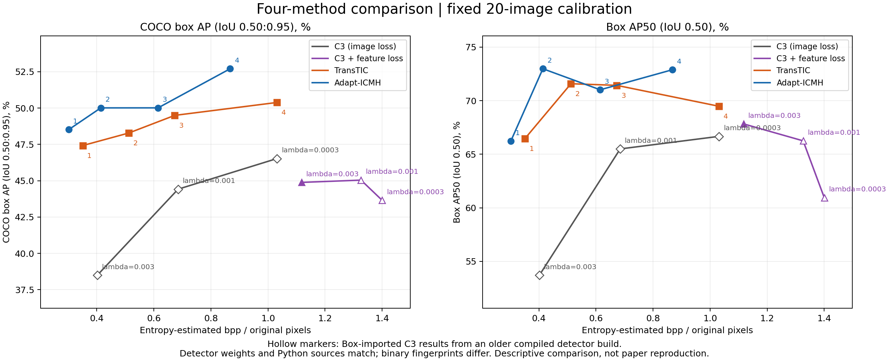

# 研究日記: 2026-10-14 11:53 JST

記録時点: 2026-10-14 11:53 JST
対象: #20/#23の4方式校正成果物のGitHub記録追加と、Issue終了状況の反映

## 目的

[前回の研究日記](2026-10-14_1102_JST.md)は、#35/#36の証拠をdocsへ保存した一方、#20/#23の4方式グラフと数値はローカル `var/` への参照に留まっていた。今回、GitHub上で閲覧できる小容量の結果を追加し、その後にcloseしたIssueの状況を記録する。

## 実施したこと

- 最新mainを基点に、既存の `docs/research/` へこの日記を追加した。過去の日記は変更していない。
- 既存の4方式・14条件グラフ、PDF、CSV、出典JSONを `assets/` へ追加した。追加実験や新たな統合グラフの作成は行っていない。
- 固定20画像manifest、旧・新評価器メタデータ差のJSONも追加した。JSON中の絶対パスは元runの出典として残し、GitHubに実データが同梱されていることを意味しない。
- GitHubのIssue状態を確認し、#20/#21/#23/#36の終了と、#35の未完了を記録した。

## 結果

### 4方式の既存校正結果

- [グラフPNG](assets/issue20_23_all_methods_calibration.png)
- [PDF](assets/issue20_23_all_methods_calibration.pdf)
- [全14点CSV](assets/issue20_23_all_methods_calibration.csv)
- [出典・環境差を含むJSON](assets/issue20_23_all_methods_calibration.json)
- [固定20画像manifest](assets/fixed20_manifest.json)
- [旧・新Detectron2メタデータ差](assets/issue20_detector_metadata_difference.json)

左はCOCO box AP@[.50:.95]、右はAP50。値は百分率。横軸は推定bits総和／元画像画素数総和。C3はlatentと量子化networkのbits、外部codecはy/z likelihood bitsを含む。実bitstreamではない。

| 方式 | λ／公開モデル段階 | 推定bpp | box AP | AP50 | 評価環境 |
|---|---|---:|---:|---:|---|
| 通常C3 | 0.003 | 0.4017 | 38.49 | 53.71 | 旧環境（JSON引継ぎ） |
| 通常C3 | 0.001 | 0.6850 | 44.42 | 65.50 | 旧環境（JSON引継ぎ） |
| 通常C3 | 0.0003 | 1.0316 | 46.52 | 66.67 | 旧環境（JSON引継ぎ） |
| C3＋特徴損失 | 0.003 | 1.1176 | 44.88 | 67.83 | 新環境 |
| C3＋特徴損失 | 0.001 | 1.3263 | 45.04 | 66.25 | 旧環境（JSON引継ぎ） |
| C3＋特徴損失 | 0.0003 | 1.4003 | 43.65 | 60.95 | 旧環境（JSON引継ぎ） |
| TransTIC | 1 | 0.3509 | 47.42 | 66.46 | 新環境 |
| TransTIC | 2 | 0.5124 | 48.28 | 71.59 | 新環境 |
| TransTIC | 3 | 0.6731 | 49.49 | 71.43 | 新環境 |
| TransTIC | 4 | 1.0312 | 50.38 | 69.48 | 新環境 |
| Adapt-ICMH | 1 | 0.3015 | 48.51 | 66.22 | 新環境 |
| Adapt-ICMH | 2 | 0.4140 | 50.01 | 72.98 | 新環境 |
| Adapt-ICMH | 3 | 0.6149 | 50.01 | 71.02 | 新環境 |
| Adapt-ICMH | 4 | 0.8674 | 52.70 | 72.89 | 新環境 |

### Issueの終了状況

| Issue | 現在の状態 | 終了範囲／未完了事項 |
|---|---|---|
| [#20](https://github.com/ken2129/c3_neural_compression/issues/20) | closed / completed | 固定20画像・C3各3条件とTransTIC4条件の予備比較。旧artifact不足・strict collector未通過を明記して終了 |
| [#23](https://github.com/ken2129/c3_neural_compression/issues/23) | closed / completed | Adapt-ICMH4条件の校正、4方式参考グラフ。旧C3の制約を含めた予備比較として終了 |
| [#21](https://github.com/ken2129/c3_neural_compression/issues/21) | closed / completed | 恒常運用を[全体方針](../experiment_policy.md)へ移管。ハーネス全体の実装完了ではない |
| [#36](https://github.com/ken2129/c3_neural_compression/issues/36) | closed / completed | 新規の同一環境・近いbpp帯でC32方式を20画像×各2点比較。事前rate許容差±10%以内の両点でAP改善を観測 |
| [#35](https://github.com/ken2129/c3_neural_compression/issues/35) | open | 初期診断と1画像pilotまで。広範な原因診断・別実装比較は未完了 |

ユーザーが終了範囲・制約を確認してcloseを指示した。各Issue本文にも終了記録とmainの結果参照がある。結果記録はPR #37、main既存構成への統合はPR #38、結果PRとIssue終了の運用規約はPR #39で反映済み。

## 考察

### 4方式グラフと#36を区別する

この4方式グラフは#20/#23で測定した以前のC3点を使う。白抜きの5点は旧環境のC3評価JSONで、元の復元artifactが引き継がれていない。評価器の重みとPythonソースは一致するがcompiled extension hashは異なり、厳密な全方式collectorを通過した比較ではない。

一方、[同一bpp帯比較のグラフ](assets/issue36_comparison.png)と[CSV](assets/issue36_comparison.csv)は、#36で新規に揃えたC32方式・4条件の結果。#36の新しいC3点と外部2方式を一枚に統合したグラフはまだ作成していない。両図のC3点を同一のrunとして扱わない。

TransTICとAdapt-ICMHは各4公開段階、以前のC3は各3λ、#36のC3は各2点。段階番号・同じλを同じrateとは解釈しない。20画像校正であり、held-out、論文再現、統計的優越性、BD-rateを主張しない。

## 決定事項

- GitHubで閲覧する4方式の結果は、この日記の `assets/` へのリンクを使う。前回の日記の `var/` リンクは実行環境内の出典であり、GitHub上で開くためのリンクではない。
- #20/#23/#36の終了は承認済みの予備比較範囲、#21の終了は文書移管の完了を指す。未確認事項が解消済みという意味に広げない。
- 全体運用は `docs/experiment_policy.md`、日時ごとの経過は `docs/research/`、実行成果物は許可された永続領域と承認済みBox保管に分けて管理する。

## 未完了・次の作業

- #36の新C3結果を含めた外部2方式との統合グラフは未作成。
- 追加rate点、held-out、100画像・COCO全体評価は未実施。必要な場合は別Issueで条件と予算を固定する。
- #35全体、共通CLIハーネス全体、旧C3再実行差の原因調査は未完了。
- ログ、復元画像、重み、checkpointなど大容量の全成果物はGitHubへ追加していない。以前のBox精査パッケージは#35/#36実行前のもの。#35/#36全成果物のBox転送はまだ未実施。
