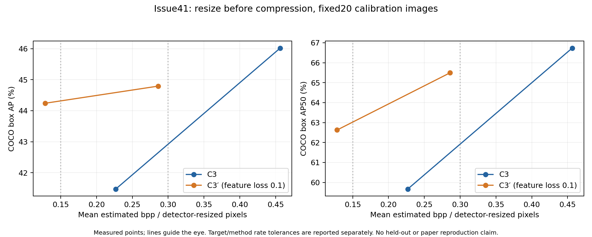

# 研究日記: 2026-10-14 21:33 JST

記録時点: 2026-10-14 21:33 JST
対象: [Issue #41](https://github.com/ken2129/c3_neural_compression/issues/41)の新入力protocol・低rate検証。①CPU準備から④固定20画像×4条件までの更新。

## 目的

[前回の研究日記](2026-10-14_1153_JST.md)以降に実施した、圧縮前resizeを導入した通常C3／C3′の検証を記録する。#36の元RGB入力での結果は保持し、今回は入力を変更しても特徴損失の効果が残るかを限定的に測った。

到達点は80符号化・検出評価・グラフ作成の完了。ただし方式間rate差が許容10%を超えており、同程度のrateでの改善判定は未達。Issueフローの④後の「rate不一致を報告する」分岐に入った。⑤の外部方式比較には進んでいない。

## 実施したこと

### ① CPU準備

[PR #42](https://github.com/ken2129/c3_neural_compression/pull/42)で `detector_input_v1` を追加。Detectron2のuint8 mapperで短辺800／長辺上限1333へresizeしてからC3へ渡し、復元したnative RGB PNGを二重resizeせず評価する。検出boxは元画像座標へ戻す。

主rateは画像ごとの全推定bits／resize済み非padding画素数の算術平均。C3のlatent、synthesis network、entropy networkの推定bitsを含み、実bitstreamではない。旧「総bits／総元画像画素数」は補助指標として保持し、旧グラフと同じ横軸として混ぜない。

- GPUを隠したCPUテスト151件成功。実際の20画像の元画像hash・公式mapperとのbitwise parityを確認。
- 外部8点と#36の4点の詳細JSONをCPUで再集計し、12点のmanifest／評価器metadataを照合。旧C3の分母変更は新入力での符号化結果ではない。
- [CPU検証](assets/issue41_cpu_protocol_validation.json)、[既存rate監査JSON](assets/issue41_existing_rate_audit.json)、[監査CSV](assets/issue41_existing_rate_audit.csv)。CPU検証JSONの `GPU_not_started` は準備完了時点の状態であり、その後のGPU完了を否定しない。

実行コードは固定commit `0c3a60c703bd41956b6558d527470350bcc7dd5d`。PR #42は未マージで、基盤の未マージPR #22に対応する `issue20/cpu-comparison-preparation` への追加。現mainのdocsだけを取得して実験が再現できるとは扱わない。

### ② 1画像smokeと実行先の判断

ID 474039、C3′、λ=0.01、500 noise＋最大50 STEで試験。初回は実行wrapperの保存hook引数名が実装と合わず、保存時に失敗した。hookを修正して同一条件で再試行し、入力800×1277、主bpp 0.493719、最適化＋network量子化約251.4秒を確認した。これは動作・費用確認であり、1画像APを性能の根拠にしない。失敗と再試行の2回を候補数・費用に含めた。

当初、追加範囲の起動は実行環境の自動承認レビューで拒否されて保留した。GPU 2台も使用中だったため、tmuxで空き監視とSlack通知を開始し、別マシン移行用の[Issue #43](https://github.com/ken2129/c3_neural_compression/issues/43)を作成した。使用者は現環境から特定できず、誰の処理か断定していない。

その後2台とも空き、ユーザーが最大10回の追加校正と80符号化、本実験の合計8 GPU時間／16 GiB上限を明示承認。このマシンのRTX 3090×2で続行した。別マシンへの転送・移行は行っていない。

### ③ λ校正と④固定20画像の測定

ID 474039で、rateだけを使って目標0.15／0.30を挟むλを測定し、log λ上でrateを線形補間して各方式2条件を固定。APはλ選択に使っていない。通常C3は3回、C3′は初回失敗・smoke再試行を含め5回、計8回で校正を終了した。今回追加した符号化は計6回で、最大10回の追加枠を使い切っていない。

- [通常C3の校正・選択λ](assets/issue41_selection_image.json)
- [C3′の校正・選択λ](assets/issue41_selection_combined.json)
- [固定した測定計画・費用上限](assets/issue41_measurement_plan.json)

通常C3をGPU 1、C3′をGPU 0で並行実行。固定20画像×2方式×2 rate点＝80符号化を完了し、全4条件を共通Detectron2で評価した。C3′は画像MSE係数1、feature L1係数0.1、FPN層0–3各0.25。500 noise＋最大50 STE、seed 20261004と既存の画像ID折り込み規則を維持した。20画像は校正・探索集合であり、独立評価とは呼ばない。

全4評価の完全なmanifestと評価器metadataの一致、各画像のbits・入力protocol・寸法・hash・完了attempt出典を検証し、画像平均rateを再計算した。[公開用の検証要約](assets/issue41_validation_summary.json)に対象20画像の件数と照合結果を保存した。全per-image行、config、環境metadataと入力パスを含む詳細集計元はローカルに保持し、公開版には含めていない。

## 結果

[PNG](assets/issue41_comparison.png)・[PDF](assets/issue41_comparison.pdf)・[4点CSV](assets/issue41_comparison.csv)・[結果とrate許容判定JSON](assets/issue41_comparison.json)

横軸はresize済み画素数を分母とする画像平均推定bpp。左はCOCO box AP@[.50:.95]、右はAP50、値は百分率。線は点の位置関係を示すだけで、AP補間・BD-rate推定には使っていない。

| 方式 | 目標bpp | 固定λ | 実測bpp | box AP | AP50 | 目標からの相対ずれ | 目標±10% |
|---|---:|---:|---:|---:|---:|---:|---|
| 通常C3 | 0.15 | 0.002137495035 | 0.226762 | 41.47 | 59.67 | +51.17% | 未達 |
| C3′ | 0.15 | 0.095949540991 | 0.128143 | 44.24 | 62.63 | −14.57% | 未達 |
| 通常C3 | 0.30 | 0.000443541045 | 0.456399 | 46.02 | 66.73 | +52.13% | 未達 |
| C3′ | 0.30 | 0.030996315959 | 0.285876 | 44.79 | 65.49 | −4.71% | 達成 |

| 校正目標 | 方式間rate差（通常C3を分母） | 許容10% | C3′−通常C3のAP差 | 解釈 |
|---|---:|---|---:|---|
| 0.15 | 43.49% | 未達 | +2.77ポイント | C3′は少ないbitsで高いAP。ただし同じrateでの改善量ではない |
| 0.30 | 37.36% | 未達 | −1.23ポイント | C3′は少ないbitsで低いAP。同じrateでの優劣は判定しない |

### 実行費用と完了状態

- 追加実行は2026-10-14 18:16:58〜20:52:50 JST（09:16:58〜11:52:50 UTC）、経過約2時間36分。
- 校正は過去の失敗・smokeを含む約0.531 GPU時間。80符号化・検出評価・集計は約4.125 GPU時間、合計約4.657 GPU時間。GPU別プロセスの経過時間を加算した観測値で、GPU kernelの実稼働時間ではない。
- 実測費用から本実験上限を7.75 GPU時間に固定。承認された8 GPU時間を超えず完了した。
- 本実験の保存容量11,440,429,717 bytes（約10.65 GiB）、上限16 GiB以内。
- サンプルしたGPU全体の使用メモリ最大はGPU 0が4,180 MiB、GPU 1が2,409 MiB。絶対最大やプロセス単独の最大ではない。
- tmuxで実行し、Slackへ開始・10分ごとの進捗・完了を通知。完了通知HTTP 200を確認。
- [実行状態](assets/issue41_status.json)、[時刻・費用・成果物SHA-256](assets/issue41_execution_receipt.json)。実行wrapper・監督・集計・描画コードのスナップショットはローカルに保持した。公開用の要約には内部絶対パスと詳細環境metadataを含めていない。実画像・重み・checkpoint・Slack秘密値はGitへ追加していない。

## 考察

1画像のrate校正は、その画像で目標帯を挟むことには成功したが、20画像の平均rateへ十分に対応しなかった。通常C3は両点で目標より約51〜52%高く、C3′は約15%／5%低かった。画像集合や方式によって変化が異なるため、1画像の倍率を20画像にそのまま適用する根拠にはできない。

低rate側の実測では、C3′が通常C3より約43%少ないbppでAPが約2.77ポイント高く、有望な観測である。一方、高rate側を含め厳密な同rate比較にはなっていない。APの線形補間で目標を満たしたことにせず、取得した4点と未達判定を残す。校正に用いた20画像から統計的優越性・汎化・論文再現を主張しない。

今回のグラフに旧#36や外部論文のAPを混ぜていない。旧#36は入力順序と主rateが異なり、今回の20画像APを論文のCOCO全5,000画像APと直接差し引くこともできない。元画像baselineは既存#35/#36でbox AP 52.6425と記録されているが、今回新たな20画像baseline推論を実行したとは扱わない。

## 決定事項

- ①〜④の測定・評価・記録は完了。④後の「rate差10%以内で改善が見えるか」はrate不一致で未達。
- Issue #41のフローでは「ここで止めて報告：rate不一致・不確実性」の分岐。⑤外部手法比較・⑥最終評価には進まない。
- 本測定後の追加λ調整、step／seed／loss変更は行っていない。失敗とrate不一致を保存し、無制限の再試行・sweepへ拡張しない。
- 旧#36の有効な比較結果を今回の未達によって撤回しない。#41全体の完了やcloseとは区別する。
- 結果はmainを基点としたdocsのみのPRで共有する。未マージの実行基盤をmainへ取り込まず、既存 `docs/research/` へ追加する。部分結果として `Refs #41` とし、ユーザーのレビュー・マージ前にIssueをcloseしない。

## 未完了・次の作業

- 同rateでの比較を続けるには、20画像平均を用いたλ再校正の範囲・候補数・費用を別途決める。今回は未実施・未承認で、残予算を自動的に追加測定へ振り替えない。
- 外部方式の対応する既存結果の再利用・論文曲線との比較は⑤の候補であり、今回の新protocolとの統合グラフは未作成。
- PR #42の実装レビュー・未マージ基盤の整理、Issue #41の次段階判断は残っている。
- Issue #43の別マシン移行は実施していない。今回現マシンで実行できたため、移行Issueの扱いは別途判断する。
- 今回の#41成果物はBoxへ未転送。GitHubには小容量の結果・証拠を載せ、大容量データの転送先・承認は従来の運用に従う。
