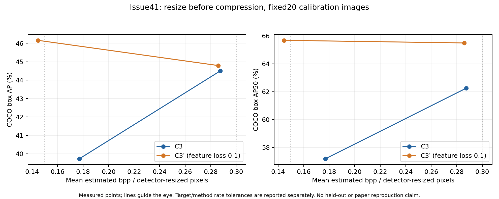
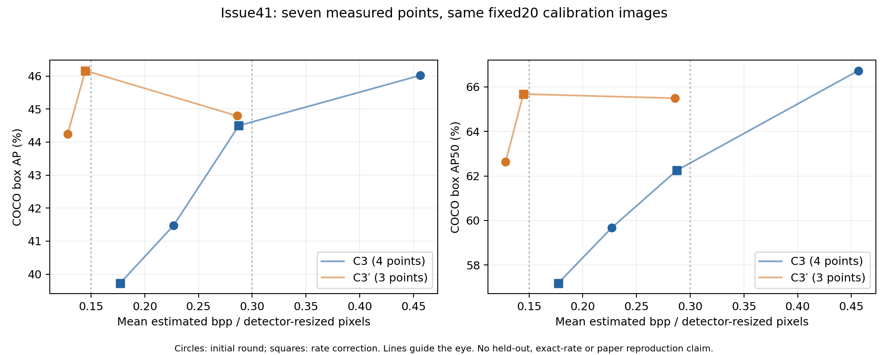

# 研究日記: 2026-10-14 23:35 JST

記録時点: 2026-10-14 23:35 JST（実行完了時刻）
対象: Issue #41の20画像平均によるrate補正、追加60符号化と既存1条件の再利用。

## 目的

[前回の研究日記](2026-10-14_2133_JST.md)・[結果PR #44](https://github.com/ken2129/c3_neural_compression/pull/44)からの差分を記録する。前回は1画像のλ校正を20画像へ適用したところ、方式間rate差43.49%／37.36%で許容10%を超えた。今回は既存20画像の平均rateだけからλを固定し、3条件を補正した。

## 実施したこと

- ユーザーが追加3条件×20画像＝60符号化、合計4.5 GPU時間／12 GiB上限を明示承認。tmuxでRTX 3090×2を使用し、Slack開始・10分ごとの進捗・完了通知を実行した。
- 通常C3の低／高rateとC3′の低rateを各1回だけ追加。前回C3′高rate（実測0.285876）は目標0.30の±10%内だったため、その20画像の完了済み評価を再利用した。
- λは既存20画像平均のrate対log λから決めた。通常C3の低rateは外挿で、到達保証はない。通常C3高rate・C3′低rateは実測点間の補間。APは選択に使わず、APを補間した比較結果も作らない。
- 固定commit `0c3a60c703bd41956b6558d527470350bcc7dd5d`、`detector_input_v1`、同じ20画像・評価器、500 noise＋最大50 STE、seed／RNG、現feature lossを維持。[追加計画とλ](assets/issue41_rate_correction_plan.json)。実行基盤PR #42／#22は未マージであり、今回もmainへ取り込まない。
- 補正後4条件と前回の全4条件（再利用の1条件を重複させず計7条件）の完全なmanifest／評価器metadata一致を確認。全140画像行から主rateをCPUで再計算した。画像ID一覧・モデル識別hash・内部絶対パス・詳細環境情報は公開要約に含めず、ローカルに保持した。

## 結果

### 補正後の4点

[PNG](assets/issue41_rate_correction_comparison.png)・[PDF](assets/issue41_rate_correction_comparison.pdf)・[CSV](assets/issue41_rate_correction_comparison.csv)・[判定JSON](assets/issue41_rate_correction_comparison.json)

| 方式 | 目標bpp | 固定λ | 実測bpp | box AP | AP50 | 目標±10% | 出典 |
|---|---:|---:|---:|---:|---:|---|---|
| 通常C3 | 0.15 | 0.00361582561326 | 0.177082 | 39.73 | 57.19 | 未達 | 今回追加 |
| 通常C3 | 0.30 | 0.00129445195354 | 0.287477 | 44.50 | 62.25 | 達成 | 今回追加 |
| C3′ | 0.15 | 0.0820432326995 | 0.144666 | 46.16 | 65.68 | 達成 | 今回追加 |
| C3′ | 0.30 | 0.030996315959 | 0.285876 | 44.79 | 65.49 | 達成 | 前回結果を再利用 |

| 目標bpp | 方式間rate差（通常C3を分母） | 許容10% | C3′−通常C3のAP差 |
|---|---:|---|---:|
| 0.15 | 18.31% | 未達 | +6.44 |
| 0.30 | 0.56% | 達成 | +0.30 |

目標または方式間rateの許容条件に未達が残り、全点同rate比較は未成立。 目標への近さと方式間の近さは別の判定。rateが揃わない点のAP差は記述的な差であり、厳密な同rate改善量としない。

### 前回と今回を合わせた7点の参考グラフ

[PNG](assets/issue41_seven_points.png)・[PDF](assets/issue41_seven_points.pdf)・[CSV](assets/issue41_seven_points.csv)・[JSON](assets/issue41_seven_points.json)

追加GPU実験をせず、既に測定した通常C3の4点とC3′の3点を同じprotocol内でまとめた。これは各方式4点を新たに承認・実行した結果ではない。前回の目標未達点も捨てずに残す。曲線の線は点の位置関係だけを示し、AP補間・BD-rate・統計的優越性の主張には使わない。

横軸はresize済み非padding画素数を分母とする画像ごとの全推定bitsの算術平均。C3のlatentと画像ごとのnetwork bitsを含む推定rateで、実bitstreamではない。COCO box AP@[.50:.95]とAP50を百分率で示す。

### 費用と検証

- 追加60符号化・評価・集計のGPU別プロセス経過時間合計は約2.931 GPU時間、上限4.5時間内。
- 実行の経過時間は約104.2分。保存容量は約7.99 GiB、上限12 GiB内。前回の再利用条件の時間・容量を新たな追加費用として二重計上しない。
- [完了状態・費用・検証要約](assets/issue41_rate_correction_receipt.json)。GPUメモリはサンプリングされた全体使用量で、絶対最大やプロセス単独の最大ではない。
- 4条件の集計と7条件の整合性をGPUなしで再検証。公開ファイルのリンク、秘密値・内部絶対パスの除外、JSON/CSVとグラフの出典を確認した。

## 考察

20画像平均でλを計算しても、有限stepの最適化と非線形なrate変化により目標へ完全一致する保証はない。未達の点をAPで選び直したり、補間したAPで実測点の代わりにしたりしない。得られた4点と全7点を残し、目標への近さ、方式間rate差、検出精度を分けて読む。

C3′の低rate側が高rate側より高いAPを示すなど、測定点は単調な精度曲線とは限らない。有限step・小規模な画像集合で得た観測としてそのまま保存し、単調になるように点を選別しない。

比較は調整に使用した同じ20画像の探索結果。独立評価、論文の全5,000画像AP、旧#36の元RGB／旧rateと同じ条件の測定ではない。旧#36の有効な結果は保持する。

## 決定事項

- 承認された追加60符号化と評価・グラフ作成は完了。各条件1回の上限を守り、無承認の再試行・追加sweepは行わなかった。
- Issue #41の④の補正結果として報告する。⑤⑥の外部比較・独立評価へは自動的に進めない。
- Goalは承認済み実験の監視・精査・研究記録・結果PRまで。Issue全体の完了やrate条件達成とは区別する。部分結果PRは `Refs #41` とし、ユーザーがマージを判断する。
- 既存mainの `docs/research/` へ差分を追加し、過去の日記・測定結果を変更しない。

## 未完了・次の作業

- 未達の補正や各方式4点への追加測定は、結果と費用を見て別途範囲を決める。今回は通常C3の4点／C3′の3点を既存測定から参考表示した範囲。
- 外部方式との共通条件比較、100／5,000画像、独立最終評価、PR #42の実装レビューは未実施・保留。
- 大容量成果物はローカル保持、Boxへは未転送。転送先を決める際は従来の承認運用に従う。
