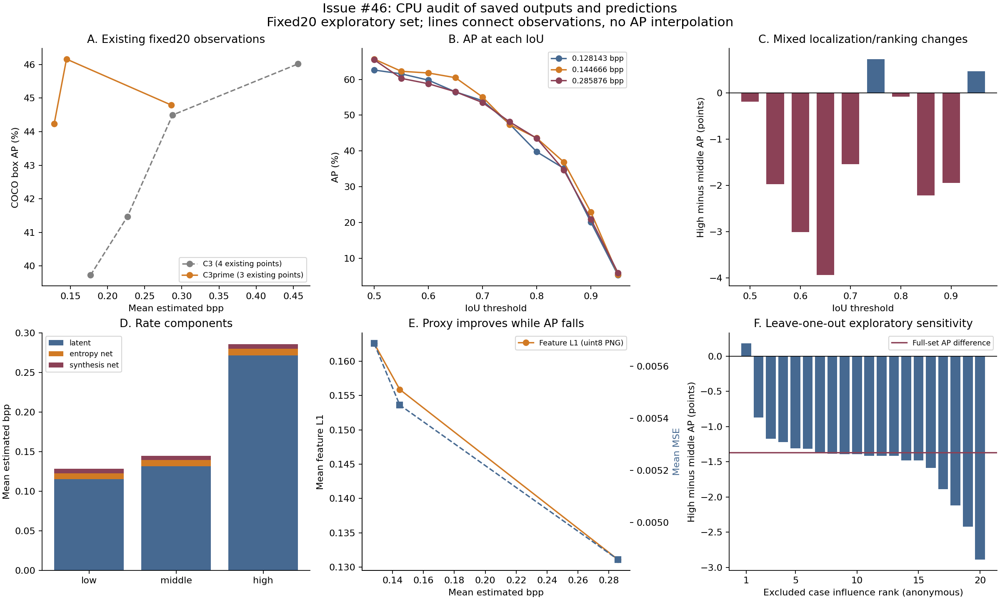
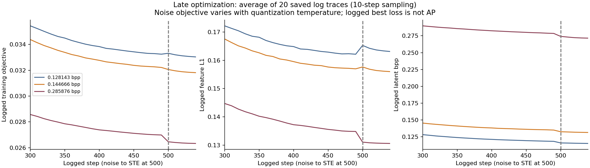

# 研究日記: 2026-10-15 00:05 JST

対象: [Issue #46](https://github.com/ken2129/c3_neural_compression/issues/46)、C3′の非単調な検出AP。既存成果物をCPUで監査した部分結果。追加GPU、符号化、再試行は実施していない。

## 結論と確認範囲

**AP低下を保存予測から再現したが、生成過程の原因は未特定。** 高rateではMSEとfeature L1が改善しているのに、集合の検出APは低下する。proxyの改善がAPの改善を保証しないことは今回の測定で確認できた。しかし、最適化、STE選択、network量子化、teacherと評価器の違いのどれがAP低下を生んだかは、保存記録だけでは識別できない。「ばらつき」で解決扱いにはしない。

[前回の7点](2026-10-14_2335_JST.md)をそのまま保持し、通常C3の既存4点を対照にした。全7条件・各20画像について、完了attempt、保存config・metrics・PNGの420ファイルhash、評価行とのbits・PNG hash対応を再検証。全manifestと検出評価器metadataは完全一致。元画像20枚のhashとresize後RGB hashを独立再計算した。全140の保存noise checkpoint payloadでphase=noise、next_step=500、計画λを照合し、全140 PNGからMSE/PSNRを再計算した（PSNR最大残差5.73e−6 dB）。RGB PNGの寸法、全画像のconfig、resume=false、seed規則、モデル・量子化設定が一致し、条件間で変わるλと目的関数を区別した。これは評価器・検出器に不具合がないことの証明ではない。

実行ソースはcleanな固定commit `0c3a60c703bd41956b6558d527470350bcc7dd5d`。ローカルwrapperはGPU使用、入力shape・範囲、非有限値、bits成分を検査して元実装へ委譲し、最適化・損失式・評価方式を変更していない。PR #42/#22は未マージのまま、mainには今回の研究記録だけを追加する。詳細config、画像対応、model識別hash、完全予測、checkpointは私有領域に保持する。

## CPU再集計と診断図

[集計JSON](assets/issue46_cpu_diagnosis.json)・[PDF](assets/issue46_cpu_diagnosis.pdf)。図の線は観測点を結ぶだけでAP補間に使わない。匿名caseはleave-one-outの影響順位で、画像IDや対応表を公開しない。

保存予測をpycocotoolsのbbox COCOeval、元の20画像、IoU .50:.05:.95、maxDets=[1,10,100]、標準area範囲で再集計した。追加のscore filterを適用せず、全7条件のAP/AP50/AP75/サイズ別APを元metricsと照合した。以下の値は%または百分率ポイント。

| C3′条件 | λ | 平均bpp | AP | AP50 | AP75 | AP small | AP medium | AP large |
|---|---:|---:|---:|---:|---:|---:|---:|---:|
| 低rate | 0.095949540990876 | 0.128143 | 44.2401 | 62.6273 | 47.5277 | 16.9231 | 47.4812 | 73.8898 |
| 中rate | 0.08204323269953812 | 0.144666 | 46.1615 | 65.6806 | 47.4173 | 18.5446 | 51.1299 | 74.7735 |
| 高rate | 0.030996315958971565 | 0.285876 | 44.7921 | 65.4927 | 48.1459 | 19.8267 | 45.8302 | 73.5022 |

中→高でAP −1.36936、AP50 −0.18782、AP75 **+0.72856**。IoU .65は−3.93616、.85は−2.21756、.95は+0.46849。高IoUだけが一律悪化する現象ではない。サイズ別ではmedium −5.29967、small +1.28219、large −1.27123で、位置・分類・score/rankingの変化が混在する。

### 予測数・matching・score

中→高で保存予測数576→626。COCOのarea=all、maxDet=100、ignoreを除いたmatchingは次の通り。全保存予測数とTP+FPが一致しないのはignore処理があるため。matchingはカテゴリ別・画像別で行い、集合APはカテゴリ別score順のprecision/recallを集約するので、TP/FP/FNや画像別APの平均でAPを置き換えない。

| IoU | 中 TP/FP/FN | 高 TP/FP/FN |
|---:|---|---|
| .50 | 133 / 407 / 53 | 134 / 450 / 52 |
| .75 | 93 / 446 / 93 | 90 / 494 / 96 |
| .95 | 9 / 529 / 177 | 8 / 575 / 178 |

IoU .50ではTPが1増えてもAP50は微減。TP数のみでは説明できず、score順位・precision/recallの違いが関わる。TP score中央値 .90338→.88480、FP .11755→.11072。ただし、中央値だけでrankingの因果寄与を定量化できない。JSONにIoU別の平均カテゴリprecision曲線とscore診断を保持した。保存scoreの最小値は両条件約.05で、評価器metadataの閾値は共通。

カテゴリAP差の大きい低下はbaseball glove −30.00（非crowd GT 1、1画像）、baseball bat −26.67（GT 1、1画像）、tv −23.23（GT 2、1画像）。改善はhandbag +25.00（GT 1）、couch +20.00（GT 1）など。カテゴリ支持数はJSONに記載する。COCO APがカテゴリを平均するため少数物体も寄与するが、カテゴリ別の一般的傾向とは主張しない。

画像別APは11/20画像で低下した。leave-one-outで**両条件から同じ1画像を除き、残り19画像を毎回COCO再集計**すると高−中AP差は−2.88988〜+0.17827となる。最大影響caseを除くと符号が反転するが、残り19画像の結果を本結果へ置換しない。カテゴリ支持集合も除外により変わり得る。これは探索的感度で、信頼区間、独立再試行、統計的優越性の根拠ではない。

## 最適化・量子化・proxy監査

ログは10step間隔のサンプル。noise温度とnoise乱数が変わるため、noise/STE境界のloss変化を同じ確定目的関数の改善量とみなさない。500noiseの最終checkpointと、各画像のSTE終了ログ49（0始まり、50反復）を確認した。早期停止や途中attemptの混入はこの証拠の範囲で見つからなかった。STEのログ上のbest objective平均相対改善は低0.9634%、中0.8489%、高0.5278%。これだけで収束や長stepの効果は証明できない。

| C3′条件 | latent bpp | entropy network bpp | synthesis network bpp | PNG平均MSE | 平均PSNR dB | feature L1 float | feature L1 uint8 |
|---|---:|---:|---:|---:|---:|---:|---:|
| 低 | 0.115107 | 0.007691 | 0.005346 | 0.00568706 | 22.69539 | 0.163876 | 0.162573 |
| 中 | 0.131498 | 0.007768 | 0.005400 | 0.00545080 | 22.86639 | 0.156619 | 0.155882 |
| 高 | 0.271440 | 0.008522 | 0.005913 | 0.00485693 | 23.33758 | 0.130949 | 0.131090 |

主rateは画像ごとの全推定bits／resize済み非padding画素数の算術平均。実bitstreamではない。中→高の増分の99.1024%はlatent。MSEは19/20画像、feature float/uint8は20/20画像で改善。平均PSNRの逆変換を平均MSEとしておらず、画像ごとのMSEを平均した。

feature teacherはtorchvision FasterRCNN ResNet50 FPN COCO_V1、検出評価器は共通Detectron2モデルで別物。FPN 0–3、各.25、feature係数.1、MSE係数1を全60 C3′画像で照合。teacherの前後checksum一致・parameter gradientなしを保存metricsで確認した。teacher処理はeval/frozen、入力RGB float、評価側はRGB→BGR255と共通padding、PNG評価は二重resizeせず元座標へ戻すコードで、条件による分岐差は見つからない。保存予測の実際の生成を独立再実行してはいないため、runtimeの色・precision・座標不具合を完全除外するものではない。

network量子化候補は7 weight step×7 bias step。選択式は **rounded画像MSE + λ×(latent+network bits)/画素数 + .1×decoder-float feature L1**。featureを無視する選択ではない。保存選択objectiveをこの式で再計算し、最大残差は全60画像で6.09e−9以下。ログの通常`loss`はMSE+λ×latent rateでfeature/networkを含まないため、これをcombined objectiveと混同しない。

選ばれたweight stepは低.006/.01、中.003/.006/.01、高.003/.006/.01で、候補別件数をJSONに保存。量子化前後の平均PSNRは低22.70537→22.69539、中22.88924→22.86639、高23.34400→23.33758。大きな平均PSNR破壊は観測しないが、検出APへの影響を除外できない。全候補のobjective、量子化前AP、最終STE/量子化パラメータは保存されていない。noise checkpointから最終復元への変化を完全追跡するには承認された追加検証が必要。

### ソースで見つかったSTE選択の不整合

固定ソース`experiments/image.py`の`single_train_step_machine`は更新前paramsでmetricsを計算し、更新後paramsを返す。`fit_datum`はその更新前`train_metrics['loss']`がbestを下回ると、返された更新後paramsを`best_params`へ保存する。また、STE開始時bestはrounded MSE、反復のlossはfloat MSEで比較する。したがって「評価したlossに対応する候補を保存する」という不変条件が満たされない。通常C3にも更新前後の対応ずれがあり、C3′固有の原因とは言えない。

**コード上の不整合は確認済み、今回のAP低下との因果関係・寄与は未確認。** 全stepのloss/params対、最終選択step、STE後のparamsが保存されておらず、CPU監査だけでは再選択できない。修正でAPが改善すると主張せず、今回のdocs PRに実装修正を混ぜない。最小修正候補は、比較するparamsを評価済み候補と一致させ、開始・反復で同じ確定objectiveを使うこと。実装PRはこの不変条件を検証するテストと影響測定を別途review可能な変更として扱う。

旧#35の係数0の1更新一致、勾配接続・teacher凍結、固定checkpointの勾配probeは関連証拠として確認した。ただし旧入力protocol、固定1画像・別probeであり、今回の60画像の勾配時系列や収束の証明へ転用しない。

## 仮説表

| 仮説 | 支持する証拠 | 反証・除外できる範囲 | 未確認・次に識別するもの |
|---|---|---|---|
| 転記・点順・COCO再集計ミス | 当初候補 | 7条件の保存予測再集計と元値一致、正しいbpp順。今回のAP低下を転記だけでは説明できない | detector runtimeそのものは再実行していない |
| 画像集合・設定・attempt・PNG取り違え | 当初候補 | 140行、420hash、元/resize入力、完了attempt、λ/seed/寸法/PNG対応一致 | 保存予測をそのPNGから再生成した証明は不足 |
| network bitsだけ増えた | 当初候補 | bpp増分99.1%がlatent | 推定rateと実bitstreamの差は評価外 |
| featureが無効・teacher更新・量子化選択がMSEだけ | 当初候補 | frozen記録、非零feature、49候補の選択コードと保存objective式一致 | 勾配の全画像・全step正当性、全候補比較は未保存 |
| 短い最適化・未収束 | 500+50固定、終盤loss変化、λ依存の挙動 | 全画像完走。単なる途中終了ではない | 長stepの対照がなく効果・必要step不明 |
| STE候補選択のloss/params対応ずれ | ソースで更新前lossと更新後paramsのずれ、開始と反復のMSE定義差 | 通常C3にも存在し、C3′だけの低下を自動説明しない | 同条件の原選択vs整合選択の対照。AP影響は未確認 |
| network量子化またはPNG丸めが検出を壊す | q stepの変化、float/uint8 feature差 | 平均PSNR落差小、uint8 featureも全画像改善 | 量子化前AP、候補別AP、最終float検出がない |
| proxyと検出器/APの不一致 | 全20画像のfeature改善と集合AP低下、teacher≠評価器 | proxy悪化だけの説明は不成立 | 原因の生成段階・teacher差とranking/box変化の寄与分離は未達 |
| 少数カテゴリ・画像構成、score/ranking・box変化 | medium低下、IoU混在、FP増、カテゴリ支持数小、LOO符号反転 | AP75改善。単一の全体位置悪化ではない | 構成感度は因果原因や再試行ばらつきでない。独立集合は未実施 |
| seed/retryのばらつき | 直接の支持証拠なし | seed規則共通、resume=false、各条件1 attempt | 独立同条件反復なし。λ違いを再試行と呼ばない |

## 次の最小検証案（未承認・未実行）

APを見てseed/λ/checkpointを選び直さない。以下は**各段階ごとに新たな承認が必要**で、自動連続実行しない。費用は実測保証ではなく保守的上限。承認時に対象・実装差分・停止条件を固定する。

| 優先 | 対象と固定条件 | 一度に識別する仮説・判定 | 費用上限・停止条件 |
|---|---|---|---|
| 1 | 中/高の保存PNG各20＝40画像。元評価器、weights、source、RGB/native寸法、precision、score/NMS、元座標変換、COCO設定を固定。再符号化なし | 保存予測と新予測を画像/カテゴリ/box/scoreで照合し、集合AP再現。差異があれば評価runtimeへ調査を限定、差異なしなら保存PNG→予測の経路を強く裏付ける | 1 GPU、0.10 GPU時間、1 GiB追加、1回。最初のロード失敗・非有限値・寸法/設定差で停止。6分または容量上限で停止しretryしない。差異が出てもcodecを再実行しない |
| 2 | 私有のLOO最大影響caseと影響中央値caseの2画像×中/高2λ。保存noise500 checkpointから同じ50STEを再開する原選択と整合選択の2arm＝8完了候補。init/RNG・LR・loss係数・teacher・49量子化候補・PNG評価を固定 | 変更はSTE候補の評価と保存の対応を同じ確定objectiveへ揃えることだけ。候補step、評価loss、保存params対応を記録し、原選択再現・case別予測差を比較。最適化step/seed/q候補を同時に変えない | 1 GPU、0.50 GPU時間、4 GiB、各arm1回。原armが保存結果と整合しない場合は修正armへ進まず停止。30分/容量上限・checkpoint署名不一致・非有限値で停止。2画像で集合20 APの原因確定や一般性能改善を主張しない |
| 3（2と別承認） | 同じ2画像×2λの原設定。原STE終了paramsを保持し、network量子化前/後とdecoder-float/uint8を段階別評価。最適化や選択式を変更しない | 量子化とPNG丸めの段階でbox/score/APが変わるか。候補全件APによる選び直しをしない。前段paramsが未保存のため、既存noise checkpointからのSTE replayが必要 | 0.50 GPU時間、4 GiB、4 replayまで各1回。原再現不一致・非有限値・30分/容量上限で停止。原因未確定なら結果を保存して承認待ち |

40PNGの再検出は既存ログの検出時間とモデルロードを含めた6分上限。STE replayは既存の画像別STEと49候補探索が数十秒規模だが、warmupと監査出力を含めて30分上限を置く。GPU価格は契約単価未確認なので金額を捏造せず、上限GPU時間×承認時単価とする。容量は追加分のみで既存成果物を削除しない。

長step化、loss/architecture変更、seed変更、100/5000画像、各方式4点への拡張、外部codecはこの計画へ自動追加しない。優先2/3は**新しい再試行・符号化相当の作業を含む提案**であり、現承認では実行禁止。比較結果に応じた次段は別途レビューする。

## 検証と公開境界

今回のCPU解析は保存予測の再集計・既存入力/PNG/checkpoint/log読み取りだけ。独立再検出、追加最適化、新規符号化はしていない。公開は数値、匿名の感度順位、コードcommit、監査要約だけ。内部絶対パス、画像ID/対応表、モデル識別hash、環境詳細、秘密値、実画像、重み、checkpoint、全予測を含めない。

過去結果は上書きせず、最新mainを基点としたdocs専用ブランチの結果PRで **Refs #46** とする。生成原因未確定と追加検証の未承認を残す。merge/Issue closeは行わない。
