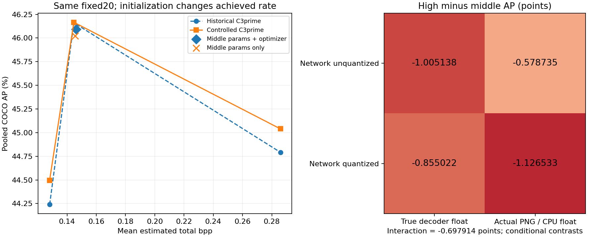
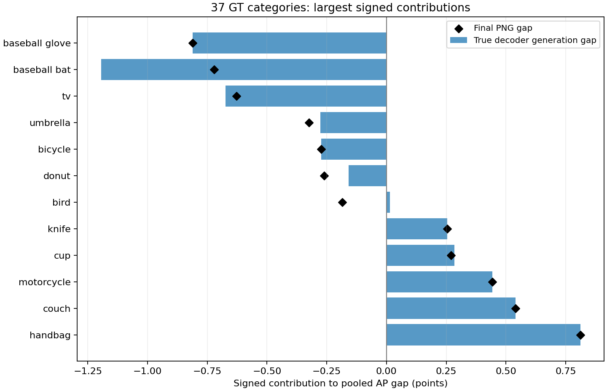
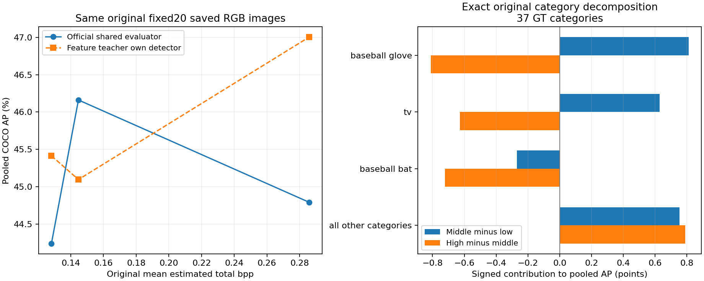

# 研究日記: 2026-10-15 03:17 JST

[Issue #46](https://github.com/ken2129/c3_neural_compression/issues/46) の原因調査。CPU監査の部分記録 [PR #47](https://github.com/ken2129/c3_neural_compression/pull/47) に続き、原画像の再検出・再現用実行条件・固定20画像の対照と介入を記録する。原結果は保持した。

固定20画像で確認した機構は、有限ステップ学習の生成状態依存、数値的な学習軌道分岐、network量子化とPNG表現の相互作用、それらが検出score順位とIoUを通してCOCO APへ現れる過程である。原noise500候補は、既知の別候補に対して実際の最終noise目的でも劣る画像が17/20あり、同じ高λで生成パラメータを介入すると集合APと目的値が変わった。原50-step状態を固定した全20画像の数値条件対照でもAP差が変わったが、非単調性は両条件で残った。したがって数値条件だけを原差の唯一の原因とはしない。原の全画素をfresh学習からbit単位で再現した主張、唯一のoptimizer実装欠陥、同rate改善や一般化は未証明である。公開revisionと完了監査は未了であり、Goal完了宣言ではない。

## 判明した機構と説明範囲

高rateで検出APが下がる現象は、保存画像と予測の取り違えではない。保存PNG40枚の再検出は box/category/score まで完全一致した。高rateの学習済み復元パラメータは、中rateの復元を単純に高精度化したものではなく、bat の偽陽性の順位と glove の位置精度を悪化させる別の画像を生成している。主要領域を双方向に置換すると、固定20画像の集合APが方向に従って変わり、面積を合わせた背景対照ではほぼ変わらない。

生成状態の因果寄与は、同じ高rate条件の λ・入力・RNG・50 STE・選択式を保持し、中rateの noise500 パラメータを一律に初期値にする固定20画像対照で調べた。params+optimizer状態を置換した場合のAPは 46.090977、パラメータだけを置換した場合は 46.023200、元の高rate対照は 45.039600。この効果はAPを見て画像やcheckpointを選んだ結果ではない。ただし、実測rateも変わるため、同rateでの性能改善や提案手法の修正成功とは呼ばない。

高rateの真の decoder float 段階に既に -1.005138 ポイントの集合AP差がある。network量子化とPNG表現の組合せはさらに -0.121395 ポイントを加える。処理間相互作用は -0.697914 ポイントで、両者の一意な加算寄与率は定義できない。生成状態・量子化/表現処理・カテゴリ内順位/IoUによる評価への増幅を分けて説明する。

## 原条件と再現上の修正

- 実行コードは `0c3a60c703bd41956b6558d527470350bcc7dd5d`。実装PR #42/#22は未マージであり、mainの文書だけで実行を再現できない。実行checkoutは変更していない。
- 同じ固定20画像、`detector_input_v1`（短辺800/長辺上限1333のuint8 RGB入力）、native PNG評価、元画像座標へのbox復元を保持。seedと画像ごとの折り込み規則、500 noise＋最大50 STE、MSE係数1、feature L1係数0.1、FPN0–3各0.25を保持した。
- rateは各画像の latent+synthesis+entropy 推定bitsをresize後の非padding画素数で割った算術平均。実bitstreamではない。原条件ではteacherと共通検出評価器は別モデルである。公式評価器は保持し、後述の診断だけでteacherまたは評価器bundleを変更した。
- Stage2の起動失敗は保存JSONから復元した設定のtupleがlistになることで生じた。元のcanonical configを型付きで再構成し、JSON化した全設定が保存設定と完全一致することをassertした。CPUで元の失敗・entropy constructor成功・checkpoint入力/目的signature一致を確認し、checkpointを書き換えていない。
- 同じ固定パラメータで、既定実行条件のteacher勾配とJAX VJPに反復差があった。`torch.backends.cudnn.deterministic=True` と `--xla_gpu_exclude_nondeterministic_ops=true` を分けて調べ、両方を使用した対照はGPU0/1間で固定20高rateのパラメータ・PNG・予測が完全一致した。これは過去の未保存kernel状態を再現したという主張ではない。[PyTorch Conv2d](https://docs.pytorch.org/docs/main/generated/torch.nn.Conv2d.html)、[XLA determinism](https://openxla.org/xla/determinism)。
- 最初の「float」診断は `Experiment.reconstruct` が既に `jnp.round(rec*255)/255` を返す点を見落としていた。旧private記録を保持して訂正し、本記録はforwardの真のdecoder floatを直接取得する対照を使う。真のfloat由来PNGと元のPNGの整数画素は全条件一致し、元reconstruct/予測の一致もguardした。同じ整数画素でもJAX内の正規化とCPU PNG正規化は1 ULP差で予測が変わる場合があり、混同していない。

## 3点と生成状態の対照

[JSON](assets/issue46_causal_controls.json)・[CSV](assets/issue46_causal_controls.csv)・[PDF](assets/issue46_causal_controls.pdf)

| 条件 | λ | 平均推定bpp | 集合AP | AP50 |
|---|---:|---:|---:|---:|
| low_control | 0.0959495409909 | 0.128079167 | 44.493775 | 62.762729 |
| middle_control | 0.0820432326995 | 0.144666453 | 46.166132 | 65.696621 |
| high_control | 0.030996315959 | 0.285875932 | 45.039600 | 65.596922 |
| middle_params_and_optimizer_high_lambda | 0.030996315959 | 0.146239772 | 46.090977 | 65.616986 |
| middle_params_only_high_lambda | 0.030996315959 | 0.145611140 | 46.023200 | 65.480140 |

過去の3点は AP 44.240126 → 46.161502 → 44.792141、最後の差は −1.369361。再現用実行条件の3点は 44.493775 → 46.166132 → 45.039600、最後の差は -1.126533。過去の差との残差は -0.242828。異なるλは独立再試行ではなく、この残差を統計的ばらつきとは呼ばない。過去の最終STE/量子化パラメータとkernel内部状態は未保存で、過去の全画素のbit単位再現は保証できない。原環境のbit単位再現gateは未達である。この保存checkpoint対照では元のライブラリ探索prefixが未復元だったため、過去との差を再現用flagだけに帰属しない。後述のfresh再計算ではprefixを復元し、実ロードを確認した。

既存の通常C3の4点はAP 39.725801、41.473343、44.496079、46.018510と単調だった。入力・評価経路の対照として保持するが、λと実測rateがC3′と異なるため、feature項の有無だけの因果比較には使わない。

params+optimizer状態介入では、元の高rate対照に対し、目的値が改善した画像は16/20、rateが下がった画像は20/20、MSE改善は1/20、feature改善は0/20。平均目的値は 0.026813210 → 0.025584977、APは +1.051378 ポイント、bppは 0.285875932 → 0.146239772。これは同じλで既知のより低い目的値に到達できる生成経路がある証拠であり、元の解を大域最適や固有の局所最小とは断定しない。パラメータのみ介入の対応数はJSONに保存した。

## 検出側で起きた変化と領域介入

[PDF](assets/issue46_category_contributions.pdf)。集合COCO APはGTのある37カテゴリの平均であり、画像別APの平均ではない。最終差への寄与は glove −0.810811、bat −0.720721、tv −0.627955 ポイント。他カテゴリの改善もあり、これらの和を全差としない。生成状態介入では、この3カテゴリが中rateのAP水準に回復した。

主要症例では、中rateのbat TPはscore 0.823656、順位1、IoU 0.730163。高rateはIoU 0.828113に改善していても、score 0.363250、上に偽陽性2件があり順位3に落ちる。gloveはTP順位1のままIoU 0.903300 → 0.770359となり、AP50は通過しても高IoU閾値のAPが落ちる。この違いがAP50とAP@[.50:.95]の変化量の違いを説明する。

原PNGの事前固定bat/glove領域を高→中へ入れ替えると、他19画像の予測を保持した集合APが +1.531831 / +0.555293 ポイント、両領域で +2.087783。逆方向は −0.898894 / −0.544477。面積を合わせ、全GTを避けた背景対照は −0.000062 ポイントだった。領域外画素は完全に保持した。bat置換ではMSEは改善してもfeature lossが悪化し、APは回復するため、global feature proxyとtask指標の局所的な不一致を実際の画像介入で示している。これらは符号化点ではなく、1症例の領域介入だけで全20画像の生成機構を確定していない。固定20の生成状態/表現処理対照と併せて読む。

## 真のdecoder float × network量子化 × PNG

| network | 真のdecoder float: 高−中AP | PNG: 高−中AP |
|---|---:|---:|
| 未量子化 | −1.005138 | −0.578735 |
| 量子化 | −0.855022 | −1.126533 |

真のfloatでnetwork量子化だけを入れる差は +0.150116、未量子化networkでPNGだけを入れる差は +0.426403、相互作用は −0.697914。実際の処理順では +0.150116 と −0.271511、逆順では +0.426403 と −0.547798になる。順序依存する条件付き対照であり、相互作用を隠して「networkが何割、丸めが何割」とは書かない。

## 反証と保留

| 仮説 | 予測した識別結果 | 観測と判定 |
|---|---|---|
| 保存PNG/評価対応の不具合 | 同じPNGの再検出が変わる | 40/40 box/category/score完全一致。この範囲で除外 |
| STE lossとparamsの対応バグ | 対応を直すとAP低下が回復 | sourceの不整合は実在。修正対照40セルでPNG/予測一致、6種類の集合AP全て一致。今回のAP原因ではなかった |
| latentの整数丸めが低下を作る | latent丸め除去で差が縮小 | noise500では差 −0.557867 → −3.772927、STE後では −0.578735 → −2.613595。むしろ丸めが差を緩和。非量子化診断に符号化bppを付けない |
| STE50だけが短すぎる | STE500で主要症例が回復 | 高rate症例AP54.081408は変わらず、中rateは悪化。単純なSTE延長での救済を主要症例では反証、全20を除外した主張ではない |
| 極低温度の疎なlatent勾配がAP原因 | hard forwardを保持し温度0.1にすると回復 | 勾配は29/1279147非zeroからほぼ全要素へ変わったが、高rate主要症例APは変わらず。勾配normだけではAP原因にしない |
| noise500の生成状態に依存 | 同じ高λで初期生成状態を変えるとAP/目的値が変わる | 固定20の一律介入で確認。rateも変わる。最適化経路依存を支持するが、同rate改善や唯一の最適化欠陥は未証明 |
| network/PNGが無関係 | retained状態を保持した表現介入で差が変わらない | 固定20のfactorialで条件付き効果と相互作用を確認 |

保存noise500をそのままhard latent/JAX画像丸めで検出した時点でも、中rate AP45.921572、高rate45.363705、差 −0.557867。最後の50 STEやnetwork量子化が初めて低下を作ったわけではない。

## 費用・証拠・限定

ユーザーが原因特定をGoalとし、GPU0/1・実験時間上限なしを承認した。初回記録時点の実GPU対象プロセス経過は約 1.735 時間（import/compileを含む合計、純GPU kernel時間ではない）。失敗attemptを含め全receiptを保存した。診断保存は初回集計時点で約 3.128 GiB、9 GiB保存方針と3 GiB空き監視を維持。旧420ファイルのhashを再照合し、source・原成果物の無変更を確認した。各対照の原/介入設定・checkpoint signature・入力・RNG・コードとwrapper・PID・metrics・必要パラメータ・画像・予測はprivate証拠として保持した。

原因を単一のコードバグや「小規模ばらつき」にまとめない。今回検証したのは、固定20画像における、λ別生成状態が作るtaskに不利な復元と、network/PNGの条件付き相互作用、それがscore順位とIoUを通して集合APへ現れる機構である。noise500がその生成状態に到達した唯一の理由、同rateで改善する修正、別teacher/評価器/独立データへ一般化した説明は未証明。研究用の初期値置換を製品修正には取り込まない。100/5000画像や新方式の開発を実施していない。merge/Issue closeはユーザー判断。

## 継続検証で追加した証拠

[PNG図](assets/issue46_teacher_and_threepoint.png)。左は評価器bundleだけを変えた診断、右は原COCO APの符号付きカテゴリ分解。生成teacher対照の途中結果は含めない。

原の保存予測で3点をカテゴリ×IoUごとに再集計した。gloveのカテゴリAPは60→90→60、tvは61.815182→85.049505→61.815182で、集合APの上昇側へそれぞれ+0.810811/+0.627955、下降側へ同量の負寄与となる。batは60→50→23.333333で、下降側に−0.720721。これはCOCOカテゴリ平均の厳密な符号付き寄与であり、ROIの因果効果との加算分解ではない。集合AP75は中47.417303→高48.145862と増えており、位置精度が全画像で一律悪化したとは言えない。

以前から固定したglove maskと面積一致背景を、そのまま原low/middle PNGへ適用した。lowへのmiddle glove画素置換で集合20 APは+0.541033、逆は−0.812066、背景は両方向とも0。原baseline予測は完全一致。他19画像の予測と領域外画素を保持した。以前のhighへのmiddle glove置換+0.555293と合わせ、同じ局所領域が3点の両側の変化へ寄与することを示す。画素置換はcodec点ではない。

保存PNGの評価器だけを、元の特徴teacher自身の検出器へ変更すると、APはlow45.414385、middle45.096551、high47.003984、uncompressed48.091186。high−middleは+1.907433で、公式共通評価器の−1.369361と符号が逆になり、条件付きの評価器bundle差は+3.276794ポイント。座標処理、score/NMS閾値、最大検出数を保持し、teacher凍結checksumと再検出の反復一致を検証した。このbundleには固有の前処理・backbone/headも含まれ、weightsの違いだけの寄与とは言わない。公式評価器は変更していない。評価器の切替だけで生成側のteacher因果を確定せず、生成中のteacher bundleを変更する固定20対照も完了した（後述）。

原noise500状態を全3条件から読み、同じ高λ・元の最終noise stepの温度とKumaraswamy値・固定16組の共通noiseで値評価した。middle候補−highのnoise目的平均差は−0.001662536、low候補は−0.001416590。両候補とも17/20画像で3 Monte Carlo標準誤差を超えて低く、middleのhard latent目的も15/20で低い。最適化は行わず、input/目的signature/RNG一致、teacher凍結、値反復一致を検証した。Monte Carlo誤差は固定状態のnoise積分の誤差であり、APや画像集合の統計的優越性ではない。この候補集合では、hard表現へ変えて初めて順位が逆転したという説明は支持されない。有限最適化経路の劣位を示すが、唯一のoptimizer欠陥や大域最適値を同定したわけではない。

元のlibrary探索条件・RNG・固定20順序を復元したfresh高rate再計算は、既定実行条件でAP46.187622、再現用実行条件で46.856131となった。原PNGとの完全一致は両者0/20。保存頻度を50から500へ変える保存上の差もあり、過去との差を特定のkernel/flagだけに帰属しない。原seedからのbit単位再現gateは未達である。入力/RNG/signatureを保持した再計算でも高rate点が大きく変わるため、過去の1点を普遍的なrate−AP関係と扱わない。保存された原結果と、その局所/状態/表現対照の証拠は保持する。

生成側teacher対照は既存FPN L1式・層重み・λ/RNG/500noise/50STEを保持し、既存共通評価器のbackboneと前処理をteacher bundleとして再利用する。raw featureの尺度はbundle固有の差なので、alignmentだけの効果や同rate改善とは解釈しない。adapterは実backbone値の完全一致・有限非zero input勾配・全モデルparameter勾配Noneを実データで確認した。このadapterで得た生成側結果は次節に示す。

## 生成側teacher bundle対照の完了

同じ物理GPU1、固定20画像、入力/元RNG/高λ/500noise/50STE/既存FPN L1式/層重みを保持したfresh生成対照を完了した。原teacherでAP46.856131・平均推定0.283910642 bpp、共通評価器backboneをteacherにしたbundleでAP51.529310・0.385118328 bppとなった。差はAP+4.673179ポイント、rate+0.101207686 bpp。MSEは0.004897378→0.005187756。teacherの前後checksum一致・全parameter勾配None、全20件の入力/RNG/非teacher目的signature一致、元入力寸法との一致、正常終了receiptを確認した。

生成側teacher bundleの変更が同じ公式評価器でAPを変えることを固定20で確認した。ただしbundleには前処理・backbone・raw feature尺度が含まれ、rateも変わるため、alignmentだけの効果や同rate改善とは言わない。異なるteacher間のraw目的値は比較しない。この対照は高λのfresh生成1点であり、原の3点全てをteacher交換して単調化を証明した実験ではない。原のbit単位fresh再現gateも未達のままである。最終の因果説明・限定事項と公開記録の監査が残る。

原条件再現差をさらに切り分けるため、元の順序の先頭2画像で、同じ物理GPU・同じ計算条件のfresh反復と、checkpoint保存頻度だけを500から元の50へ戻す対照を開始した。原checkpointは保持する。この2画像対照の結果を固定20のAP原因の確定には用いず、再現性と保存時同期の影響を識別する。両画像の対照を完了し、結果は次節に示す。

## 初期noise軌道の再現性対照

元の順序の先頭2画像で、同じGPU・入力/目的/RNG・元500-step scheduleを保持したfresh反復と保存頻度50/500を比較した。両画像ともSTE後/量子化後パラメータ、PNG、検出予測は完全一致した。この範囲では保存頻度差による効果は観測されなかった。原の50-step checkpointとの比較では、同じ保存頻度でも既に差がある。

さらに元500-step scheduleを変えず50-step保存直後に停止する診断を行った。同じGPU0の既定数値条件で独立2反復を行うと、両画像とも学習状態は一致せず、パラメータの相対L2差は1.217119/1.234191となった。再現用数値条件のGPU0の状態は、既存GPU1の同条件50-step状態と完全一致した。全armで原checkpointとの入力/目的signatureとRNGの一致を検証した。これは既定数値条件で初期noise軌道が分岐する直接証拠であり、単に過去との差をflagへ帰属した比較ではない。ただし50-step・2画像の診断にAP評価はなく、原20画像の非単調APの寄与量をこのパラメータnormから推定しない。

## 原50-step状態を固定した数値条件の集合AP対照

初期noise軌道の2画像診断だけでは集合APへの寄与を確定できないため、原middle/highの50-step checkpointを各20画像で固定した継続対照を開始した。パラメータ・optimizer状態・RNGを原checkpointからそのまま読み、元の500-step scheduleの残り450 noiseと最大50 STE、量子化/公式評価を実行する。中λはGPU0、高λはGPU1へ固定し、各λの既定数値条件と再現用数値条件は同じ物理GPUで順次比較する。原50-stepより前の履歴は固定される。

主比較は各λのAP変化と、それによる高−中AP差の変化である。既定条件は各λ1実現なので統計的ばらつきの推定や過去の差の一意な加算寄与には使わない。2つの数値flagはbundleとして扱い、個別flagの効果はこの対照では分離しない。rateも同時に記録し、同rate改善とは解釈しない。元のcheckpoint保存頻度50を保持し、原成果物を変更せず、今回の再生成可能な途中checkpointだけを保存完了後にhash/bytes記録して間引く。再開元50と出力500、STE/量子化パラメータ・PNG・予測は保持する。全20件の結果は下記の完了結果に示す。

既定数値条件の原50-step再開armが中λ・高λとも固定20件で正常終了した。中λはAP47.088524・0.145006306 bpp、高λはAP46.150293・0.286242398 bppで、高−中差は−0.938231。原50-step状態を保持して残りの学習を再実行しても非単調差が残った。ただし過去の最終結果のbit単位再現やAPの分散推定ではない。再現用数値条件との同GPU比較も完了し、下記に示す。

この保存予測を公式COCOevalで再集計し、37カテゴリの寄与和が集合差と厳密に一致することを確認した。今回の負寄与はskateboard−0.674338、bat−0.630631、bird−0.612494、glove−0.540541などで、他カテゴリの改善が相殺する。原のbat/gloveの低下は残る一方、カテゴリ別寄与量は数値的実現に依存して変わる。これはmetricの厳密な分解であり、生成側の一意な因果配分ではない。

## 原50-step固定の数値条件対照：完了結果

全4 arm・各20件が正常終了した。80件全てで原50-stepコピーのhash、入力/目的signature、RNG、元入力寸法、保存成果物と公式集合APを照合した。各λの2条件は同じ物理GPUで比較し、λをまたぐ差では中λをGPU0・高λをGPU1へ固定している。

| 数値条件bundle | 中λ AP | 高λ AP | 高−中AP | 中λ bpp | 高λ bpp |
|---|---:|---:|---:|---:|---:|
| 既定 | 47.088524 | 46.150293 | −0.938231 | 0.145006306 | 0.286242398 |
| 再現用 | 47.514514 | 44.600620 | −2.913894 | 0.144532565 | 0.286198186 |

同じ原50-step状態を固定し、その後の数値条件bundleを変えると、高−中AP差は−1.975664ポイント変わった。中λのAP変化は+0.425990、高λは−1.549673。rate差は小さいが一致はしておらず、matched-rate実験とは呼ばない。数値的な軌道分岐が集合APへ伝播することを固定20で確認した一方、再現用設定はAPの修正ではなく、非単調差はむしろ大きくなった。各λの既定条件は1実現で、AP分散の推定や過去の−1.369361の一意な配分には使わない。2つのflagの個別効果と、原50-stepより前の履歴の寄与もこの対照では分離しない。

再現用条件の保存予測も公式COCOevalで再集計し、37カテゴリ×IoUの寄与和が集合AP差と厳密に一致した。負寄与の上位はbed−0.675676、laptop−0.540541、donut−0.467974、bat−0.360360等となった。原結果・既定継続・再現用継続で寄与構成が変わるため、原の主要症例だけを全ての実行に普遍化しない。

## 因果説明として確定した範囲と残る限定

原の中→高の低下はnoise500時点で既に存在する。原候補を同じ高λ・実際の最終noise条件で比較すると、中候補の方が低い目的値となる画像が17/20あり、hard化して初めて生じた候補順位逆転だけでは説明できない。同じ高λの一律な生成状態介入が固定20のAPと目的値を変えるため、有限ステップ最適化が到達したλ別状態への依存を支持する。初期勾配の数値差は同一RNGの学習軌道を分岐させ、原状態を固定した継続対照でもAP差を変えた。この数値感度を統計的な「小規模ばらつき」で済ませず、同時に非単調差の唯一の原因とも呼ばない。

復元された局所画素の違いは、原結果ではbatの偽陽性順位とgloveのIoU閾値通過を変えていた。双方向の領域介入と背景対照は、その局所画素のAPへの因果効果を確認する。原3点の上昇側・下降側はカテゴリ平均で厳密に分解でき、同じglove領域のlow/middle/high介入は両側の変化を支持する。network量子化とPNGは既存の差を条件付きで変え、相互作用がある。これらを一意な加算寄与率として足し合わせない。

teacherと評価器bundleの対照はtaskへの依存を示すが、生成teacherの交換ではfeature尺度とrateも変わる。proxyとAPの不一致や評価器切替だけを原因特定とはしない。高λの解が唯一の局所最小であること、最適化欠陥の単一箇所、同rateでの修正、別データへの一般化は未証明である。選択不整合は固定20のAP原因として支持されなかった。STE延長・温度変更は主要症例で救済せず、保存頻度も先頭2画像では影響がなかった。これらの限定的な反証を全条件への普遍的な除外には使わない。

最新の全receipt合計はGPU対象プロセス約10.266時間（import/compile・失敗attemptを含む、純kernel時間ではない）。診断保存は約7.880 GiBで、9 GiB方針と3 GiB空き監視を維持した。全GPU実験は終了し、merge/Issue closeは実行していない。
