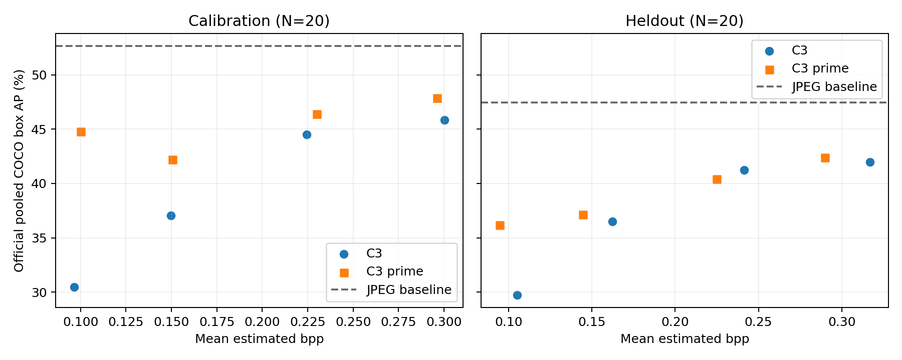
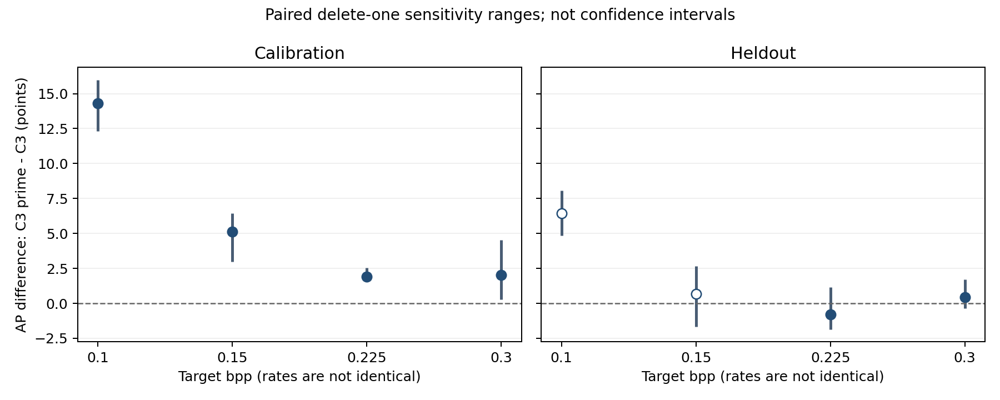

# Issue 49: frozen four-rate comparison on a nonoverlapping 20-image subset

All planned measurements and CPU provenance checks completed. Eight initial
fixed 20 conditions passed calibration target and between-method 10% tolerances,
so no correction candidate was needed. The eight lambdas were frozen before any
heldout job or baseline began. Heldout rates and AP never changed the settings.

## Measured results

Main rate is the arithmetic mean of total estimated latent plus per-image
network bits divided by resized nonpadding pixels. It is not an actual
bitstream size. AP is official pooled COCO box AP, not mean image-wise AP.

### Calibration 20 images

COCO-distributed JPEG baseline AP: **52.6425**.

| Target bpp | C3 bpp | C3 AP | C3 prime bpp | C3 prime AP | AP difference | Method rate gap |
|---:|---:|---:|---:|---:|---:|---:|
| 0.100 | 0.096506 | 30.4712 | 0.100129 | 44.7892 | +14.3180 | 3.754% |
| 0.150 | 0.149798 | 37.0760 | 0.150564 | 42.1859 | +5.1099 | 0.511% |
| 0.225 | 0.224341 | 44.4978 | 0.230089 | 46.3998 | +1.9020 | 2.563% |
| 0.300 | 0.300367 | 45.8356 | 0.296122 | 47.8446 | +2.0089 | 1.413% |

### Heldout 20 images

COCO-distributed JPEG baseline AP: **47.4330**.

| Target bpp | C3 bpp | C3 AP | C3 prime bpp | C3 prime AP | AP difference | Method rate gap |
|---:|---:|---:|---:|---:|---:|---:|
| 0.100 | 0.105177 | 29.7332 | 0.094571 | 36.1648 | +6.4316 | 10.083% |
| 0.150 | 0.162317 | 36.4919 | 0.144600 | 37.1499 | +0.6580 | 10.915% |
| 0.225 | 0.241380 | 41.2319 | 0.224726 | 40.4243 | -0.8076 | 6.900% |
| 0.300 | 0.316945 | 41.9716 | 0.289719 | 42.3905 | +0.4189 | 8.590% |

## Interpretation and uncertainty

Heldout C3 prime minus C3 AP differences are +6.4316, +0.6580, -0.8076 and +0.4189
points in target order. The 0.225 result reverses the positive calibration
contrast. All heldout target-relative rate errors are within 10%, while the
0.10/0.15 between-method gaps exceed 10%. Positive differences at unequal rates
are not strict equal-rate gains. At the two higher pairs the rate-gap criterion
passes, but the AP differences have mixed signs and small magnitude.

Calibration C3 prime drops from 44.7892 AP near 0.10 bpp to 42.1859 near 0.15 bpp,
then rises. The selected heldout C3 prime points increase across all four rates.
Both behaviors are retained. They do not establish universal monotonicity or a
unique failure mechanism; no new cause investigation or architecture was added.

The predeclared paired delete-one analysis recomputes pooled official COCO AP
for identical 19-image subsets in all eight conditions and baseline. Its ranges
are descriptive sensitivity, not confidence intervals. Supported noncrowd
categories vary from 33 to 37 in calibration and 26 to 30 in heldout. In particular,
AP can move when a category disappears, so these ranges are not a powered test
of superiority. All paired contrasts and ranges are in the CSV/JSON artifacts.

## Fixed protocol and traceability

Implementation commit: `0c3a60c703bd41956b6558d527470350bcc7dd5d`, from
unmerged PRs #22/#42. Main's documentation alone cannot reproduce that code.
The feature teacher and evaluation detector remain fixed and separate. Input
uses short-edge 800/long-edge 1333 uint8 resize before compression; native PNG
reconstructions are not resized again and predicted boxes use original image
coordinates. Generation uses both predeclared deterministic flags, image MSE
weight 1 and C3 prime feature L1 weight 0.1 on FPN layers 0-3 with weights 0.25.
Optimization is 500 noise steps plus maximum 50 STE, seed 20261004 with the pinned
per-image RNG rule. Checkpoint and quantization selection use the frozen
objective, never AP. Lambdas and full metrics are in the linked CSV/JSON.

The 20 heldout JPEGs were selected by fixed SHA256 ordering after excluding 624
prior-used images from the 5,000-image population. Input hashes, dimensions,
nonoverlap, seed and source manifests were frozen privately before evaluation.
Unused means relative to inspected records; unavailable or unrecorded histories
are not certified. This small one-seed subset is not the paper's 5,000-image AP.

Fresh full-run repeats on one calibration input per method matched parameters,
PNG, RNG/checkpoint records, bits and common predictions exactly. The final CPU
audit verified all 320 main encode/evaluation correspondences, retained parameter
and output hashes, frozen lambdas/configurations, input mappings and common
metadata. It exactly replayed 18 full-set AP results and 360 delete-one results.
No additional GPU experiments were used for the final audit.

## Cost, storage and next step

Total cost: **16.2897 cumulative GPU hours** and **9.5598 elapsed hours** for 42 jobs. This includes 4 reproducibility encodes, 160 calibration encodes, 160 heldout encodes, 20 compressed-image evaluation jobs and 2 JPEG baselines. There were no failed jobs or correction encodes. It is below the 40-GPU-hour/484-encode cap; billing-unit price is unavailable, so no currency total is claimed. CPU provenance/uncertainty replay time is separate.

Old artifact copies were SHA1-verified in Box before authorized intermediate
checkpoint cleanup; final states and small dependencies remain locally. New
parameters, PNGs, predictions, configs, RNG/seed and audit evidence are retained
privately in 21 SHA1/size-verified Box archives (3,402,874,880 bytes,
3.1692 GiB), below the approved 8 GiB cap. All 2,966 job files
were rehashed against member SHA256 lists; independent Box metadata readback
matched all archive hashes, sizes and destination. A small delivery supplement
also retains the final public record and publication receipts.

The evidence is mixed and does not justify a general equal-rate improvement
claim. Before external-codec comparisons or a larger study, the next question
is whether the small higher-rate differences and subset sensitivity persist in
a separately budgeted independent evaluation. No external-codec inference,
new loss, full 5,000-image run, merge or issue closure is included here.

## Artifacts and remaining review

- [Numerical JSON, full six AP metrics and tolerances](assets/issue49_four_rate/comparison.json)
- [All 16 measured points CSV](assets/issue49_four_rate/comparison.csv)
- [Frozen eight conditions](assets/issue49_four_rate/frozen_conditions.csv)
- [Paired rate/AP differences and sensitivity](assets/issue49_four_rate/paired_comparisons.csv)
- [Per-condition/baseline sensitivity ranges](assets/issue49_four_rate/uncertainty.csv)
- [Comparison PDF](assets/issue49_four_rate/comparison.pdf)
- [Sensitivity PDF](assets/issue49_four_rate/paired_sensitivity.pdf)

Scientific work and scientific retention are complete at the stated scope.
Final PR/delivery-supplement readback is retained separately as private evidence. User review and the issue's post-review
merge/closure decision remain outstanding. This record does not mark the Goal
or Issue complete. Refs #49.

[Issue requirement audit](2026-10-16_1041_JST.md#completion-audit) separates delivered scientific work, notification exception, and remaining user review.

## 完了条件・成果物の監査（結果公開時点の記録）

以下は結果公開時点の監査を統合したものです。未マージ・レビュー待ち等は当時の状態であり、現在の終了状態は[Issue #49](https://github.com/ken2129/c3_neural_compression/issues/49)と[結果PR #51](https://github.com/ken2129/c3_neural_compression/pull/51)を参照してください。

The approved scientific study is complete: 160 fixed 20 calibration encodes,
eight frozen conditions, 160 encodes on a nonoverlapping 20-image subset,
four fresh reproducibility encodes, both JPEG baselines, and predeclared
sensitivity analysis. No heldout AP or rate was used to change lambda.
This audit distinguishes scientific completion, delivery verification, and the
user's review/merge decision. It does not close the issue.

[Final results and interpretation](2026-10-16_1041_JST.md).
[Item-by-item requirement audit](assets/issue49_four_rate/requirement_audit.json)
contains every scientific checklist item and all five completion conditions.

| Requirement group | Evidence and outcome |
|---|---|
| 1: fixed protocol and reproducibility, all five items | Pinned PR22/42 implementation; both predeclared deterministic settings; original seed/RNG; full fresh repeats exact for parameters, PNG, bits and common predictions; measured pilot cost/storage. PR 48 remains open and unmerged; its unresolved causal questions are not claimed solved. |
| 2: calibration/freeze, all eight items | Fresh fixed 20 means for eight initial conditions, all target and pair rate criteria pass; rate-only historical proposals; no correction jobs; frozen conditions before heldout generation and baseline. Historical points were not mixed into final curves. |
| 3: subset and storage, all five items | Fixed SHA256 selection seed and N=20 after 624 inspected prior-use exclusions, nonoverlap and input hashes checked; no AP/category selection; scoped unused claim; approved destination; shared JPEG baseline. Pilot-based forecast constrained N before measurement. |
| 4: eight-condition evaluation, all eight items | All 160 heldout encodes complete; shared evaluator and six pooled COCO metrics; image-mean estimated total-bit rates; pinned resize/objective/teacher/steps; final provenance replay passed. Actual cost 16.2897 cumulative GPU hours versus 9.5598 elapsed hours, 324 total encodes, 42 completed jobs, no failures. |
| 5: interpretation/next step, all six items | Complete separate plots/tables, target and pair flags, paired delete-one pooled AP ranges and category support; mixed AP differences; no universal equal-rate superiority, BD-rate, interpolation, significance or full 5000-image claim. No external-codec or new causal experiments added. |

The method-rate tolerance is met at all calibration pairs. On heldout, individual
target tolerances pass, but the 0.10/0.15 method-pair tolerances fail. At 0.225,
the AP difference is negative. These outcomes satisfy the requirement to retain
unfavorable and unmatched points; they do not satisfy a strict equal-rate
improvement claim. Calibration C3 prime remains nonmonotonic.

### Validation and private evidence

- Four preflight, six rate-selection and five public-report tests passed.
- The final CPU audit checked 42 terminal receipts, the frozen scope/config/input
  identities, final parameters/PNG/predictions, and recomputed image-mean rates.
- All 18 full-set and 360 paired delete-one official metric dictionaries replayed
  exactly from saved predictions. The ranges are descriptive, not confidence
  intervals. Minimal repeat checks use one input per method and one seed.
- Public final CSV/JSON reproduce exactly through the path-parameterized final
  renderer; both PNG/PDF plots were inspected. Private original controllers,
  plans, job files, input/asset identities, source and audit records remain
  separate from the public numerical whitelist.
- All four older collections were SHA1-verified before authorized intermediate
  checkpoint cleanup. 1,848 deletions freed 18.586 GiB; 7,816 retained old files
  were rehashed. First/latest states and required small dependencies remain.

### Delivery and outstanding conditions

All scientific artifacts are retained in 20 codec/evaluation batches plus one
metadata/source/input/baseline supplement, **3,402,874,880 bytes
(3.1692 GiB)**, below the approved 8 GiB cap.
All 21 remote archive SHA1 values and sizes match the local archive receipts;
a separate Box connector readback also confirms the intended destination and
active files. All 2,966 job files are covered by immutable member SHA256 lists
and were rehashed after upload. Final public files and publication receipts are
retained in a small delivery supplement, with its final readback kept privately.
No source result files are deleted during delivery and sharing is unchanged.

A Slack start-notification action was rejected by automatic approval review:
it could not verify authorization for the saved destination and payload.
The action was not retried. Periodic/completion notification delivery is not
claimed; the rejection is an operational exception, not a scientific failure.

The first three Issue 49 completion conditions are met: traceable separation and
selection, all eight conditions with common provenance-checked evaluation, and
an interpretable account of rate/AP/baseline/uncertainty/cost/limits. This record, numerical assets and the results PR deliver the fourth condition;
PR head/tree readback is retained as private delivery evidence. The fifth requires
the user's review/merge and scope decision and remains pending. No PR is merged
and no issue is closed by this work. Refs #49.
