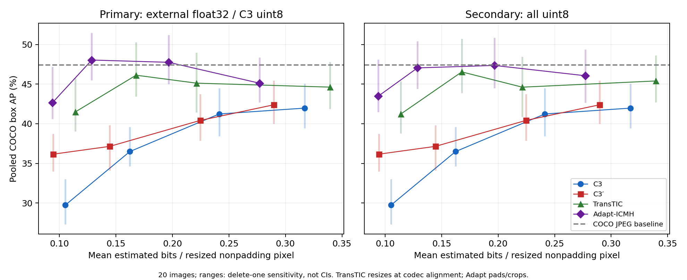

# 同じ評価20画像でのC3／C3′／TransTIC／Adapt-ICMH比較

対象は[Issue50](https://github.com/ken2129/c3_neural_compression/issues/50)。
[Issue49結果PR51](https://github.com/ken2129/c3_neural_compression/pull/51)の固定評価20画像、
通常C3／C3′各4点とCOCO配布JPEG baselineを再利用し、外部2方式各4点・計160推論を追加した。
外部全8条件、float主比較／uint8補助比較、全点のpaired delete-one評価が完了した。
#49の設定・画像・結果・最適化には変更を加えていない。PR51は別PRであり、このPRへ取り込まない。

## 図と全点

[PNG](assets/issue50_four_method.png)・[PDF](assets/issue50_four_method.pdf)・
[CSV](assets/issue50_four_method.csv)・[JSON](assets/issue50_four_method.json)。
主比較16点、外部uint8補助8点、JPEG baselineを全て残した。
線は観測点の対応を示すだけで、補間・外挿したAPではない。縦線は同じ1画像を除いた
19画像集合の公式AP範囲で、信頼区間ではない。

**TransTICはcodec前後に公式bilinear resizeを行う。Adapt-ICMHはpadding→crop、C3は共通入力寸法のまま。**
この方式固有の再サンプリング差と、主比較の外部float32／C3 uint8という精度差が残る。
共通検出器はどの方式にも追加resizeしない。図の右側は同じ外部復元をuint8にした補助比較で、
codec推論もbitsも追加していない。主・補助の有利な方を事後選択していない。

AP/AP50/AP75/サイズ別APは公式COCO集合bbox評価の%であり、画像別APの平均ではない。
C3の品質欄は校正時の目標bpp、外部方式は公開品質番号で、同rateを意味しない。

| 方式 | 品質/目標 | 実測bpp | AP | AP50 | AP75 | small | medium | large | delete-one AP範囲 |
|:---|---:|---:|---:|---:|---:|---:|---:|---:|:---|
| C3 | 0.100 | 0.105177 | 29.733 | 52.509 | 27.599 | 12.661 | 28.440 | 52.357 | 27.310–33.028 |
| C3 | 0.150 | 0.162317 | 36.492 | 56.431 | 38.565 | 20.841 | 36.537 | 56.770 | 34.647–39.594 |
| C3 | 0.225 | 0.241380 | 41.232 | 61.152 | 45.031 | 21.433 | 43.045 | 62.771 | 38.438–44.496 |
| C3 | 0.300 | 0.316945 | 41.972 | 62.197 | 46.162 | 19.604 | 42.733 | 65.187 | 39.419–45.053 |
| C3′ | 0.100 | 0.094571 | 36.165 | 56.096 | 38.234 | 10.382 | 33.909 | 62.977 | 33.964–38.757 |
| C3′ | 0.150 | 0.144600 | 37.150 | 58.772 | 37.149 | 17.369 | 38.807 | 61.782 | 34.110–39.813 |
| C3′ | 0.225 | 0.224726 | 40.424 | 55.683 | 43.580 | 16.775 | 40.569 | 68.900 | 37.847–43.756 |
| C3′ | 0.300 | 0.289719 | 42.390 | 58.880 | 45.939 | 18.126 | 44.426 | 66.536 | 40.015–45.432 |
| TransTIC | 1 | 0.113950 | 41.478 | 64.512 | 47.318 | 17.636 | 47.898 | 63.257 | 39.038–45.735 |
| TransTIC | 2 | 0.167846 | 46.122 | 65.435 | 51.757 | 20.456 | 51.050 | 68.062 | 43.423–50.273 |
| TransTIC | 3 | 0.221335 | 45.121 | 64.318 | 53.297 | 20.158 | 47.872 | 67.302 | 41.428–48.987 |
| TransTIC | 4 | 0.339419 | 44.620 | 63.545 | 53.359 | 18.720 | 50.275 | 66.576 | 41.871–47.789 |
| Adapt-ICMH | 1 | 0.093872 | 42.658 | 63.588 | 43.935 | 13.633 | 45.571 | 70.757 | 40.616–47.201 |
| Adapt-ICMH | 2 | 0.128633 | 48.036 | 67.194 | 53.863 | 20.172 | 59.402 | 67.792 | 45.472–51.470 |
| Adapt-ICMH | 3 | 0.196753 | 47.749 | 65.293 | 55.600 | 19.285 | 55.170 | 73.853 | 45.009–51.213 |
| Adapt-ICMH | 4 | 0.277056 | 45.116 | 63.071 | 53.642 | 18.511 | 49.273 | 68.980 | 42.702–48.378 |
| COCO JPEG baseline | — | — | 47.433 | 64.797 | 49.998 | 21.085 | 50.799 | 70.806 | CSV参照 |

JPEG baselineは配布JPEGであり圧縮前のlossless原画ではない。今回のentropy-estimated rate軸上の
codec動作点を持たないため、図ではAP水平線、CSVではbpp空欄として区別した。

## 復元精度の感度

外部APを見る前に、主比較をclamp後float32、補助比較を
`torch.round(clamp(rgb,0,1)*255)`（ties-to-even）のuint8 HWC RGB lossless PNGと固定した。
PNG decode後はfloat32で255除算する。全復元についてNumPy独立roundとの一致、PNG往復、
float32保存往復、寸法、有限性、hashを検証した。C3の未保存float復元は推測していない。

| 方式 | 品質 | float AP | uint8 AP | uint8−float (pp) | paired delete-one差の範囲 (pp) |
|:---|---:|---:|---:|---:|:---|
| TransTIC | 1 | 41.478 | 41.233 | -0.245 | -0.353–+0.094 |
| TransTIC | 2 | 46.122 | 46.540 | +0.418 | +0.089–+0.483 |
| TransTIC | 3 | 45.121 | 44.615 | -0.506 | -1.103–+0.166 |
| TransTIC | 4 | 44.620 | 45.396 | +0.776 | -0.087–+0.977 |
| Adapt-ICMH | 1 | 42.658 | 43.472 | +0.815 | -0.012–+0.947 |
| Adapt-ICMH | 2 | 48.036 | 47.044 | -0.992 | -1.303–-0.348 |
| Adapt-ICMH | 3 | 47.749 | 47.355 | -0.394 | -0.509–-0.066 |
| Adapt-ICMH | 4 | 45.116 | 46.057 | +0.940 | -0.064–+1.100 |

roundの影響は品質・方式により正負が変わる。同じ復元でもAPが変わるため、主比較の精度非対称を
無視しない。差の範囲も信頼区間や優越性検定ではない。

## rate範囲と限定的な解釈

主rateは各画像の推定bitsを**codec alignment前のD2 resize済み非padding画素数**で割った値の
算術平均。外部はy+z全likelihood bits、C3はlatentと画像ごとのnetwork bitsを含む。
外部の共有事前学習重みは画像ごとに課金しない仮定であり、実bitstream・コンテナoverheadの測定ではない。
元画素分母の旧点は混ぜず、元bitsから全点を再集計した。

| 方式 | 最低実測bpp | 最高実測bpp |
|:---|---:|---:|
| C3 | 0.105177 | 0.316945 |
| C3′ | 0.094571 | 0.289719 |
| TransTIC | 0.113950 | 0.339419 |
| Adapt-ICMH | 0.093872 | 0.277056 |

4方式の実測rate端点範囲の共通部分は0.113950–0.277056 bpp。端点間を連続測定した意味ではない。
範囲外では全方式が揃わず、範囲内にも離散4点しかない。全6組の端点範囲重なりはJSONに記録した。
外部公開4品質はC3の目標4rateへ調整していないため、同rate到達は未達である。
AP差を同rate改善と扱わず、AP補間・外挿やBD-rateを作らない。

主比較では外部方式の観測APは全点でC3/C3′の観測範囲と重なるか上回るが、rateとalignmentが異なる。
Adapt品質2のfloat APはJPEG baselineより高い一方、uint8化で値が下がる。
これはこの20画像・固定検出器の観測で、lossless原画を超える一般的改善や論文再現を意味しない。
TransTIC/Adaptとも公開品質番号に対してAPは単調ではない。全品質を残し、APで選び直していない。
#49のC3′−C3がrateにより混合結果だったことも、この追加測定で変更しない。

## 入力・出典・公式alignmentの監査

#49の固定評価20画像manifestと画像bytesをそのまま使用し、校正20画像との非重複を確認した。
全8 C3条件・計160件の保存済み入力ハッシュと、外部codec直前のD2 uint8入力をbitwise照合した。
短辺800・長辺上限1333の共通入力後に方式固有alignmentを適用する。

TransTICは[固定公式source](https://github.com/NYCU-MAPL/TransTIC/tree/1132f62cbddc0122aa19f620453c3b0c4de49b2c)の
`Alignment(divisor=256, mode='resize')`、codec前後bilinear・`align_corners=False`を維持した。
当初Issueのpadding→crop条件との矛盾は新規TransTIC推論前に検出し、測定を保留した。
2026-10-16のユーザー明示承認とIssue本文更新により公式resizeを例外採用した。
公式align/resumeと独立bilinear実装が全80件で一致した。結果を見てpadding経路へ変更していない。
Adapt-ICMHは[固定公式source](https://github.com/qingshi9974/ECCV2024-AdpatICMH/tree/cf77f2eab798c9e949d2efd46db1adf3bbbc5cc1)の
zero padding→cropを独立実装と照合した。共通検出器は元画像座標へboxを戻す。

外部8重みのhashと公式sourceの固定commit/未変更を実行前に照合した。
共通検出器の重み・設定・環境・padding・前処理metadataは#49と完全一致する。
以下の実装状態は測定時点の記録である。基盤PR #22／#42はその後2026-10-16にmainへ統合済みだが、保存成果物は元の固定sourceを正本とする。

元実行runtimeは固定source commit `0c3a60c703bd41956b6558d527470350bcc7dd5d`で、
未マージ実行基盤PR22/42に依存する。mainだけで実行可能とは扱わない。
[実装と再集計手順](../../experiments/issue50/README.md)に各段階を記録した。
画像ID、内部絶対パス、モデル識別hash、環境詳細、実画像・重み・全予測は公開に含めない。

## 不確実性・費用・完了範囲

全25評価経路（主16点・外部補助8点・JPEG）について同じ1画像を除く20通りの19画像集合で
公式COCO APを再計算した（計500評価）。全体で支持される30カテゴリが削除画像により26–30へ
変わる。paired delete-oneは記述的感度であり、信頼区間や統計的優越性ではない。
外部両方式の全集合AP16件と再利用C3/JPEGの9件も元予測から再計算して完全一致した。
全点のrate・復元・条件対応を私有正本から監査し、公開CSV/JSON/PNG/PDFを再生成した。

codec推論は累計160件（各方式80、各品質20）、失敗・再試行なし。
起動・モデルload・codec・検出・終了を含む累計GPU時間は188.234秒（0.052287 GPUh）。
集計時の私有成果物は1,951,379,691 bytes（1.817 GiB）。
承認済み160推論・2GPUh・新規4GiB・最低空き3GiBを維持した。
各方式の固定先頭画像pilotは条件・hashを検証して本測定へ再利用した。
GPU実使用者を起動直前に確認し、tmux実行・時間/容量guardを使い、他ジョブに干渉していない。
COCO AP再集計とjackknife監査はGPUを非表示にしたCPU処理である。新Box先や追加規模への拡張はない。
開始・進捗通知の配送証拠は私有領域に保持した。最終公開状態は結果PRと完了監査を参照する。

本比較は過去の20画像結果も見て企画した追加比較で、新しい独立な確認実験ではない。
外部事前学習データとの非重複は未確認で、主張しない。公開Adapt-ICMH重みは論文Figure 4そのものの
checkpointではない。全5,000画像の論文APとの差し引き、論文再現、一般的優越性は主張しない。
次に画像数を増やすなら、支持カテゴリが4カテゴリ変わる感度と小標本での非単調APを理由に
別の固定計画で評価する。rate追加なら端点共通範囲での近接した実測rateを事前計画し、
今回は追加画像・品質・seed・最適化へ拡張しない。ユーザーがレビュー・mergeを判断し、勝手にmerge/closeしない。

## 完了条件・成果物の監査（結果公開時点の記録）

以下の未マージ・レビュー待ちは当時の状態です。現在の終了状態は[Issue #50](https://github.com/ken2129/c3_neural_compression/issues/50)と[結果PR #52](https://github.com/ken2129/c3_neural_compression/pull/52)を参照してください。

[研究記録・全点](2026-10-16_four_method_comparison.md)と[実装手順](../../experiments/issue50/README.md)。
更新後Issue50の24チェック項目を私有の要件別監査に対応付けた。

| Issueの項目 | 証拠と判定 |
|:---|:---|
| 1–2 固定20画像・#49再利用 | manifest/画像bytes一致、校正との非重複、全8 C3完了attempt、保存済み入力160件の一致。C3/JPEGの全集合AP9件を再計算して完全一致。再学習・最適化・λ変更なし。 |
| 3 全外部条件 | TransTIC/Adapt各4品質×20、合計160推論・160成功。失敗・再試行なし。APで品質を選別しない。 |
| 4–6 alignment・入力・検出器 | 共通D2 uint8入力をbitwise照合。ユーザー承認済みTransTIC公式resize、Adaptのzero padding/cropを独立実装と照合。共通検出器metadata完全一致、追加resizeなし、元座標box。 |
| 7–8 rateと公式metric | 元y+z bits/C3 latent+network bitsからalignment前画素数分母のmean bppを再計算。公式集合AP/AP50/AP75/サイズAPを全点掲載。共有重み非課金・entropy-estimatedを明示。 |
| 9–10 pilot・予算 | 固定先頭画像を再利用。起動/load/終了込みGPU累計188.234秒、160/160推論。今回成果物約1.82GiB、物理空き約17GiBで4GiB/free3GiB以内。CPU監査はGPU非表示。 |
| 11–14 実行・通知・保存・停止guard | 起動直前のGPU使用確認、tmux、時間/容量guard、非有限/入力/hash/寸法チェック、既存出力時の再実行拒否。開始/進捗のHTTP成功receiptを保持。完了通知と配信状態は最終私有receiptに記録。#49を変更せず別領域で保存。新Box先は使わない。 |
| 15–16 全点図表・rate重なり | PNG/PDF/CSV/JSONに主16点、外部uint8補助8点、JPEG baseline。rate端点共通範囲0.113950–0.277056、全6組の範囲重なりを記録。同rate未達を明記しAP補間・外挿を行わない。 |
| 17 paired delete-one | 全25経路×20削除集合＝500公式再評価。全外部監査320件と#49既存180件の辞書に完全一致。同じ19画像を使用し、支持カテゴリ30→26–30を記録。信頼区間と呼ばない。 |
| 18–20 解釈と次の計画 | 追加比較・小標本・事前学習重複未確認・公開Adapt重みの相違を明記。論文AP差し引き/再現/BD-rate/一般的優越性なし。追加画像/rateは別計画。 |
| 21–23 成果物・公開範囲 | 全外部条件の対応・復元・bits・AP監査合格。公開数値25 CSV行を元bits/metricと照合。CSV/PNG再生成完全一致、PDFは作成日時以外一致、JSONは保存量snapshot以外一致。実図を目視確認。私有ID/絶対パス/モデルhash/画像/重み/全予測を公開から除外。 |
| 24 結果PRと依存 | main向けの独立結果PR。C3結果はPR51を参照し、固定runtime依存PR22/42を明記。公開後にhead treeと全blobを読み戻してローカル成果物との同一性を検証する。merge/Issue closeは行わない。 |

外部APを見る前にround/tensor→PNGを凍結し、主は外部float32/C3 uint8、補助は全uint8。
全160復元でfloat保存往復と独立round/PNG往復の全画素一致を検証した。
uint8化のAP差は−0.992～+0.940点で、影響の符号が一定ではない。主・補助を選び直していない。

科学測定・ローカル成果物の監査は合格。PR作成だけで完了とはせず、公開head tree/全blobの
読み戻し検証と最終状態確認を別の私有監査に保持する。ユーザーのレビュー・merge判断を尊重する。
