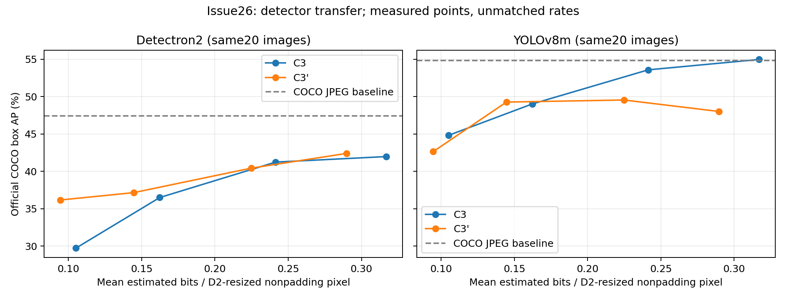

# Issue26：保存画像をYOLOv8mで再評価した転移pilot

#49の評価20画像・C3／C3′各4rateのPNG160枚とCOCO配布JPEG20枚を再利用し、YOLOv8mで計180入力を評価した。C3の再圧縮・再最適化・λ変更は行っていない。Detectron2の9評価は#49から再利用した。

## 結果

[CSV](assets/issue26_transfer/issue26_yolo_transfer.csv)・[JSON](assets/issue26_transfer/issue26_yolo_transfer.json)・[PDF](assets/issue26_transfer/issue26_yolo_transfer.pdf)。全18評価を残す。線は観測点の対応を示すだけで、補間したAPではない。

| 目標ラベル | C3実測bpp | C3′実測bpp | D2のC3′−C3 AP差 | YOLOのC3′−C3 AP差 |
|---:|---:|---:|---:|---:|
| 0.100 | 0.105177 | 0.094571 | +6.4316 | -2.1903 |
| 0.150 | 0.162317 | 0.144600 | +0.6580 | +0.2425 |
| 0.225 | 0.241380 | 0.224726 | -0.8076 | -4.0329 |
| 0.300 | 0.316945 | 0.289719 | +0.4189 | -6.9520 |

AP差は同じ検出器内の公式COCO集合box AP（百分率）の差。YOLOでは4点中3点でC3′のAPが低く、低rateでD2に見えた改善も逆転した。現行feature lossの改善が別architectureへ一貫して残る結果ではない。検出器への依存と整合する観測だが、原因の特定ではない。

低2組の方式間rate差は10%超、残りも完全な同rateではない。C3′のbppが小さいため、これらのAP差を同rateでの純粋な特徴損失効果とは解釈しない。AP補間・BD-rateは算出していない。元JPEG baselineのAPはD2が47.433、YOLOが54.799だが、検出器間のAP絶対値の差を転移効果とは呼ばない。各検出器内のJPEGからの低下はCSV/JSONへ全点記録した。

## 固定した評価条件

公式COCO学習済みyolov8m.pt、Ultralytics 8.3.0の公開wheelを固定した。公式配布元・重みSHA256・環境と入力のhashは私有記録に保存。最新版docsのdefaultsを流用せず、[固定版のvalidation後処理](https://github.com/ultralytics/ultralytics/blob/v8.3.0/ultralytics/models/yolo/detect/val.py)と[LetterBox実装](https://github.com/ultralytics/ultralytics/blob/v8.3.0/ultralytics/data/augment.py)を確認している。

- FP32、batch1、imgsz640、rect=False、auto=False、scaleup=True、center=True、stride32、padding114。modelはeval・重み凍結、fusionなし、augmentationなし。
- NMSはconf=.001、IoU=.7、multi_label=True、class-aware、max_det300。predictの暗黙defaultsは使っていない。公式COCOevalはmaxDets=[1,10,100]で、検出器側300とは区別する。
- D2のcodec入力resize後にYOLO用letterboxを共通適用。letterboxからD2入力座標へ戻し、さらに元JPEG座標へ変換して元annotationsと評価。保存PNGの変更なし。
- 連続80クラス→COCO category IDを公式対応表と照合。縦横の非正方形画像の既知bboxで二段の座標逆変換を検証。空検出の変換も検証。
- 主rateは#49のmean(bits/D2-resized nonpadding pixels)を維持。latentと画像ごとのnetwork bitsを含むentropy推定値。YOLOの640やletterbox画素数へ分母を変更しない。
- cuDNN benchmark=False、deterministic=True、torch deterministic algorithms=True。固定1画像3条件を各2回実行して予測が完全一致。本評価の同じ先頭画像予測とも完全一致。

## 検証・費用・制約

全180入力のhash・寸法・条件・完了attemptと全8rateを監査し、9条件の保存予測を公式pycocotools COCOevalで2回集計してmetric辞書の完全一致を確認した。COCOevalの標準IoU帯・面積区分を使い、画像別APの平均やYOLO内蔵mAPに置き換えていない。AP50/AP75/サイズ別APと欠測はCSV/JSONへ記録。座標・クラス対応・空検出のCPUテスト3件が成功。

対象GT支持数：30カテゴリ、全133 annotations。サイズ別のnoncrowd対象数／画像数は small 65/9、medium 42/13、large 23/15。境界値は公式COCOの面積範囲に従うため区分が重なる場合がある。

モデルloadから同期済み推論終了までの計測はsmoke6 forwardが1.460秒、本評価180 forwardが7.375秒、計8.836秒。環境構築・ダウンロード・Python import・CPU集計の経過時間はこのGPU区間に含めず、別の作業として扱う。GPU0をtmuxで使用し、他者ジョブがないことを確認した。今回の実行上限はGPU900秒・新規成果物1GiB・最低空き3GiB。上限内で完了。

初回smokeは新環境がCPU版torchを拾ってCUDA未認識で停止し、forwardは0件。既存CUDA版torchを参照する経路を新環境側だけ修正して再開した。完了後の入力・設定の事後選択や性能に基づくretryは行っていない。既存C3/外部方式環境の変更なし。

この20画像は#49では校正と非重複の評価用だったが、本件は既存結果を見て企画した探索的追加pilot。1 seed・小標本・rate不一致の制約があり、独立確認実験、全COCO性能、一般的汎化、統計的有意性・信頼区間を主張しない。YOLOもCOCO学習済みであり未学習データへの汎化評価ではない。

次はproxy／転移依存を意識した手法改良（#28など）を検討できる。ただし本pilotから新loss・追加画像・rate校正を自動開始しない。別の固定計画で対象・費用を決める。

研究記録と結果は1本の結果PRへ集約し、完了PRにCloses #26を付ける。ユーザーがレビュー・マージする。実画像・画像ID一覧・重み・全予測・内部パス・モデル識別hash・環境詳細は私有領域に保持し、新Box先への転送は実施していない。
