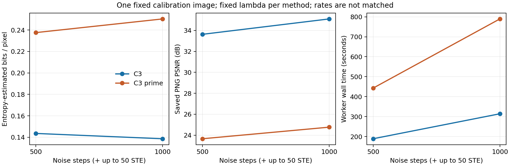

# Issue24: GTX 1080での最適化予算・費用pilot

既存の本人用workコンテナ内で、固定した校正1画像について通常C3／C3′のnoise 500／1000 step・各最大50 STEの4条件が完了した。初回接続確認の起動設定エラー1件と、修正後のC3′接続確認1件を含め計6試行。GPU工程の累計worker wallは1823.63秒（30分23.63秒）、初回起動から最終終了までは2059.05秒（34分19.05秒）で、単GPU7200秒の範囲内だった。

これは[#24](https://github.com/ken2129/c3_neural_compression/issues/24)の費用pilotである。20画像の校正・新しい評価集合・AP測定・2000-step測定・同時間対照は未実施で、研究全体のIssueは継続する。

## 条件と実行

- GPUはGTX 1080 8 GiBの1枚。起動前と各条件の直前に空きを確認し、別GPU・他者ジョブには干渉していない。新規コンテナ・ホスト側サービス・mountは追加していない。
- 入力は#49校正manifestの固定順先頭1画像。元のJPEG・annotation・順序と照合し、D2 uint8 RGB、短辺800／長辺上限1333の変換bytesも既存結果と一致した。未見評価画像とは呼ばない。
- Codec sourceは`0c3a60c703bd41956b6558d527470350bcc7dd5d`。固定ソースの全ファイルとGitコミットを復元し、元のworkコンテナのソース・CPU版Python環境は保全した。実験依存はコンテナ内の別venvに置いた。
- seed 20261004と既存の画像別fold-inを維持。各条件を独立に初期化し、初期RNGの対応も照合した。500-stepのparams／checkpointを1000-stepへ流用していない。
- 通常C3はimage係数1・machine係数0、C3′はimage係数1・feature L1係数0.1。FPN0–3は各0.25、teacherはFaster R-CNN ResNet-50 FPN COCO_V1、eval・重み固定・元側stop-gradient。復元側の勾配はCPU準備と実GPU実行で確認した。
- 500→1000ではcosine LR・Kumaraswamy・soft-roundingの進行率を各noise budgetへ対応させ、量子化候補と最大50 STEは固定。λ探索は行っていない。
- 実行順は接続確認→A→C→B→D。各条件は新しいPythonプロセスだが、JAXの永続コンパイルcacheを共用した。時間には測定順・cacheの影響が含まれる。

## 全4条件の結果

| 条件 | 方式 | noise | λ | 推定bpp | 保存PNG PSNR [dB] | worker wall [秒] | 観測GPU peak [MiB] |
| --- | --- | ---: | ---: | ---: | ---: | ---: | ---: |
| A | 通常C3 | 500 | 0.002173243273017414 | 0.143562 | 33.6291 | 189.277 | 1242 |
| B | 通常C3 | 1000 | 0.002173243273017414 | 0.138608 | 35.0979 | 314.324 | 1242 |
| C | C3′ | 500 | 0.043644024521953165 | 0.237617 | 23.6581 | 442.860 | 2902 |
| D | C3′ | 1000 | 0.043644024521953165 | 0.250371 | 24.7641 | 789.376 | 2902 |

主rateはlatent＋画像ごとのsynthesis／entropy networkの全推定bitsを、resize済み非padding画素数で割った値。actual bitstreamは生成していない。保存PNGのPSNRは、既存D2変換bytesと一致することを確認した別のCPU処理から独立に再計算した。Codec JSONの`psnr_quantized`も丸めたRGBの評価値なので、CSVでは`psnr_reported_quantized_db`として保存し、独立計算との誤差が0.0001 dB以内であることを照合した。

線は同一方式の2点の対応を示す。中間budgetの測定や連続的な収束曲線を表すものではない。

この画像・固定λでは、通常C3の500→1000で時間が1.661倍、推定bppが3.451%減り、PNG PSNRが1.469 dB上がった。C3′は時間が1.782倍、bppが5.368%増え、PSNRが1.106 dB上がった。C3′の復元float feature L1は0.140735→0.113759だった。

方式間でもbudget間でもrateは揃っていない。特徴損失の減少やPSNR変化だけから、検出AP・同rateでの優位・完全収束は判断しない。λの0.225 bpp anchorは20画像平均の条件であり、この1画像での0.225到達を意味しない。

## 失敗・監視・検証

初回の通常C3接続確認は、launcherが`JAX_PLATFORMS=cuda`だけを有効にしたため、固定CodecのCPU bookkeepingで最初の最適化step前に停止した。GPU工程は11.546秒。起動設定を元の`cuda,cpu`へ修正し、既存runnerの「default deviceがGPUでなければ拒否」を維持した。この接続確認は再試行せず、失敗記録を保持して残り5件へ進んだ。元の時間窓・計6試行からは増やしていない。

C3′接続確認はnoise 2／STE 0で成功し、76.250秒。接続確認を含むデバイス全体の観測GPU peakは3342 MiB、process groupの観測RSS peakは5.632 GiBだった。終了時のGPU工程の追加成果物は約62.95 MiB、空き容量は約84.88 GiB。2コアのaffinity、8 GiBのRSS停止閾値、追加6 GiB・最低空き10 GiBの監視で上限停止は起きなかった。RSS／GPU peakは1秒間隔の観測値であり、絶対peakやcgroupのhard limitとは扱わない。

- 入力・設定・bits内訳／分母、初期RNG、trained／quantized params・PNG・metricsの対応を監査。C3′のteacher checksumは前後一致し、teacherの勾配は残っていなかった。
- CPUで設定・元側stop-gradient・有限で非zeroのJAX–PyTorch勾配を検証。公開する監視コードのLinux CPUテスト3件も成功し、未承認拒否と、時間超過時に対象worker＋子だけを止めて無関係なプロセスを維持することを確認した。
- GPU終了後は両GPUに計算プロセスがなく、旧resident controllerは停止・全体OFFを維持した。GPU自動受付の検証や配置更新は行っていない。
- 実画像、重み、全params／復元、内部パス、画像IDと詳細hashはコンテナ内の私有記録に保持。新Box先への転送・旧成果物削除はしていない。

時間の主値はimport/load・compile・最適化・量子化・保存・終了を含むworker wallである。既存Codecの`optimization`にはteacher準備・JIT・noise・STE等が混在し、独立したphase計時は得られていない。既存の`total`は最終保存前の値なので別列へ明示した。全stepのtraceではなく、full runは既存の10step間隔ログを保持し、CSVの途中bppはlatentのみ、最終bppはnetwork bits込みと区別した。

## 次の費用判断

この1画像の2点だけからworker wallを直線外挿すると、2000-stepは通常C3で約564秒、C3′で約1482秒となる。これは未測定で、同一λ・画像・cache条件に依存する便宜的な見積りである。

#24のstep数対照360符号化（2方式×3 budget×3 rate×20画像）へ同じ1画像コストを当てはめると約63.0 GPU時間、見積り用に1.5倍すると約94.6時間。追加のλ校正・接続確認・同時間対照・AP評価・他画像／rateの変動は含まれず、信頼区間や確定予算ではない。この全体行列の実行は承認されていない。

次は、pilotで残ったphase計時と全step traceの要否、校正・評価集合、λ候補数、同時間対照のTを決め、全jobの費用を積算して計画を凍結する。今回の1画像結果だけで条件数・画像数を自動拡大しない。

## 成果物

- [全試行CSV](assets/issue24_budget_pilot/pilot.csv)・[監査済みJSON](assets/issue24_budget_pilot/pilot.json)
- [最適化ログの数値CSV](assets/issue24_budget_pilot/optimization_trace.csv)
- [図PDF](assets/issue24_budget_pilot/budget_pilot.pdf)・[図PNG](assets/issue24_budget_pilot/budget_pilot.png)
- [実行・集計・テストコードと再現上の境界](../../experiments/issue24/README.md)

Refs #24, #35, #49。
