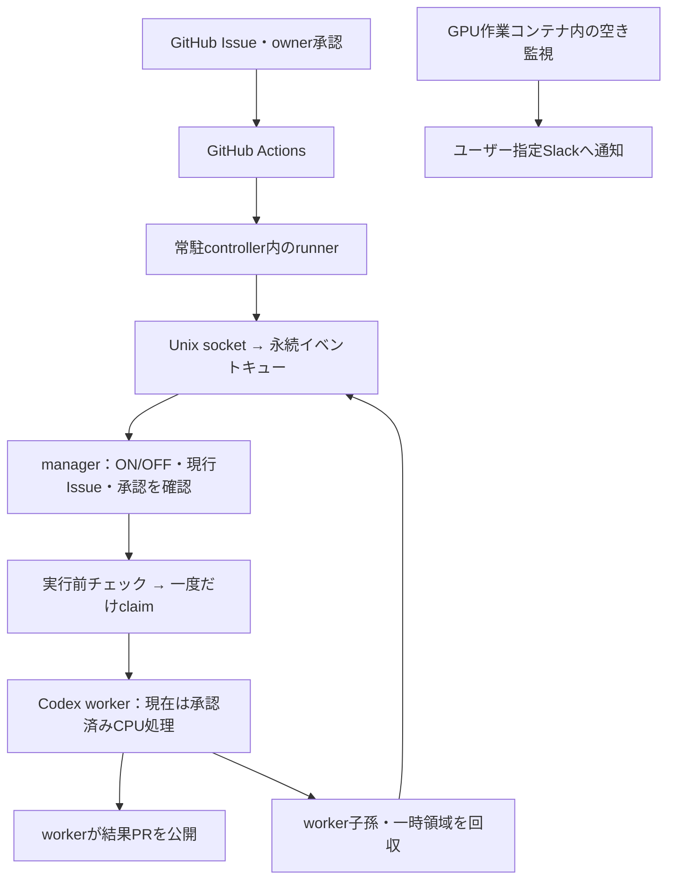

# 研究自動化システム

構成、Issueから実行までの流れ、設定、現在の配置と未対応部分を説明する入口。
研究手法・資源利用・成果物の方針は [実験ポリシー](experiment_policy.md)、
個別実験の条件は各Issueを正本とする。

以下の配置状態は **2026-11-09の確認時点**。PRの実装、テスト済み範囲、
実際に配置した機能を分けて読む。ここに書かれた計画から実験が自動承認されることはない。

## 現在どこまで動くか

| 項目 | 確認した状態 |
| --- | --- |
| 既存の常駐controller | `enabled: false` を保存し、worker不在を確認して停止済み |
| 限定CPU実E2E | #95 / PR #100で、実イベント→実Codex→結果PR→外側の報告を確認済み |
| 公開版の再現修正 | PR #104はopen・未merge。修正版イメージのbuildと未登録runner待機を確認済み。既存配置への置換は未実施 |
| モデル設定の集約 | PR #105はopen・未merge・未配置 |
| `enabled` の動的ON/OFF | PR #106と、本変更の実行開始境界の修正が必要。旧配置へ未反映 |
| GPU実験の自動起動 | 未接続。現行residentはGPUデバイスを拒否するCPU経路 |
| GPU作業用コンテナ | 既存コンテナは稼働中。GPUデバイスは見えるが、入力・依存・実験入口の準備は別途必要 |
| GPU空き通知 | 作業コンテナ内の独立した補助プロセス。controllerのOFFとは独立 |

過去のCPU成功を新版の実E2EやGPU実行の成功へ読み替えない。
準備中のGPU実験は [Issue #107](https://github.com/ken2129/c3_neural_compression/issues/107) を参照する。

## 構成と一回の仕事

この図の常駐経路は、導入・runner登録・受付設定が済んでいる場合の構成。
現在の旧controllerは停止している。GPU通知から実験を起動する線はまだない。

1. 普通の計画Issueを作っても実行しない。
2. 実行候補には `[実行承認済み]` のタイトル、本文末尾の正式な
   `c3-execution-request`、確定した内容と一致する未編集owner承認コメントが必要。
   タイトルも承認hashの対象なので、**名前の変更だけで実行開始する仕様ではない**。
3. Actionsから届くのはIssue番号等の通知であり、実行承認そのものではない。
   managerが現在のIssue・承認・期限・取消・変更をGitHubから確認する。
4. 実行前チェックに成功した仕事だけを一度claimし、専用workerで処理する。
   処理結果は保存し、同じイベントの再配送で再実行しない。
5. 正常完了ではworkerと子孫・一時領域だけを回収し、managerとrunnerを維持する。
   回収できたと確認できない場合は次の仕事を始めない。

Issue一覧の定期巡回・自動再走査はしない。Actionsの配送成功、Codex処理の終了、
PRの実在、研究としての成功、Slack通知はそれぞれ別の状態である。

### コンテナ内の役割

| 役割 | 責務 |
| --- | --- |
| PID1 broker | job起動、専用コンテナの境界、回収・終了の確認 |
| manager / UID10001 | 設定・認証・承認検証・SQLite台帳 |
| worker / UID10002 | 仕事ごとに起動するCodexと、その処理・結果PR作成 |
| runner / UID10003 | Actionsとの接続、固定形式のイベント配送 |

ホストへの常駐プログラム、Docker socket、広いホストmountを実行入口にしない。
workerへ管理台帳やmanager用GitHub認証は渡さない。worker自身の認証・外向き通信の
扱いには既存の制限と明示consentがあり、プロンプトだけを隔離の根拠にしない。

## 設定とON/OFF

日常の実行スイッチは、既存の **`/control/goal-runtime.json` の `enabled`**。
新しい操作コマンドや設定ファイルは追加しない。

| 設定 | 修正版residentでの動作 |
| --- | --- |
| `enabled: false` | 新しい仕事を開始しない。届いたイベントは待機させる |
| `enabled: true` | 待機イベントを取り出し、現在の承認を再確認して処理する |

修正版はOFFのまま起動でき、待機中は約1秒ごとにこの設定を確認する。
ファイルを保存する際はowner/group `10001:10001`、mode `0600` を保持し、
`/control` 内で一時ファイルからatomic replaceする。不正・欠損・読取失敗は新規実行を止める。
モデル・source・資源上限など、`enabled` 以外の変更は導入内容の確認と再起動を必要とする。

### OFFと実行開始が重なった場合

開始の境界は、**そのjobの実行前チェックで設定・workspace等の検証に成功した時点**。

- 境界より前にOFFを確認したら、準備した一時領域を回収してイベントを待機へ戻す。
  execution claimや失敗記録を作って、再開を不可能にしない。
- 境界を越えたjobは、worker起動までの短い区間も含めて、そのjobとして完了まで進める。
  OFFだけでは取り消さない。次のjobは待機する。
- 既存の承認取消・期限・入力/設定不一致・時間上限・回収失敗の検査は続ける。
  OFFを理由にそれらの検査や未確定claimを解除しない。

PR #106だけでは、この境界の途中でOFFになると依頼をBLOCKEDとして消費する経路があった。
本変更は、開始前のpauseと、開始済みjobの継続を区別して修正する。
固定IPC・実SQLite・承認検証の試験と、モデル化した実行環境の試験は、
実モデルを使った配置確認とは区別する。

### ほかの設定の役割

| 場所 | 内容・適用範囲 |
| --- | --- |
| `/control/goal-runtime.json` | 導入ID、source、モデル、資源上限、consent、日常の実行スイッチ |
| `/control/resident-intake.json` | 初回導入時のrunner/workflow受付ポリシー。日常のON/OFFでは触らない |
| `/control/worker-pr.json` | workerのPR公開設定。実験承認やmerge承認の代わりにはしない |
| `/control/state/`・`/control/inbox.sqlite` | claim・実行結果・イベントの永続台帳。手編集や自動resetをしない |
| `/runner` | runner本体と登録情報。managerの設定やworkerの成果物とは分離 |

PR #105以降のdirect-PR経路ではモデル名は共通設定から解決する。
現在確認した旧配置のモデルは `gpt-6.1-sol`、Codex CLIの固定版は `0.160.0`。
これらはこのシステムの採用値であり、Codex製品全体の既定値ではない。
認証・Webhookの値はドキュメントや公開Issueへ載せない。

## 実験中の待機とGPU実行

Codexが実験コマンドの終了を同じセッションで待ち、終了後に解析する流れを基本案とする。
待機のためだけに別Codexを起動し直す仕組みは必須ではない。
ただし、現在のresidentのdeadlineはコマンド待ちを含む全体時間である。

確認した旧配置の上限はwall 600秒、各プロセスCPU120秒、メモリ1GiB、64PID、
work256MiB、出力1MiB。GPUデバイスも明示的に拒否する。
**時間制限を延ばすだけではGPU実験経路にはならない。**

GPU実験には、実験用依存・入力、許可GPUの選択と直前の利用確認、メモリ/保存領域、
長い実行時間、結果回収を接続する必要がある。現在の作業コンテナでは想定COCO入力がなく、
PyTorch/torchvisionはCPU版だった。GPU版JAXのパッケージがあることは実GPU動作の証明ではない。
実験計画と未準備項目はIssue #107で追う。

### GPU空き通知は独立した補助機能

現在の通知は、GPU作業コンテナ内で60秒ごとに状態を読み取る小さな監視プロセス。
同じGPUで計算プロセスなし・利用率5%以下・使用メモリ256MiB以下が3分以上続いたら、
指定済みSlackへ1回通知して終了する。GPUの予約・実験起動・他者ジョブの停止は行わない。

Macの接続を閉じても作業コンテナが動いている間は継続するが、コンテナ停止・再起動時の
自動再開はない。residentの実行スイッチにも連動しない。
監視コード・起動・状態はまだresidentに統合されておらず、再現可能な管理への整理が残る。
ホストに一時追加した監視サービスと専用ファイルは撤去済み。

## 更新・停止・状態確認

アプリコードは読み取り専用イメージに入り、runtime/source/image・導入ID・コンテナIDと
台帳の対応を検証する。既存volumeを新しいコンテナへ付け直すだけの更新には対応しない。
現行installerは、新しい導入ID・専用control/runner volume・runner登録を使う。
導入を簡単に更新・移行する手順は今後の整備事項。

- 旧実行記録・登録を無断で消したり書き換えたりして、更新の検査を通さない。
- 認証の移送・runner登録・新配置は具体的な対象を決め、OFFで起動確認してから扱う。
- 新旧を同時に実行可能にしない。失敗時に元へ戻せる旧コンテナ・volumeを保持する。
- 旧版はOFF待機できないため、現在は設定falseに加えてcontrollerを停止している。
  ON/OFF修正のPRがあることと、その機能を配置済みであることを混同しない。

状態を見るときは、少なくとも次を合わせて確認する。

1. Docker上のcontrollerの稼働状態と実行コードの版。
2. `goal-runtime.json` のスイッチと、managerが最後に報告した状態。
3. 実workerの有無、jobのclaim・結果、イベントの待機/処理済み状態。
4. PRの実在・head/base・検証結果と、通知の配送結果。

ログの `RESIDENT_AUTOMATION_OFF` は修正版managerが確認した待機状態、
`RESIDENT_AUTOMATION_CONFIG_REJECTED` は不正/読取不可等による新規実行停止。
`WORKER_FINISHED` はworker処理の終了であり、研究結果の妥当性やmergeの完了証明ではない。

## 残る課題と詳細資料

| 優先する課題 | 現在の扱い |
| --- | --- |
| OFFと開始が重なる競合 | 本変更で修正・回帰試験。実配置は別 |
| GPU研究経路・長時間資源・入力/依存 | 未接続。Issue #107の準備と対応する実装が必要 |
| 簡単なIssue操作による実行開始 | 未実装。現在のowner承認との整合を含めて設計する |
| イメージ更新と状態の引継ぎ | 新規導入経路のみ。更新/移行手順が不足 |
| GPU監視のコード管理・再起動時の扱い | 補助プロセスの管理を整理する必要あり |

- [常駐runtimeの導入・役割・回収](../tools/research_resident/README.md)
- [公開修正と再現確認の範囲](../tools/research_resident/ISSUE101_REPRODUCTION.md)
- [Codexによるdirect-PR経路](../tools/research_goal/DIRECT_PR.md)
- [Issue形式](research_issue_intake.md)・[owner承認形式](research_owner_approval.md)
- [MVP0のCPU fixture](research_harness.md)
- [研究記録の索引](research/README.md)

Issue受付・owner承認・MVP0の文書には各段階を実装した当時の制限も残る。
現在の常駐経路との関係は本書とresident手順を入口に確認し、過去記録を現在の稼働保証へ読み替えない。
