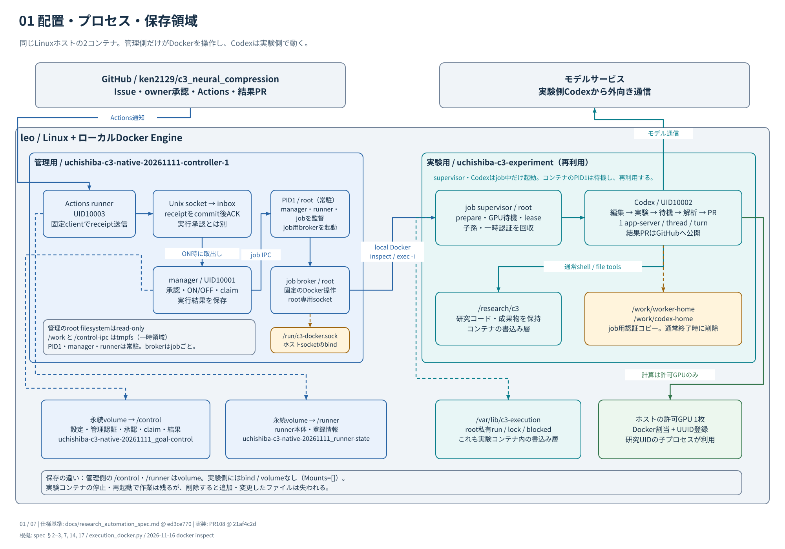
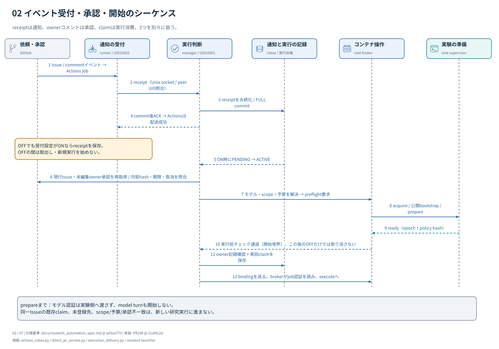
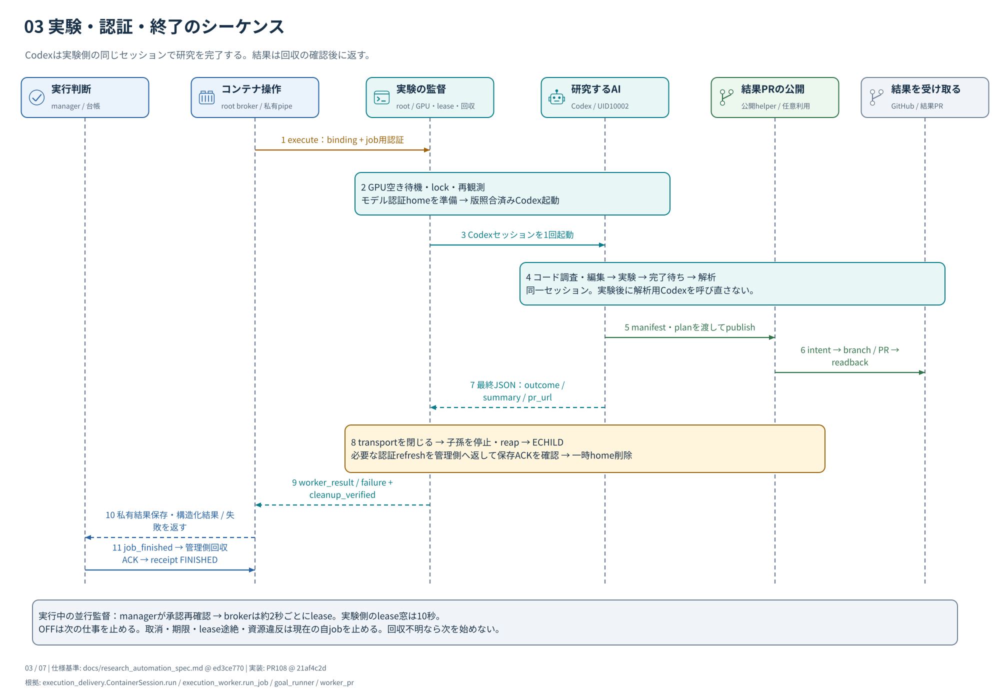
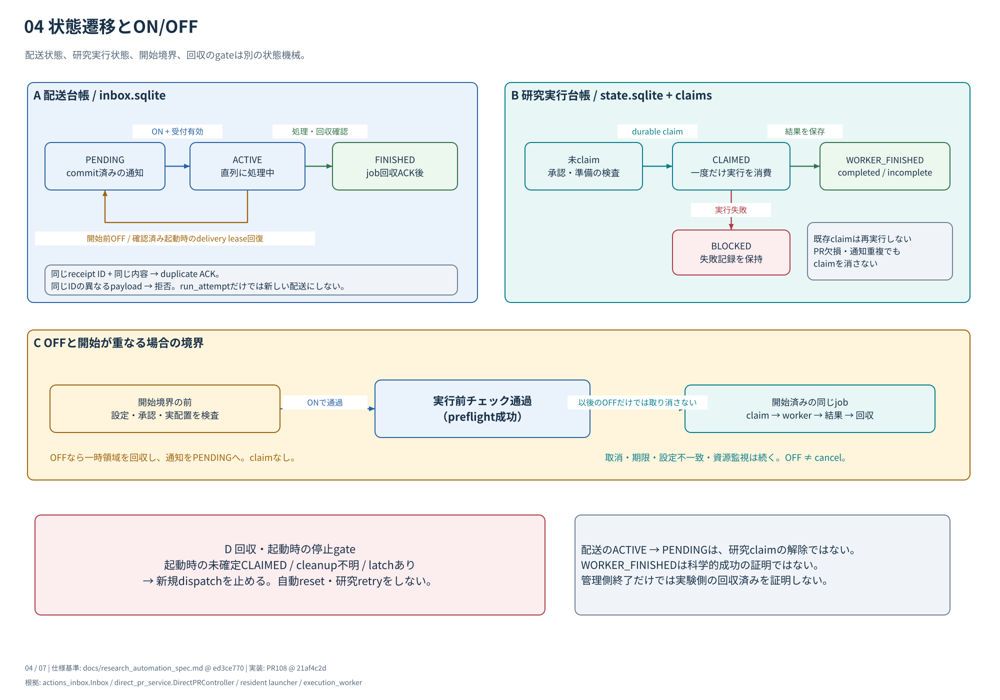
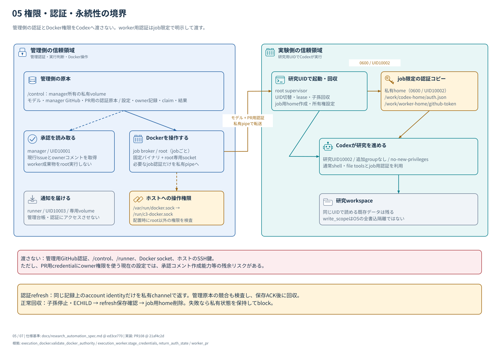
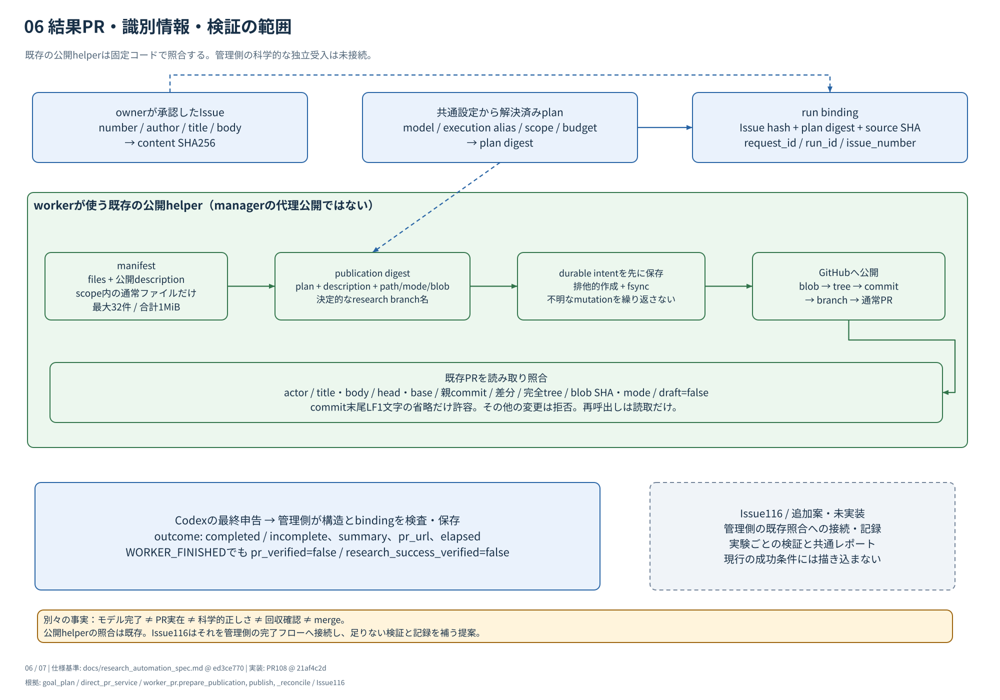
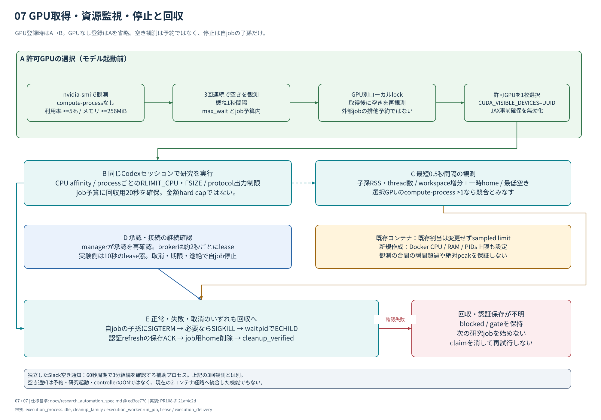

# 研究自動化システム 詳細図

[詳細仕様](research_automation_spec.md)の現行主経路を、編集可能なdraw.ioの7ページとSVGで示す。
対象は、同じLinuxホスト上の管理用コンテナと、`execution_container`で指定した実験用コンテナ。
互換CPU経路や過去のcanaryは図の対象外とし、実装済みの構成と未実装の追加案を区別する。

**[編集用draw.ioファイルを開く](diagrams/research_automation/research_automation.drawio)**

GitHubのファイルページからDownload rawで保存し、draw.io / diagrams.netの
「ファイル → 開く → デバイス」から開くと、7ページを個別に編集できる。
図形・テキスト・接続線を持つ非圧縮XMLであり、画像だけを貼り付けたファイルではない。
ブラウザーへの接続は図の生成に必要ない。以下のSVGは同じXMLのセル・座標・ラベルから生成したプレビュー。
SVGのリンク先を開くと拡大して読める。

## 図の一覧と基準

| ページ | 内容 | 対応する仕様 |
| --- | --- | --- |
| [01 配置・保存領域](diagrams/research_automation/01-deployment.svg) | ホスト、2コンテナ、UID、Docker socket、volumeと書込み層 | 第2・3・7・14・17節 |
| [02 受付・承認・開始](diagrams/research_automation/02-admission.svg) | receiptのcommit/ACK、owner検証、prepare、開始境界、claim | 第4・5・6・8・11節 |
| [03 実験・認証・終了](diagrams/research_automation/03-execution.svg) | 単一Codexセッション、公開、lease、認証refresh、回収、結果返却 | 第4・9・11・12・13節 |
| [04 状態遷移・ON/OFF](diagrams/research_automation/04-states.svg) | inboxと研究台帳、開始前OFFと開始済みjob、停止gate | 第8・12・15節 |
| [05 権限・認証](diagrams/research_automation/05-permissions.svg) | root/manager/runner/研究UID、原本とコピー、権限の残る範囲 | 第3・7・12・14節 |
| [06 結果PR・検証](diagrams/research_automation/06-publication.svg) | Issue/plan/binding、publication intent、既存照合、未実装の接続案 | 第6・13・17・18節 |
| [07 GPU・資源・停止](diagrams/research_automation/07-resources.svg) | GPU観測・lock、各上限、lease、子孫回収、block | 第10・11・12・15・18節 |

- 仕様の基準は`docs/research_automation_spec.md`の公開版`ed3ce770`、実装はPR #108の`21af4c2d`。
- コンテナ名・workspace・割当はleoの配置例。Docker mountの種類は2026-11-16の実inspectでも確認した。
- 管理image/runtime更新の手順は本文第16節と実機記録を参照する。この図だけを更新・実行の承認にはしない。
- 新しい成果物検証の接続は[Issue116](https://github.com/ken2129/c3_neural_compression/issues/116)の提案。図06では「未実装」の灰色破線枠に置き、現行フローに接続していない。

色は、青＝管理・承認、青緑＝実験・回収、緑＝GPU・公開、黄＝認証・注意、赤＝停止、灰＝補助・配置条件を示す。
実線は処理・通信の方向、破線は返答・状態/データの参照等を表し、具体的な意味は各ラベルに従う。
シーケンス図の縦破線はlifelineであり、別の常駐コンテナを表すものではない。

## 01 配置・プロセス・保存領域

管理のPID1、manager、runnerは常駐し、job用brokerは仕事ごとに起動する。
実験側のsupervisorとCodexもjob用のプロセスで、実験コンテナ自体は再利用する。
図の枠はホスト・コンテナ・保存先を分けており、追加のrunnerコンテナを示していない。

管理側はDockerのnamed volumeを2つ持つ。実験側のworkspace・root私有記録は、現在はvolumeではなく
コンテナの書込み層である。両者の永続性は異なる。

| ホスト側 | 管理コンテナ内 | 種類 |
| --- | --- | --- |
| `/var/lib/docker/volumes/uchishiba-c3-native-20261111_goal-control/_data` | `/control` | Docker volume |
| `/var/lib/docker/volumes/uchishiba-c3-native-20261111_runner-state/_data` | `/runner` | Docker volume |
| `/var/run/docker.sock` | `/run/c3-docker.sock` | bind。固定root brokerだけが利用 |
| ホストの通常フォルダとの共有なし | `/work`、`/control-ipc` | 管理側の一時tmpfs |

実験側は`Mounts: []`、`Binds: null`、`Config.Volumes: null`を確認した。
追加・変更した研究ファイルはコンテナ削除時に失われる。停止・再起動だけでは削除されない。
Docker自身の保存先はホストの`/var/lib/docker/overlay2/`配下で、ユーザーの作業フォルダのbind mountではない。

主な根拠：
[Docker操作と配置検査](../research_harness/execution_docker.py)、
[PID1とjob監督](../tools/research_resident/launcher.py)、
[実験側起動・回収](../research_harness/execution_worker.py)。

## 02 イベント受付・承認・開始

receiptは固定形式の通知であり、owner承認そのものではない。
Actionsの配送成功は、SQLiteのcommit後ACKを受けたことを示す。
managerが現在のIssueと未編集ownerコメントを再取得し、内容hash・期限・取消を確認して初めて次へ進む。

prepareでは実コンテナ・固定input・公開bootstrap・epoch/policyを確認する。
モデル認証はまだ渡さず、Codexの本番turnも開始しない。実行前チェックを通過したjobを一度だけclaimした後、executeへ進む。
図のroot broker欄は、管理PID1経由で起動するjob用監督コードをまとめて示す。配置上のプロセス区分は図01を参照する。

主な根拠：
[receipt/inbox](../research_harness/actions_inbox.py)、
[owner検証](../research_harness/owner_approval.py)、
[単回dispatch](../research_harness/direct_pr_service.py)、
[prepare/execute](../research_harness/execution_delivery.py)。

## 03 実験・認証・終了

この図は正常に結果を返す場合の主要順序。Codexが必ず公開helperを呼ぶことをハーネスが保証するものではない。
helperはworkerが利用できる固定プログラムであり、Codexは同じthread/turnで研究とPR作成を担当する。
モデルサービスへの通信と、Codexの通常toolsによる科学コードの実行は、実験側で行われる。

実行中の承認再確認とleaseは、研究処理に並行して続く。単なるOFFでは現在のjobを取り消さない。
終了時は、子孫停止・ECHILD、必要な同一account認証refreshの保存ACK、一時home削除を経て結果を返す。
回収が不明な分岐は正常なworker_resultへ流さず、図04・07の停止gateに進む。

主な根拠：
[実験側の処理順序](../research_harness/execution_worker.py)、
[管理側のlease・結果保存](../research_harness/execution_delivery.py)、
[単一sessionとprompt](../research_harness/goal_runner.py)。

## 04 状態遷移とON/OFF

inboxは配送の状態、state.sqliteとclaim witnessは研究実行の状態。
配送のACTIVEをPENDINGへ戻す操作は、研究のclaimを消すこととは違う。
起動時の未確定CLAIMEDがある場合は、通常のinbox lease回復へ進まずgateを立てる。

開始の境界はpreflightを通過した時点であり、claim保存の瞬間だけでOFFの扱いを分けない。
境界より前ならpauseとして回収し、claimを作らず待機へ戻す。
境界を越えた同じjobは、OFF後も承認・取消・期限・資源の検査を続けて処理する。
WORKER_FINISHEDはcompletedとincompleteの両方を保持でき、科学的成功の証明ではない。

主な根拠：
[配送状態](../research_harness/actions_inbox.py)、
[実行状態](../research_harness/service_state.py)、
[OFFの開始境界](../tools/research_resident/launcher.py)、
[開始境界の試験](../tests/test_harness_resident_admission_switch.py)。

## 05 権限・認証・永続性の境界

認証原本は管理側の私有volumeに置き、job用のモデル・PR認証コピーだけを実験側へ渡す。
manager用GitHub認証、Docker socket、管理volumeをCodexへ渡す図ではない。
root brokerが認証を読むときはmanager UIDへの切替と保護されたファイル読取を行う。

Codexには承認済みの認証コピーを読む能力と外向き通信があり、その残余リスクは残る。
ownerのPR credentialを使う選択や、同一研究UIDで読める既存データまで完全隔離したと誤解しない。
図の認証refreshはモデルの記録上の同一identityと管理原本の競合を照合するもので、独自のJWT署名検証ではない。

主な根拠：
[Docker権限の検査](../research_harness/execution_docker.py)、
[認証stage/refresh/削除](../research_harness/execution_worker.py)、
[管理原本の保存ACK](../research_harness/execution_delivery.py)、
[worker認証の設定](../research_harness/worker_pr.py)。

## 06 結果PR・識別情報・検証の範囲

Issue hash、解決済みplan digest、run binding、publication digestは別の識別情報。
モデル名は共通profileから解決し、その具体値を含むplanがclaimと結果に結び付く。
公開helperは、内容を固定するintentをremote mutation前に保存し、実PRを固定コードで照合する。
同じintentでの再呼出しは読み取り照合であり、新たな研究・branch・PR作成を繰り返さない。

このPR照合は既存機能。現行managerはworker結果の構造とbindingを保存するが、
pr_verifiedやresearch_success_verifiedを自動でtrueにする独立した受入処理は未接続である。
Issue116の灰色破線枠は今後の接続・検証・記録の提案で、現在の成功経路に含めていない。

主な根拠：
[planの解決](../research_harness/goal_plan.py)、
[worker結果の扱い](../research_harness/direct_pr_service.py)、
[既存の公開と照合](../research_harness/worker_pr.py)。

## 07 GPU・資源監視・停止と回収

空きの3回観測・ローカルlock・再観測は、別コンテナや他の管理系を含むホスト全体の予約ではない。
競合を観測したら自jobを止める。他者jobを停止する処理は設けない。
既存コンテナでのsampled limitと、新規作成時にも設定するDocker上限を区別する。

回収は元のprocess groupの消滅だけではなく、subreaper・pidfd・ECHILDで確認する。
認証保存ACKやhome削除が不明な場合も次の仕事へ進めない。
独立したSlack通知の「3分継続」と、job取得時の「3回観測」は別の処理である。

主な根拠：
[GPU観測・子孫回収](../research_harness/execution_process.py)、
[lease・資源検査](../research_harness/execution_worker.py)、
[作成時のDocker上限](../research_harness/execution_docker.py)。

## 編集と確認

1. draw.ioファイルの該当ページを編集する。図形の文字だけでなく、矢印の向き、開始境界、回収順序も実装と照合する。
2. 対応するSVGを更新し、文字切れ・矢印が無関係なboxを横切る箇所・未実装案との混同を確認する。
3. 仕様書の節・対応するコード・観測日が変わる場合は、この索引と図の根拠も更新する。

今回の確認は、XMLのpage/ID/parent/接続先、描画範囲、文字の収まり、SVG・画像プレビュー、仕様/コードとの対応。
draw.ioデスクトップアプリ内での最終表示はこの環境では確認していない。SVGは同じXMLをオフライン描画したもので、
エディター固有のfontや描画差があり得る。新しいモデル・GPU実験や稼働環境の変更は行っていない。
