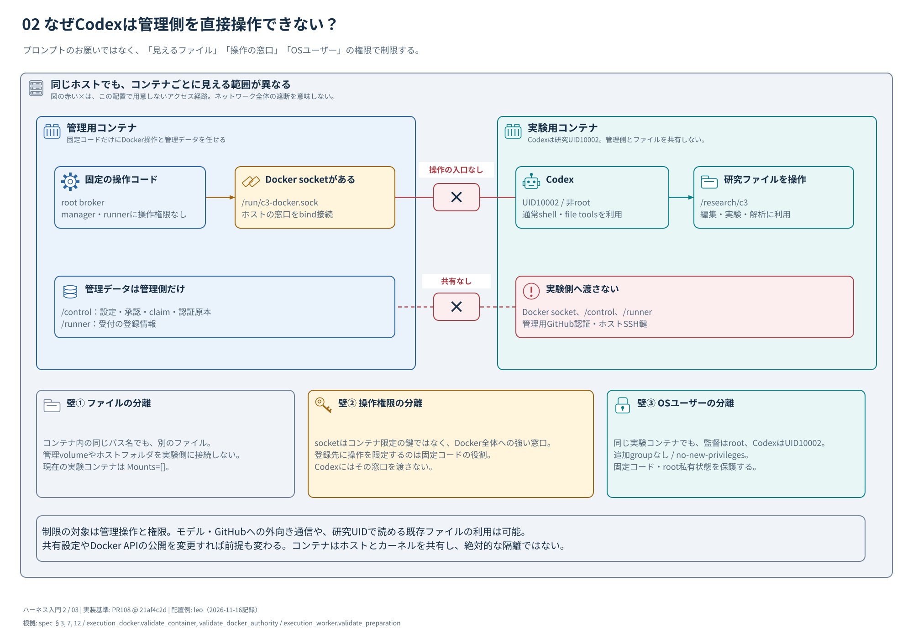

# 図で理解する研究自動化のハーネス

**研究の手順はCodexが選び、開始・権限・継続・後始末は固定プログラムが管理する。**
この固定プログラムのまとまりを「ハーネス」と呼ぶ。管理用コンテナと実験用コンテナの両方に存在する。

DockerやOSの権限に詳しくなくても読めるよう、現在の構成を3枚に絞って説明する。
実装基準は[詳細仕様](research_automation_spec.md)と同じPR #108の`21af4c2d`。
ホスト名や配置はleoの2026-11-16の確認記録を例にしており、最新の実機状態を再確認した記録ではない。

**[編集用draw.io：ハーネス入門・全3ページ](diagrams/research_harness/research_harness.drawio)**

GitHubのDownload rawで保存し、draw.io / diagrams.netの「ファイル → 開く → デバイス」で開ける。
アイコン・見出し・説明・接続線は編集可能なベクター。以下のSVGは同じdraw.io XMLから作成したプレビューで、
リンク先を開くと拡大できる。全体の詳細は[詳細図・全7ページ](research_automation_diagrams.md)を参照する。

## 最初に押さえる言葉

| 言葉 | このシステムでは何か |
| --- | --- |
| ホスト | コンテナを動かす実際のLinuxマシン。配置例ではleo |
| コンテナ | 同じホストの中で、見えるファイルやプロセスなどを分けてプログラムを動かす環境。別の物理マシンではなく、ホストのカーネルを共有する |
| プロセス | 実行中のプログラム。1つのコンテナの中に複数存在できる |
| Docker Engine / dockerd | ホスト上でコンテナを作成・起動・操作するプログラム |
| Docker CLI / `docker`コマンド | Engineに操作を依頼するクライアント。コマンドが入っていることと、Engineを操作する権限があることは別 |
| Docker socket | Engineへ操作を依頼するための、ファイルシステム上に名前を持つ通信口（Unix socket）。ソースコードや設定を書き込む普通のファイルではない |
| mount / マウント | 外のファイルや保存領域を、コンテナ内のパスから利用できるように接続すること。接続した対象だけが共有される |
| UID / root | プロセスのOSユーザーを表す番号 / 強い権限を持つユーザー。実験側の監督はroot、Codexは非rootのUID10002 |
| ハーネス | 承認・準備・起動・監視・回収を行う固定コードの総称。Codexのプロンプトとは別 |

コンテナの分離、カーネルの共有、Docker操作権限の強さについては
[Docker公式のセキュリティ説明](https://docs.docker.com/engine/security/)も参照できる。
Engineは通常、ローカルのUnix socketで要求を受ける。
[Docker公式：daemonへの接続](https://docs.docker.com/engine/daemon/remote-access/)

## 図01：ハーネスはどこにあり、どうCodexを起動するか

管理側の`manager`がIssue・承認・設定を確認し、`broker`が登録先に対するDocker操作を担当する。
実験側の`supervisor`は固定コードであり、Codexを研究用UIDで起動し、資源と子プロセスを監督する。
ロボットのアイコンだけがCodexで、他のハーネスの判断にモデルを呼ぶ構成ではない。

操作の入口は、次の1つのsocketを管理側に接続したもの。

| 見る場所 | socketのパス | 意味 |
| --- | --- | --- |
| ホスト | `/var/run/docker.sock` | ホストのDocker Engineへの窓口 |
| 管理コンテナ | `/run/c3-docker.sock` | 上記をbind mountした別名。同じEngineに接続する |
| 実験コンテナ | 接続しない | CodexへDocker操作の窓口を渡さない |

brokerはこの窓口を通じてEngineに依頼し、Engineが指定した実験コンテナで`supervisor`を起動する。
その先でCodexが起動する。実験コンテナから管理コンテナへSSHして仕事を受け取る仕組みではない。
現在のコンテナ間の制御通信は、ローカルの`docker exec -i`を介した標準入出力で行う。

図01は起動要求の順番を示す。実行中の通信は双方向で、継続確認、結果、認証refreshと保存ACKも往復する。
標準入出力の内容は任意の管理コマンドではなく、固定プログラムが形式と順序を確認する制御メッセージである。

根拠：
[Docker操作・登録先検査](../research_harness/execution_docker.py)、
[起動と制御通信](../research_harness/execution_delivery.py)、
[実験側の固定監督コード](../research_harness/execution_worker.py)。

## 図02：なぜCodexは管理側を直接操作できないか

同じホストにコンテナが2つあっても、隣のコンテナのファイルが自動で共有されるわけではない。
たとえばCodexが実験側で`/control`という名前のフォルダを作っても、それは管理側の`/control`とは別物である。
管理volumeを実験側へマウントしていないため、名前を合わせても管理設定や認証原本には届かない。

Docker socketも同様に、実験側には接続していない。`docker`コマンドを追加するだけではこの窓口を利用できない。
管理側では、socketと固定Dockerバイナリの所有者・アクセス権を検査し、runnerやmanager UIDへ操作権限を渡さない。
実験側では、配置検査に加え、prepare時にも既知のDocker socketのパスが存在すれば拒否する。

**socket自体には「この実験コンテナだけ」という制限はない。**
Docker全体とホストへ強い影響を及ぼせる窓口であり、brokerは信頼するコードに含まれる。
許可された登録先を選び、名前・ID・危険なmount・権限設定などを検査し、以後の操作を確定したIDに向けるのは
ハーネスの責任である。Codexにsocketを渡してからプロンプトで操作先を指定する設計ではない。

| Codexが行う操作 | 現在の扱い | 境界を設ける方法 |
| --- | --- | --- |
| 研究コードを編集し、実験を起動する | 可能 | 実験側の通常shell/file toolsを研究UIDで利用 |
| モデル・GitHubへ外向きに通信する | 可能 | job用のモデル・PR認証コピーを渡す |
| 管理設定や承認台帳のファイルを直接書き換える | 経路を渡さない | 管理volumeを実験側に共有しない |
| Docker経由で管理側や別コンテナのコマンドを実行する | 経路を渡さない | 実験側にDocker socketを渡さない |
| 実験側のroot監督コードやroot私有記録を書き換える | OS権限で制限 | CodexはUID10002、追加groupなし、`no-new-privileges`。コードや状態の所有者・書込権限を保護 |

この境界はネットワーク全体の遮断を意味しない。また、同じ研究UIDで読める既存ファイルはCodexからも読める。
`write_scope`は公開対象などを検査する契約であり、OS上の全ファイル操作をそのディレクトリだけに閉じ込めるものではない。
PR用credentialにowner権限を使う現在の設定では、GitHub上の承認コメント作成能力なども残るため、
「管理コンテナへ直接入れない」と「管理に関係する外部情報へ一切影響できない」は同じ意味ではない。

図の前提は、登録先の配置・権限検査に通ること。コンテナはホストとカーネルを共有し、絶対的な隔離を保証しない。
socket共有、危険なmount、Docker APIのネットワーク公開などを変更すれば、アクセス経路も変わり得る。
この説明はそれらを変更する提案ではない。

根拠：
[配置とDocker権限の検査](../research_harness/execution_docker.py)、
[prepare・UID切替・job認証](../research_harness/execution_worker.py)、
[研究UIDの確認](../research_harness/goal_runtime.py)。

## 図03：実験中もハーネスは何をしているか

図03のカードは段階ごとの役割を示す。②④⑤は同じsupervisorの処理であり、監視専用の別コンテナや別supervisorを追加する意味ではない。
Codexは同じセッションで編集・実験・完了待ち・解析・PR作成を進める。
実験が始まったあとも、ハーネスは次の確認を並行して続ける。

| タイミング | 固定プログラムの役割 |
| --- | --- |
| 開始前 | 承認、ON/OFF、登録先、予算、実配置を検査。単回claim。GPU登録時は空きを確認して起動 |
| 実験中 | 承認・取消・期限を再確認。brokerが約2秒ごとにleaseを送り、実験側は10秒の窓で継続を確認。資源も観測 |
| 停止が必要なとき | 取消・期限・lease途絶・資源違反などで自jobを停止。他者の実験を停止しない。単なるOFFは次の仕事を止める |
| 終了時 | 正常・失敗・取消のいずれも、子孫を停止・回収。必要な認証refreshの保存ACK後に一時homeを削除 |
| 確認不能のとき | blocked / gateを保持し、次の研究を始めない。claimを消して自動再試行しない |

ここでの後始末は、自jobの子孫と一時認証の回収を指す。研究workspaceや実験コンテナを毎回消すことではない。
現在の実験workspaceはコンテナの書込み層にあり、停止・再起動では残るが、コンテナを削除すれば追加・変更した内容は失われる。

ハーネスが確認する実行の完了と、研究結果の科学的な正しさは別の事実である。
既存の公開helperにはPRの固定コード照合があるが、現行managerの科学的な独立受入は未接続。
詳しくは[詳細図06：結果PR・検証](research_automation_diagrams.md#06-結果pr識別情報検証の範囲)を参照する。

根拠：
[承認・単回実行](../research_harness/direct_pr_service.py)、
[leaseと結果の往復](../research_harness/execution_delivery.py)、
[資源監視と終了順序](../research_harness/execution_worker.py)、
[自jobの子孫回収](../research_harness/execution_process.py)。

## 図の確認と更新

図の矢印は各ページの説明に従う。図02の赤い×は用意しない経路、図03の破線は継続確認・監視・結果返却を表す。
細かい常駐プロセス、受付のUnix socket、認証refreshの往復、全状態遷移は[詳細図](research_automation_diagrams.md)に分けている。
Docker socketと受付用Unix socketは別の窓口であり、受付用socketに通知を届けてもDocker操作権限は得られない。

draw.io XMLのID・親子・接続先・座標、SVGとのラベル一致、文字の収まりと画像プレビューを確認する。
draw.ioデスクトップアプリ内の表示は未確認で、SVGは同じXMLのオフライン描画。fontやエディター固有の描画差はあり得る。
この追加は説明資料のみであり、稼働環境・コンテナ・GPU・権限設定は変更しない。
