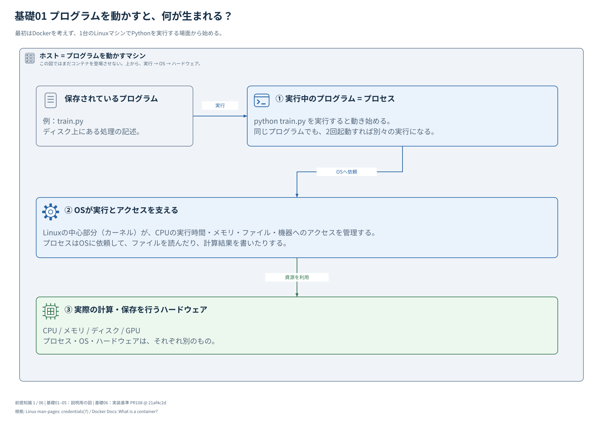
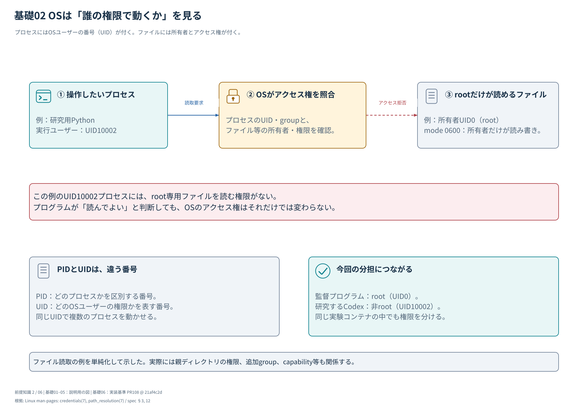
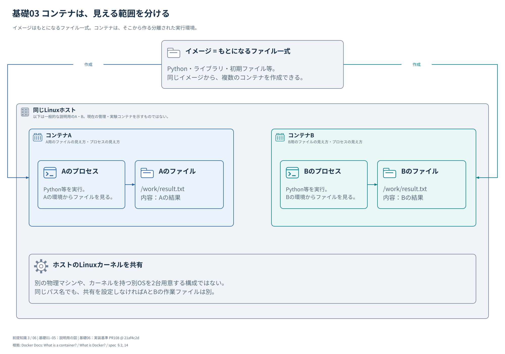
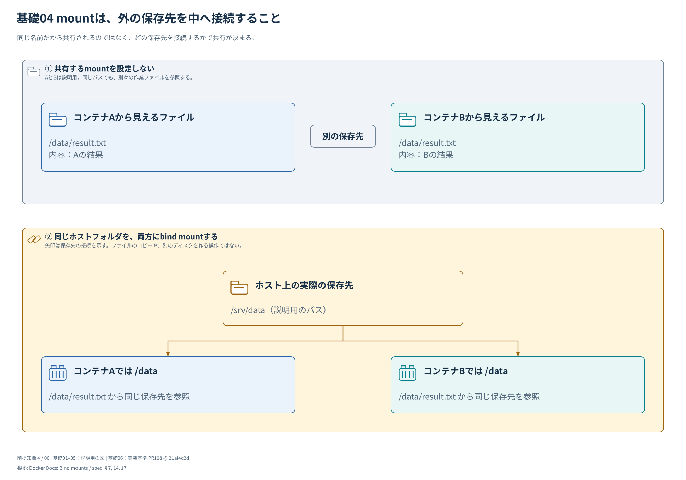
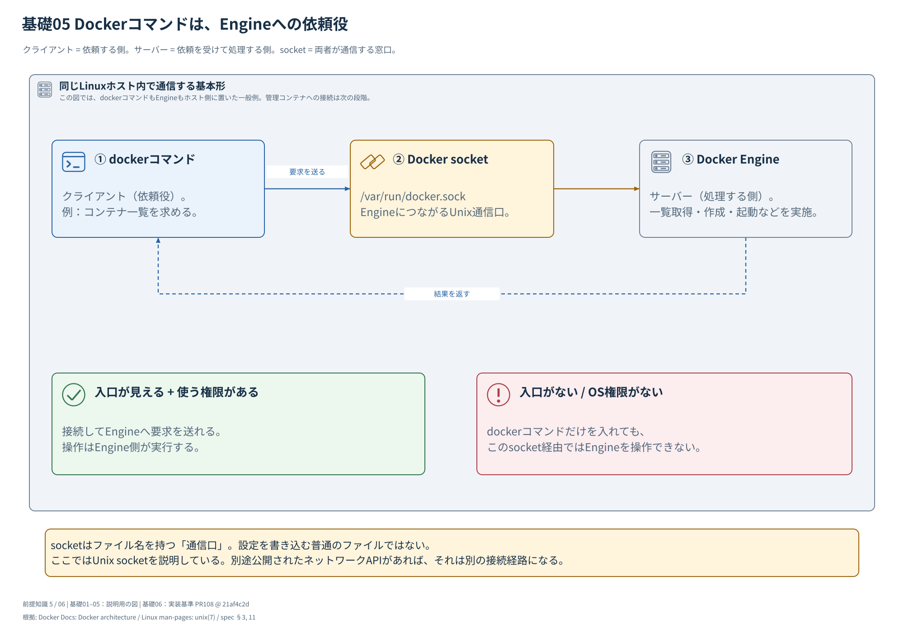
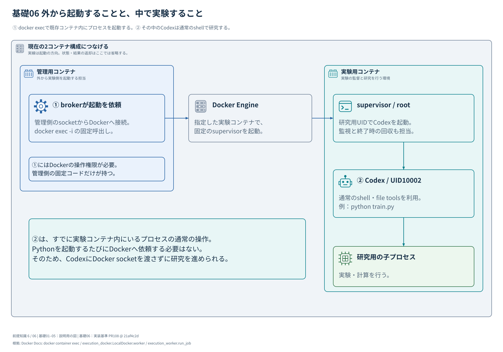
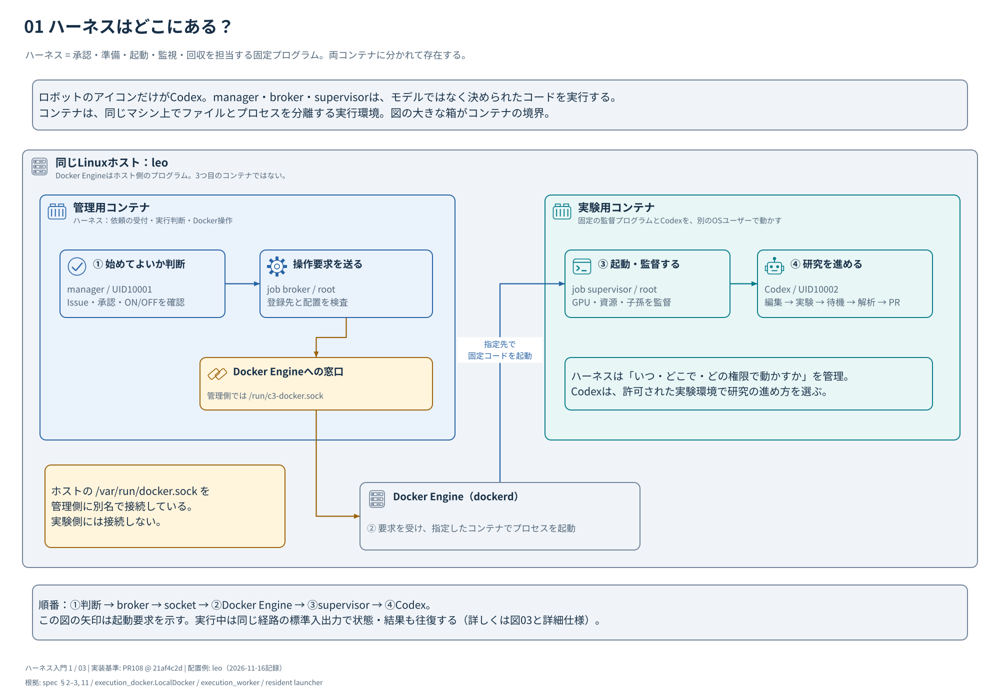
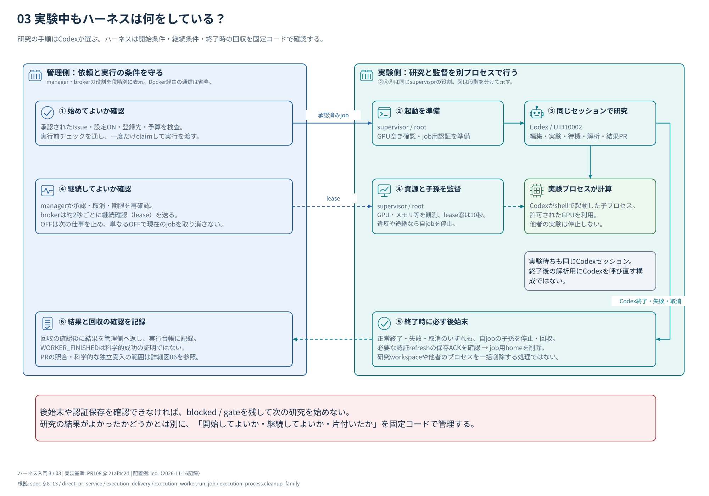

# 図で理解する研究自動化のハーネス

最初はDockerを登場させず、1台のLinuxマシンでPythonを動かすところから始める。
「実行中のプログラム」「誰の権限で動くか」「見えるファイル」「操作を依頼する窓口」を順に理解し、
最後に現在の研究自動化システムへ当てはめる。前提知識6枚と、現在の構成3枚の図を用いる。

実装基準は[詳細仕様](research_automation_spec.md)と同じPR #108の`21af4c2d`。
ホスト名や配置はleoの2026-11-16の確認記録を例にしており、最新の実機状態を再確認した記録ではない。
前提1〜5のA・Bやパスは、概念を説明するための例。前提6から実際の構成につなげる。

## 読む順番

| 順番 | この段階で理解すること |
| --- | --- |
| [前提1：プログラムとプロセス](#前提1プログラムを動かすとは) | Pythonを動かすと何が生まれ、OSは何をするか |
| [前提2：ユーザーと権限](#前提2誰の権限で動くかをosが確認する) | プログラムにできることを、誰が制限するか |
| [前提3：コンテナとイメージ](#前提3コンテナは見える範囲を分ける) | 同じマシンの中で、環境をどう分けるか |
| [前提4：ファイルの共有とmount](#前提4mountで外の保存先を中へ接続する) | 別環境のファイルが見えるのはどんなときか |
| [前提5：Docker Engineとsocket](#前提5dockerコマンドはengineへ依頼する) | Docker操作の窓口とは何か、なぜ強い権限なのか |
| [前提6：外からの起動と中での実験](#前提6docker-execとコンテナ内の通常コマンドを分ける) | Docker権限がないCodexが、どう実験を動かせるか |
| [構成図01：ハーネスの配置](#図01ハーネスはどこにありどうcodexを起動するか) | 管理側と実験側に、固定コードをどう置くか |
| [構成図02：管理側を操作できない理由](#図02なぜcodexは管理側を直接操作できないか) | 前提知識を現在の権限設計に当てはめる |
| [構成図03：実験中の監督](#図03実験中もハーネスは何をしているか) | 開始後も何を監視し、どう後始末するか |

編集用ファイル：
[前提知識・全6ページ](diagrams/research_harness/basics/research_harness_basics.drawio)、
[現在の構成・全3ページ](diagrams/research_harness/research_harness.drawio)。

GitHubのDownload rawで保存し、draw.io / diagrams.netの「ファイル → 開く → デバイス」で開ける。
アイコン・見出し・説明・接続線は編集可能なベクター。以下のSVGは同じdraw.io XMLから作成したプレビューで、
リンク先を開くと拡大できる。全体の詳細は[詳細図・全7ページ](research_automation_diagrams.md)を参照する。

## 前提1：プログラムを動かすとは

**疑問：`python train.py`を実行すると、マシンの中で何が起きるのか。**

`train.py`は、処理を書いて保存したファイルである。それをPythonで実行すると、実行中のプログラムである
「プロセス」が動き始める。OSは、それぞれのプロセスにCPUの実行時間やメモリを割り当て、
ファイルや機器へのアクセスを仲介する。Linuxの中心部分を「カーネル」と呼ぶ。

| 区別するもの | 例 |
| --- | --- |
| プログラム・コード | 保存してあるPython実行ファイルや`train.py` |
| プロセス | Pythonで実験を実行している、その1回の実行 |
| OS・カーネル | プロセスの実行や資源へのアクセスを支えるLinux |
| ハードウェア | CPU・メモリ・ディスク・GPU |

同じ`train.py`を2回起動すれば、同じ処理を書いたファイルから別々の実行が生まれる。
今回のCodex、実験用Python、監督プログラムも、それぞれ実行中はプロセスとして動く。
1つのマシンや、後で説明する1つのコンテナの中で、複数のプロセスが同時に動くことができる。

**次の疑問：同じマシンで動くなら、どのプロセスも全ファイルを操作できるのか。**
その区別に使うのが、次のOSユーザーとアクセス権である。
プロセスを識別する番号については[Linux manual：credentials(7)](https://man7.org/linux/man-pages/man7/credentials.7.html)を参照。

## 前提2：誰の権限で動くかをOSが確認する

**疑問：プログラムがファイルを読もうとしたら、必ず読めるのか。**

プロセスには「どのOSユーザーの権限で動くか」という情報が付く。ユーザーを表す番号が`UID`である。
ファイルには所有者と、誰が読む・書く・実行することを許されるかというアクセス権が付く。
プロセスがアクセスすると、OSがこれらを照合する。

たとえば、所有者がroot（UID0）で、所有者だけが読み書きできる`0600`のファイルがあるとする。
通常のUID10002のプロセスが読もうとしても、必要な権限がなければOSが拒否する。
プログラムの中に「このファイルを読んでよい」と書いても、OSのユーザーや権限は変わらない。

ここでのrootは、強い操作権限を持つOSユーザーを指す。ディレクトリ階層の先頭を表す`/`もrootと呼ぶが、
それはパスについての別の用法である。また、`PID`はプロセスを識別する番号、`UID`は実行ユーザーを表す番号で、役割が違う。

図は通常のファイル読取を単純化した例である。実際にはgroup、親ディレクトリのアクセス権、
細分化された特権（capability）なども関係する。
[Linux manual：credentials(7)](https://man7.org/linux/man-pages/man7/credentials.7.html)

**今回への接続：** 実験の監督はroot、研究するCodexは非rootのUID10002で動かす。
このように、同じ環境内でも、実行する役割によってOSユーザーを分けられる。
では、その環境そのものを分ける「コンテナ」は何だろうか。

## 前提3：コンテナは見える範囲を分ける

**疑問：同じホストで複数の研究環境を動かすと、ファイルやプロセスは混ざらないのか。**

コンテナは、ファイルやプロセスなどの見える範囲を分けて、プログラムを動かす環境である。
そのコンテナを動かすマシンを「ホスト」と呼ぶ。この資料のホストはLinuxマシンのleoである。
複数のコンテナはホストのLinuxカーネルを共有する。
[Docker公式：コンテナとは](https://docs.docker.com/get-started/docker-concepts/the-basics/what-is-a-container/)

「コンテナAの中でPythonを起動する」とは、Aのファイルやプロセスの見え方の中で、Pythonのプロセスを動かすこと。
Aの中から`/work/result.txt`と指定した場合と、Bの中から同じパスを指定した場合では、
共有を設定していなければ別々の作業ファイルを参照する。

コンテナを作るもとになるファイル一式が「イメージ」である。Pythonやライブラリなどの初期状態を含められる。
同じイメージからAとBを作っても、Aに加えたファイル変更が自動でBにも反映されるわけではない。
コンテナごとに、イメージの上へ変更を記録する書込み層がある。
[Docker公式：イメージとコンテナ](https://docs.docker.com/get-started/docker-overview/#docker-objects)

| 操作 | 何が起きるか |
| --- | --- |
| イメージからコンテナを作る | 初期ファイルと分離された環境を用意する。作成と起動は別の操作 |
| コンテナを起動する | その環境でメインプロセスが動き始める |
| 起動済みコンテナで別の処理を動かす | 同じ環境内に追加のプロセスを起動する。新しいコンテナを作る意味ではない |
| コンテナを停止する | 動いているプロセスが止まる。コンテナのファイル変更は残る |
| コンテナを削除する | そのコンテナ固有の書込み層も失われる。別管理のvolumeやbind mountの保存先は別に扱う |

この分離は、別の物理マシンを用意することや、完全な安全性を保証することとは異なる。
コンテナ内のrootも、コンテナ設定やcapabilityなどによる制限を受ける。
ネットワーク通信やファイル共有を設定できるため、何を接続するかで到達できる範囲も変わる。
次は、ファイルを共有する接続を説明する。

## 前提4：mountで外の保存先を中へ接続する

**疑問：分離したコンテナから、同じデータを使いたい場合はどうするのか。**

「パス」は、プロセスから見えるファイルやフォルダの位置を表す名前である。
`/data/result.txt`という文字列だけでは、どの環境の、どの実体に届くのかまでは決まらない。
外の保存先をコンテナ内のパスへ接続する設定を、mount（マウント）と呼ぶ。

図の下段では、ホストの`/srv/data`を、AとBそれぞれの`/data`にbind mountしている。
この場合、AとBの`/data/result.txt`は同じ保存先を参照する。
コピーを2つ作る操作ではないので、書込み可能な設定とOS権限があれば、片方の変更は同じ保存先を読む他方からも見える。
読取専用（read-only）のmountにすれば、その接続先への書込みを制限できる。
[Docker公式：bind mount](https://docs.docker.com/engine/storage/bind-mounts/)

この資料では、次の2種類を区別する。

| 種類 | 接続するもの | 今回の例 |
| --- | --- | --- |
| bind mount | ホストの既存ファイル・フォルダ | ホストのDocker socketを管理コンテナへ接続 |
| named volume | Dockerが管理する保存領域 | 管理側の`/control`と`/runner` |

bind mountの「ホスト」は、Docker Engineが動く側のマシンを指す。
MacからleoのDockerを操作する場合、接続元Macのフォルダが自動で共有されるわけではない。
[Docker公式：bind mountの接続先](https://docs.docker.com/engine/storage/bind-mounts/#considerations-and-constraints)

**今回への接続：** 管理側の`/control`を実験側へmountしていないため、Codexから管理側のその保存先は見えない。
現在の実験コンテナは`Mounts=[]`という配置記録で、研究ファイルはコンテナの書込み層にある。
一方、管理側へ接続するDocker socketは、データ保存先とは異なる用途を持つ。次でその中身を説明する。

## 前提5：dockerコマンドはEngineへ依頼する

**疑問：`docker ps`を打つと、dockerコマンド自身が全コンテナを調べるのか。**

Dockerは、操作を依頼するプログラムと、要求を受けて実際にコンテナを操作するプログラムに分かれている。
依頼側を「クライアント」、受けて処理する側を「サーバー」と呼ぶ。ここでいうサーバーは、プログラムの役割である。
別の物理マシンを必ず用意する意味ではない。

| 役割 | Dockerでは何か | `docker ps`の場合 |
| --- | --- | --- |
| クライアント | Docker CLI：`docker`コマンド | 「コンテナ一覧がほしい」と要求する |
| 通信の窓口 | Docker socket | クライアントとEngineの通信をつなぐ |
| サーバー | Docker Engine：`dockerd` | 一覧を取得して結果を返す |

この分担は[Docker公式：アーキテクチャ](https://docs.docker.com/get-started/docker-overview/#docker-architecture)で説明されている。
同じLinuxホスト内で通信する場合、通常は`/var/run/docker.sock`というUnix socketを使う。
Unix socketは、同じマシンのプロセス同士が通信する仕組みで、ファイルシステム上のパスを持つものがある。
Docker socketのパスはその通信口の名前であり、通常の設定ファイルを編集するように中身を書き換えて操作するものではない。
[Linux manual：unix(7)](https://man7.org/linux/man-pages/man7/unix.7.html)

この窓口を使うには、プロセスから見える位置に接続されており、OSのアクセス権も許されている必要がある。
dockerコマンドだけをインストールしても、この窓口への接続権限がなければ、その経路でEngineを操作できない。
逆に、Dockerコマンドを入れなくても、APIを話せる別プログラムから同じ窓口へ接続できれば操作を依頼できる。
したがって、制限すべき対象は「dockerというコマンドの有無」だけではなく、窓口とそのアクセス権である。

**なぜsocketが重要なのか。** Engineはコンテナの作成・起動・内部でのコマンド実行・ホストファイルの共有設定などを扱う。
その操作権限は、通常の研究フォルダへの書込み権限より大きく、ホストへも強い影響を及ぼし得る。
socket自体には「この実験コンテナだけ」という制限はない。
[Docker公式：daemonの操作権限](https://docs.docker.com/engine/security/#docker-daemon-attack-surface)

図はローカルのUnix socketを使う場合である。SSH経由のDocker contextや、認証付きのネットワークAPIも別の接続方法として存在する。
socketがないことだけで、あらゆるネットワーク経由の管理経路まで否定しているわけではない。
[Docker公式：接続の保護](https://docs.docker.com/engine/security/protect-access/)

では、Docker socketを持たないCodexは、どうやって実験のPythonを起動するのだろうか。

## 前提6：docker execとコンテナ内の通常コマンドを分ける

**疑問：「コンテナの中でPythonを動かす」には、毎回Docker操作権限が必要なのか。**

ここからは、現在の管理用コンテナと実験用コンテナを使って説明する。
管理側で起動を依頼する固定プログラムを`broker`、実験側の監督プログラムを`supervisor`と呼ぶ。
混同しやすいのは、次の2つの操作である。

| 操作 | 何をするか | Docker操作権限 |
| --- | --- | --- |
| 外から`docker exec`で起動 | Engineに依頼して、起動済みの指定コンテナ内に新しいプロセスを作る | 依頼側に必要 |
| すでに中にいるプロセスがPythonを起動 | 自分がいる実験環境で、通常の子プロセスを作る | それだけのためには不要。OSの実行・ファイル権限等は必要 |

`docker exec`は「起動済みコンテナで追加のコマンドを実行する」操作である。新しいコンテナを毎回作る意味ではない。
[Docker公式：docker container exec](https://docs.docker.com/reference/cli/docker/container/exec/)

管理側の固定プログラムは、管理側にだけ接続したsocketを通してEngineへ依頼し、実験側の監督プログラムをrootで起動する。
監督プログラムがOSユーザーを研究UIDへ切り替えてCodexを起動し、Codexは通常のshellを通して実験用Pythonなどを動かす。
ここでいうshellは、コマンドを受け取ってプログラムを起動するプログラムである。
Codexが実験のたびに管理側へ「docker execしてほしい」と頼む構成ではない。

**ここまでの接続：** Codexに通常の研究作業を任せるために、Docker全体の操作権限まで渡す必要はない。
「実験環境の中でできること」と「環境そのものを操作する権限」を分けられる。
この分担を、開始から後始末まで固定コードで管理するのが、次のハーネスである。

根拠：
[固定のDocker呼出し](../research_harness/execution_docker.py)、
[研究UIDでの起動](../research_harness/execution_worker.py)。

## ここまでの知識を、現在のハーネスへ当てはめる

**研究の手順はCodexが選び、開始・権限・継続・後始末は固定プログラムが管理する。**
この固定プログラムのまとまりを「ハーネス」と呼ぶ。管理用コンテナと実験用コンテナの両方に存在する。
ここからの構成図01〜03を、前提知識と次のように対応させて読む。

| 前提知識 | 現在の構成での意味 |
| --- | --- |
| プロセス | manager、broker、supervisor、Codex、実験用Pythonはそれぞれ動くプログラム |
| OSユーザーと権限 | rootの監督と、非rootの研究UIDを分ける |
| コンテナ | 管理環境と研究環境の、見えるファイル・プロセスを分ける |
| mount | 管理の保存先やDocker socketを、実験側へ共有しない |
| Engineとsocket | Docker全体への操作権限を管理側の固定コードに限定する |
| 外からの起動と中の通常操作 | 管理側が実験側で監督コードを起動し、その中でCodexが研究を進める |

## 用語を確認したいとき

| 言葉 | このシステムでは何か |
| --- | --- |
| ホスト | コンテナを動かす実際のLinuxマシン。配置例ではleo |
| コンテナ | 同じホストの中で、見えるファイルやプロセスなどを分けてプログラムを動かす環境。別の物理マシンではなく、ホストのカーネルを共有する |
| プロセス | 実行中のプログラム。1つのコンテナの中に複数存在できる |
| Docker Engine / dockerd | ホスト上でコンテナを作成・起動・操作するプログラム |
| Docker CLI / `docker`コマンド | Engineに操作を依頼するクライアント。コマンドが入っていることと、Engineを操作する権限があることは別 |
| Docker socket | Engineへ操作を依頼するための、ファイルシステム上に名前を持つ通信口（Unix socket）。ソースコードや設定を書き込む普通のファイルではない |
| mount / マウント | 外のファイルや保存領域を、コンテナ内のパスから利用できるように接続すること。接続した対象だけが共有される |
| UID / root | プロセスのOSユーザーを表す番号 / 強い権限を持つユーザー。実験側の監督はroot、Codexは非rootのUID10002 |
| ハーネス | 承認・準備・起動・監視・回収を行う固定コードの総称。Codexのプロンプトとは別 |

## 図01：ハーネスはどこにあり、どうCodexを起動するか

管理側の`manager`がIssue・承認・設定を確認し、`broker`が登録先に対するDocker操作を担当する。
実験側の`supervisor`は固定コードであり、Codexを研究用UIDで起動し、資源と子プロセスを監督する。
ロボットのアイコンだけがCodexで、他のハーネスの判断にモデルを呼ぶ構成ではない。

操作の入口は、次の1つのsocketを管理側に接続したもの。

| 見る場所 | socketのパス | 意味 |
| --- | --- | --- |
| ホスト | `/var/run/docker.sock` | ホストのDocker Engineへの窓口 |
| 管理コンテナ | `/run/c3-docker.sock` | 上記をbind mountした別名。同じEngineに接続する |
| 実験コンテナ | 接続しない | CodexへDocker操作の窓口を渡さない |

brokerはこの窓口を通じてEngineに依頼し、Engineが指定した実験コンテナで`supervisor`を起動する。
その先でCodexが起動する。実験コンテナから管理コンテナへSSHして仕事を受け取る仕組みではない。
現在のコンテナ間の制御通信は、ローカルの`docker exec -i`を介した標準入出力で行う。

図01は起動要求の順番を示す。実行中の通信は双方向で、継続確認、結果、認証refreshと保存ACKも往復する。
標準入出力の内容は任意の管理コマンドではなく、固定プログラムが形式と順序を確認する制御メッセージである。

根拠：
[Docker操作・登録先検査](../research_harness/execution_docker.py)、
[起動と制御通信](../research_harness/execution_delivery.py)、
[実験側の固定監督コード](../research_harness/execution_worker.py)。

## 図02：なぜCodexは管理側を直接操作できないか

同じホストにコンテナが2つあっても、隣のコンテナのファイルが自動で共有されるわけではない。
たとえばCodexが実験側で`/control`という名前のフォルダを作っても、それは管理側の`/control`とは別物である。
管理volumeを実験側へマウントしていないため、名前を合わせても管理設定や認証原本には届かない。

Docker socketも同様に、実験側には接続していない。`docker`コマンドを追加するだけではこの窓口を利用できない。
管理側では、socketと固定Dockerバイナリの所有者・アクセス権を検査し、runnerやmanager UIDへ操作権限を渡さない。
実験側では、配置検査に加え、prepare時にも既知のDocker socketのパスが存在すれば拒否する。

**socket自体には「この実験コンテナだけ」という制限はない。**
Docker全体とホストへ強い影響を及ぼせる窓口であり、brokerは信頼するコードに含まれる。
許可された登録先を選び、名前・ID・危険なmount・権限設定などを検査し、以後の操作を確定したIDに向けるのは
ハーネスの責任である。Codexにsocketを渡してからプロンプトで操作先を指定する設計ではない。

| Codexが行う操作 | 現在の扱い | 境界を設ける方法 |
| --- | --- | --- |
| 研究コードを編集し、実験を起動する | 可能 | 実験側の通常shell/file toolsを研究UIDで利用 |
| モデル・GitHubへ外向きに通信する | 可能 | job用のモデル・PR認証コピーを渡す |
| 管理設定や承認台帳のファイルを直接書き換える | 経路を渡さない | 管理volumeを実験側に共有しない |
| Docker経由で管理側や別コンテナのコマンドを実行する | 経路を渡さない | 実験側にDocker socketを渡さない |
| 実験側のroot監督コードやroot私有記録を書き換える | OS権限で制限 | CodexはUID10002、追加groupなし、`no-new-privileges`。コードや状態の所有者・書込権限を保護 |

この境界はネットワーク全体の遮断を意味しない。また、同じ研究UIDで読める既存ファイルはCodexからも読める。
`write_scope`は公開対象などを検査する契約であり、OS上の全ファイル操作をそのディレクトリだけに閉じ込めるものではない。
PR用credentialにowner権限を使う現在の設定では、GitHub上の承認コメント作成能力なども残るため、
「管理コンテナへ直接入れない」と「管理に関係する外部情報へ一切影響できない」は同じ意味ではない。

図の前提は、登録先の配置・権限検査に通ること。コンテナはホストとカーネルを共有し、絶対的な隔離を保証しない。
socket共有、危険なmount、Docker APIのネットワーク公開などを変更すれば、アクセス経路も変わり得る。
この説明はそれらを変更する提案ではない。

根拠：
[配置とDocker権限の検査](../research_harness/execution_docker.py)、
[prepare・UID切替・job認証](../research_harness/execution_worker.py)、
[研究UIDの確認](../research_harness/goal_runtime.py)。

## 図03：実験中もハーネスは何をしているか

図03のカードは段階ごとの役割を示す。②④⑤は同じsupervisorの処理であり、監視専用の別コンテナや別supervisorを追加する意味ではない。
Codexは同じセッションで編集・実験・完了待ち・解析・PR作成を進める。
実験が始まったあとも、ハーネスは次の確認を並行して続ける。

| タイミング | 固定プログラムの役割 |
| --- | --- |
| 開始前 | 承認、ON/OFF、登録先、予算、実配置を検査。単回claim。GPU登録時は空きを確認して起動 |
| 実験中 | 承認・取消・期限を再確認。brokerが約2秒ごとにleaseを送り、実験側は10秒の窓で継続を確認。資源も観測 |
| 停止が必要なとき | 取消・期限・lease途絶・資源違反などで自jobを停止。他者の実験を停止しない。単なるOFFは次の仕事を止める |
| 終了時 | 正常・失敗・取消のいずれも、子孫を停止・回収。必要な認証refreshの保存ACK後に一時homeを削除 |
| 確認不能のとき | blocked / gateを保持し、次の研究を始めない。claimを消して自動再試行しない |

ここでの後始末は、自jobの子孫と一時認証の回収を指す。研究workspaceや実験コンテナを毎回消すことではない。
現在の実験workspaceはコンテナの書込み層にあり、停止・再起動では残るが、コンテナを削除すれば追加・変更した内容は失われる。

ハーネスが確認する実行の完了と、研究結果の科学的な正しさは別の事実である。
既存の公開helperにはPRの固定コード照合があるが、現行managerの科学的な独立受入は未接続。
詳しくは[詳細図06：結果PR・検証](research_automation_diagrams.md#06-結果pr識別情報検証の範囲)を参照する。

根拠：
[承認・単回実行](../research_harness/direct_pr_service.py)、
[leaseと結果の往復](../research_harness/execution_delivery.py)、
[資源監視と終了順序](../research_harness/execution_worker.py)、
[自jobの子孫回収](../research_harness/execution_process.py)。

## 理解を確かめる短い例

| 疑問 | この資料での答え |
| --- | --- |
| 実験側に`/control`というフォルダを作れば、管理側の設定が見える？ | 名前が同じだけでは別の保存先。管理volumeを共有するmountが必要 |
| 実験側にdockerコマンドを入れれば、管理側でコマンドを動かせる？ | コマンドだけでは足りない。Engineにつながる入口と、使う権限が必要 |
| `docker.sock`という空ファイルを作れば、Engineへ接続できる？ | 名前を付けた普通のファイルは通信口にならない。Engineが受け付ける実際のsocketへの接続が必要 |
| Docker socketがないのに、なぜCodexはPythonを起動できる？ | 自分がいる環境で通常の子プロセスを起動する操作には、Dockerへの依頼が不要だから |
| コンテナを分けたのに、なぜさらにUIDも分ける？ | コンテナ同士の環境分離と、同じ実験コンテナ内のroot監督・非root研究プロセスの権限分離は、別の境界だから |

## 図の確認と更新

図の矢印は各ページの説明に従う。構成図02の赤い×は用意しない経路、構成図03の破線は継続確認・監視・結果返却を表す。
前提4の矢印はmountによる保存先の接続、前提5の実線・破線は要求・返答、前提6の実線は起動の方向を示す。
細かい常駐プロセス、受付のUnix socket、認証refreshの往復、全状態遷移は[詳細図](research_automation_diagrams.md)に分けている。
Docker socketと受付用Unix socketは別の窓口であり、受付用socketに通知を届けてもDocker操作権限は得られない。

draw.io XMLのID・親子・接続先・座標、SVGとのラベル一致、文字の収まりと画像プレビューを確認する。
draw.ioデスクトップアプリ内の表示は未確認で、SVGは同じXMLのオフライン描画。fontやエディター固有の描画差はあり得る。
この追加は説明資料のみであり、稼働環境・コンテナ・GPU・権限設定は変更しない。
