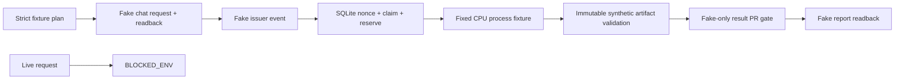

# Research harness: CPU fixture runbook

This is the MVP0 implementation for [#56](https://github.com/ken2129/c3_neural_compression/issues/56), not a deployment of the target research service. It is intentionally usable without JAX, torch, GPU access, GitHub credentials, Box credentials or a chat connection. Run from the repository root with Python 3.10+ on Linux.

## What is operational

- Strict version-1 plan parsing, unknown-field rejection, immutable plan IDs/revisions, salted private-plan digest, explicit source-scope freeze contract.
- Local fake chat request/readback, fixture issuer events, SQLite admission/nonce/claim/attempt/budget transactions, single-machine reservation and single-instance lock.
- Fixed benign CPU subprocess fixture, private launch intent and process identity, owned-group cancellation, uncertain-launch and lease reconciliation.
- Synthetic artifact verification, head/base/artifact-bound fake validation evidence, restricted public rendering, fake PR merge/readback and optional fake storage receipts.
- Separate scientific, publication, merge, issue-close, report and storage statuses. Postprocessing retries must not rerun science.

Every fake approval is fixture-only. The process fixture has no API accepting arbitrary shell, interpreter, environment overrides or GPU commands. It is not an unattended Codex worker. Do not adapt a production request to this schema to bypass unavailable live gates.



## Run locally

```shell
python -m unittest discover -s tests -p 'test_harness_*.py' -v
python -m research_harness demo
python -m research_harness capabilities
```

The demo creates a new temporary directory and removes only its own temporary fixtures when it exits. It never touches existing experiment roots. Tests likewise use newly created temporary roots and their own child processes. Output states explicitly identify synthetic data. No synthetic metric is a research result.

The control tests use stdlib only. Existing scientific tests may require additional already-installed packages and the repository's `c3_neural_compression` package path. A successful fixture run is not an installation or scientific validation of those dependencies.

## Trust and limits

The same-UID local test process is cooperative, not an adversarial sandbox. SQLite, file mode bits, a process group, tmux, `shell=False`, a salted digest and `CUDA_VISIBLE_DEVICES` do not establish the production trust boundary. Source freeze is a typed contract, not proof that code is semantically within approval. The real issuer, immutable validator authority, protected control store, credentials and worker filesystem/device restrictions require independently verified enforcement.

`capabilities` reports unavailable live capabilities. There is no flag to turn the real backend on. Environment/issuer booleans supplied in a plan cannot grant trust. No keys, OAuth grants, tokens, containers, cgroups, quotas, services, schedules or machine settings are created by this package.

The snapshot linked in #56 reports shared-machine storage pressure, same-UID controller/worker, unsupported hard limits and unverified noninteractive sandbox/approval behavior. Those are prior observations from another environment, not measurements made by this PR. This cloud fixture run cannot prove those constraints resolved.

## Source and science adapter boundary

Approval binds the plan revision, baseline runtime, allowed file scope and total budget. A proposed source change must pass independent scope/semantic validation before an immutable execution manifest binds its exact commit. An out-of-scope or unknown change needs a new approved plan. The fixture manifest cannot authorize real execution.

Existing scientific validators remain the numerical authority: `evaluation/comparison_attempt.py`, `evaluation/comparison.py`, `evaluation/detector_input_protocol.py` and experiment-specific provenance audits. The current primary rate is the arithmetic mean of each image's full estimated bits divided by its detector-resized, nonpadding input pixels; C3 includes image-specific network bits. Original-pixel pooled rate is not substituted. Official set-level COCO AP must be recomputed from original predictions by a protected real validator before a live result can merge. Fake fixture metric checks are not this validation.

## Stop and recovery

Only the identified fixture process group may be stopped. PID, boot ID and process start time must match; unknown identity blocks automatic kill and relaunch. A lease timeout alone never authorizes replacement. Keep reservation/evidence until owned-process termination is verified. Failed or incomplete attempts remain evidence; retry is a fresh attempt within the same approved total budget, for declared transient failures only. OOM, scientific/configuration failures and unfavorable metrics are not automatic retry reasons.

Publication, merge uncertainty, close and report failures resume their own stage. An externally closed issue/PR is not a command to recreate it. Manual merge is an external event requiring readback and audit, not automatic gate success. Unknown events and invalid transitions fail closed. Optional storage failure cannot erase scientific completion; mandatory unavailable artifacts block validation.

## Staged acceptance still required

1. Verify protected identity/credentials/policy/store/validator boundaries and enforced CPU, RAM, PID, IO, time, disk, device and API limits on the authorized target machine. Unsupported required limits mean no run.
2. Select and authorize an actual non-executing chat bridge destination, delivery route and issuer; demonstrate request presentation, explicit owner approval, immutable record readback, duplicate/out-of-order/revocation handling and result delivery. Neither fake transport nor prior day-to-day chat is evidence of this round trip.
3. Separately approve a bounded real CPU canary, including normal sandbox, structured Codex output, approval-request blocking, timeout and cleanup.
4. Only after that succeeds, approve one minimal GPU pilot with exact device allocation, inputs and budgets. Verify actual imports, source and numerical artifacts.
5. Connect separately authorized Box and limited publisher operations. Verify complete copy/readback before any independently approved cleanup. Real result merge requires required checks, protected independent numerical audit, exact head/base and existing protection guarantees. This harness PR is excluded.

Until these steps pass, #56 remains open. No runtime acceptance box is checked by this MVP0 PR.

## Coverage and what the fixtures do not prove

| Scenario | Local evidence | Remaining real acceptance |
| --- | --- | --- |
| S01–S03 | Duplicate immutable events, unique run/nonce claim, one machine reservation, absent capability rejection | Actual Issue/PR readback, shared allocator, dependencies |
| S04–S05 | Expiry/revision/revocation, explicit source-scope freeze, no execution on admission refusal | Owner-authenticated issuer, semantic code audit, immutable runtime |
| S06–S08 | Total attempt reservation, declared transient retry only, pid/start/boot ownership, cancellation/lease/restart faults | Unattended Codex approval handling, independent persistent watchdog, kernel-enforced worker boundary |
| S09–S10 | Frozen synthetic bits, current per-image mean rate, negative/mixed result accepted | Real input/prediction provenance and protected official COCO AP recomputation |
| S11–S16 | Mock head/base/check/scope gate, unknown-merge readback, external change and aftermath transition tests | Live publisher authority, protection/merge queue guarantees, chat delivery |
| S17–S20 | Mock all-file size/hash receipts, partial copy/restore, approval and cleanup eligibility | Authorized Box route, durable transfer receipts, actual cleanup/space readback |

The transition table models all 20 scenario categories, not a complete dispatcher implementation for every real event. Unknown transitions reject. Fake chat and fake transports are in-memory; their durability or authentication is not claimed. The SQLite run ledger and process receipts are local durable state. The demo journals publication intent before the fake merge side effect.

`wait`/`reconcile` enforce fixture timeout while the controller is running. The fixed child also has an independent 32-second exit alarm plus small CPU/log limits. These do not implement a persistent production watchdog, RAM/PID/IO/filesystem quotas, or defense against arbitrary code escaping a process group. No production resource guarantee is inferred from their tests.
